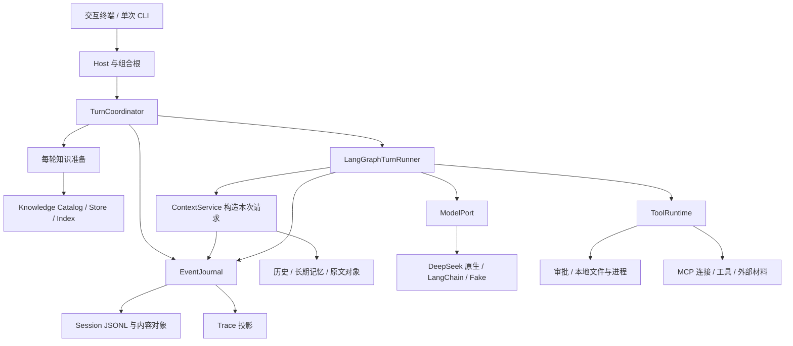
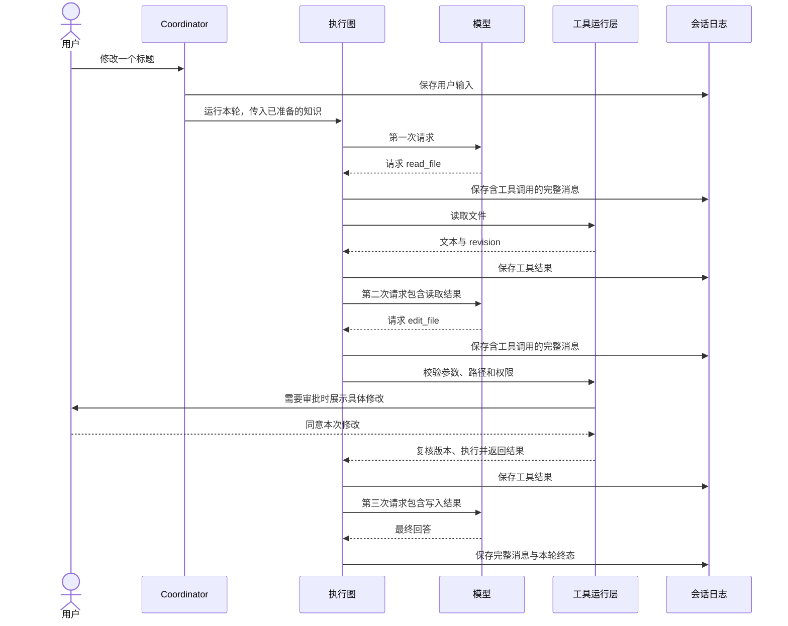

# JDAgent 详细设计、架构与面试问答

**代码基准**：`main` 分支 · 提交 `9d3281a` · 2026-11-21 核对  
**文档状态**：`Implemented`（严格对应当前代码实现，不混入未落地的规划）

JDAgent 是一个运行在 Windows 本地工作区中的 Python 命令行 Agent。简单来说，你把一个编程或文件处理任务交给它，大模型可以主动提出“读某个文件”“改某几行代码”或“跑一条命令”；但真正拍板让不让做、记录实际做了什么的，是本地的 **宿主程序（Host）**。宿主会把工具执行后的真实结果喂回给模型，让模型基于事实再给出回答。

如果这是你第一次接触这个项目，最容易建立全局观的方式，是带着一个具体问题往下读：

> **当大模型告诉你“文件已经改好了”时，系统里究竟有哪些代码机制和持久化记录，能让我们放心地相信这句话？**

下文会先顺着“用户发出一句话 → 模型修改本地文件”的完整路径跑通一遍主流程，再沿着这条主干，逐步拆解长对话压缩、历史与长期记忆、RAG 知识库、MCP 外部工具以及异常恢复和工程验证。

| 你的阅读目的 | 推荐入口 |
| --- | --- |
| 准备 1～2 分钟的面试项目介绍 | [一、项目边界与总体架构](#architecture) |
| 顺着一次真实任务去读核心代码 | [二、沿一条请求看完整系统](#walkthrough) → [三、宿主、配置与 LangGraph 执行图](#runtime) → [四、模型协议与流式输出](#model) |
| 搞懂如何安全地改文件、跑命令与崩溃恢复 | [五、本地工具、权限与 Windows 执行](#tools) → [六、事件日志、会话恢复与中断语义](#sessions) |
| 弄清模型每一次请求到底“看到了什么” | [七、上下文、窗口预算与压缩](#context) → [八、历史检索、长期记忆与后台整理](#memory) → [九、RAG 知识库、证据与引用](#knowledge) |
| 了解外部扩展能力与工程化测试手段 | [十、MCP 客户端、外部材料与远端 Task](#mcp) → [十一、可观测性、验收与复现](#verification) |
| 面试前快速自测或查漏补缺 | [十二、20 组面试追问与标准参考答案](#interview) |

<a id="architecture"></a>

## 一、项目边界与总体架构

**一句话看懂 JDAgent**：它用 **LangGraph** 驱动一个“模型思考 ↔ 工具执行”的循环，并刻意把三件事分开记录——**模型想做什么、宿主批准做什么、工具实际做成了什么**。

这个看似朴素的分工，直接决定了整个架构的三项核心能力：
1. **模型可替换**：底层通信封装在统一接口之后，换模型或换 SDK 不影响主流程。
2. **过程可核查**：每一步调用、审批和结果都有落盘记录，方便事后追责和排错。
3. **中断可恢复**：程序崩溃或强退后，重启时可以根据已落盘的事实准确判断哪些完成了、哪些没执行、哪些状态未知，而不是盲目重跑。

### 使用方式与能力边界

在用户侧，JDAgent 提供两种前台运行模式，并且底层共用同一套执行逻辑：
- **交互模式（Interactive）**：适合日常多轮协作，可以在终端里随时检查状态、审批文件修改或命令执行。
- **单次无头模式（Headless）**：输入一句提示词直接跑完，输出纯文本或机器可读的 JSON，适合写进自动化脚本。

此外，命令行还提供了两类辅助入口：`knowledge` 子命令用于在对话外管理知识库和导入文档；`maintain --pending` 用于续跑尚未完成的后台记忆整理作业。

同时，必须明确当前系统的**边界（什么没做）**：
- 它是围绕**单个会话中的单个前台任务**设计的，没有拆分成多个自治协作的 Multi-Agent。
- 它没有独立的“任务结果验收器”。运行结束时看到的停止原因 `completed`，仅仅代表**执行协议正常收尾**；至于代码改得对不对、任务到底成没成，仍要以文件内容、命令输出、检索证据或测试结果为准。



**怎么读懂这张架构图？**  
图中的箭头代表调用或数据依赖方向。最关键的粘合点是 `composition.py`（软件工程里常说的**组合根 / Composition Root**），它负责在启动时把所有具体实现组装起来；模型 SDK、终端、数据库和文件系统都各自藏在对应的端口（Port）与适配器（Adapter）后面。

举个直观的例子来理解这种解耦的好处：假设明天要把 DeepSeek 换成另一家大模型，你只需要写一个新适配器去适配统一的消息格式、工具协议和流式事件，上层的执行图、审批策略、日志持久化和恢复逻辑完全不用动；反过来，如果你要改会话恢复规则，也根本不需要去碰底层 HTTP/SSE 的流式解析代码。

> 代码入口：[组合根](../../src/jdagent/composition.py) · [端口定义](../../src/jdagent/ports.py) · [领域数据类型](../../src/jdagent/domain)

### 四种时间尺度

新手读 Agent 代码时，最容易把“一个会话”“一轮对话”“一次 API 请求”混为一谈。在 JDAgent 中，下面四个概念严格区分了不同的生命周期和计数口径：

| 概念 | 何时建立 | 生命周期内保存什么 | 状态变化后去哪里查 |
| --- | --- | --- | --- |
| **Workspace（工作区）** | 宿主解析目标项目目录时 | 规范路径生成的唯一身份、项目级会话分区与知识库绑定范围 | `DataPaths`、知识 Catalog、项目配置 |
| **Session（会话）** | 新建对话或恢复旧对话时 | 按序排列的事件流、可撤销的会话级许可、可引用的原始大对象 | JSONL 日志、对象引用、可重建的会话目录 |
| **Turn（一轮任务）** | 用户提交一次输入时 | 用户原话、本轮锁定的模型配置、冻结的知识证据、模型与工具调用计数 | `TurnCoordinator`、本轮新建的图状态、Turn 终态 |
| **Model Request（单次模型请求）** | 执行图准备向大模型发一次请求时 | 实际发出的消息列表、系统指令、工具定义快照、Token 估算与请求 ID | `RequestManifest`、用量事件、费用账本 |

**为什么必须把它们分清楚？**  
举个常见场景：你在同一个窗口（1 个 **Session**）里连续问了两次问题，这就是 2 个 **Turn**。其中某一次你问“帮我读一下这个文件再解释”，在这 1 个 **Turn** 里，程序其实会发 2 次 **Model Request**——第 1 次请求让模型决定调用 `read_file`，拿到文件内容后，第 2 次请求才把内容发给模型生成最终解释；而单次模型请求里，模型又可能一口气提出多个工具调用。如果把这四层计数混在一起，算账会算错、工具次数会乱套，甚至会把上个会话的授权错漏地继承给新会话。

### 代码怎样分工

如果你想顺着模块去翻源码，可以按下面这张职责地图来找对应目录：

| 模块分组 | 负责的核心行为 | 代码阅读入口 |
| --- | --- | --- |
| **宿主、配置、组合根** | 解析命令行参数、定位本地数据目录、组装依赖对象、安排退出清理 | [cli](../../src/jdagent/cli.py)、[host](../../src/jdagent/host.py)、[configuration](../../src/jdagent/configuration.py) |
| **应用层** | 驱动交互终端与单次运行、处理用户审批交互、管理会话目录、执行恢复与每轮协调 | [application](../../src/jdagent/application) |
| **领域与执行合同** | 定义消息、工具、事件、错误类型和 Runner 接口，统一各模块间交换的数据结构 | [domain](../../src/jdagent/domain)、[core/contracts](../../src/jdagent/core/contracts.py) |
| **图调度与模型适配** | 推进每轮状态流转、控制停止条件、收集模型流式响应、做底层协议翻译 | [runtime](../../src/jdagent/runtime)、[adapters](../../src/jdagent/adapters) |
| **本地工具层** | 工具注册与执行、权限判定、工作区路径安全检查、文件版本控制、进程与日志管理 | [tools](../../src/jdagent/tools)、[Windows 进程实现](../../src/jdagent/adapters/windows_process.py) |
| **事件与会话持久化** | 顺序追加落盘、大对象外存与文件锁、异常配对修复、结构化 Trace 投影 | [eventing](../../src/jdagent/eventing.py)、[JSONL](../../src/jdagent/adapters/jsonl_session.py)、[observability](../../src/jdagent/observability.py) |
| **上下文管理** | 将事件投影为模型消息、管理原文与摘要、发现目录指令、Token 预算与压缩、请求重建 | [context_runtime](../../src/jdagent/context_runtime.py)、[context_archive](../../src/jdagent/context_archive.py) |
| **历史、记忆与维护** | 检索同工作区旧会话、版本化长期记忆、后台提取合并、租约防冲突与费用计量 | [memory_service](../../src/jdagent/memory_service.py)、[memory_store](../../src/jdagent/memory_store.py)、[maintenance](../../src/jdagent/maintenance.py) |
| **RAG 知识库** | 文档入库解析、父子分块、索引与版本可见性、按轮取证、回答引用校验及评测 | [knowledge](../../src/jdagent/knowledge) |
| **MCP 客户端** | 发现和授权远端 Server 能力、保存原始结果、长任务绑定轮询、外部来源隔离传播 | [mcp_service](../../src/jdagent/mcp_service.py)、[mcp_execution](../../src/jdagent/mcp_execution.py)、[mcp_provenance](../../src/jdagent/mcp_provenance.py) |

<a id="walkthrough"></a>

## 二、沿一条请求看完整系统

抽象架构看多了容易发虚，我们直接走一遍最典型的真实场景。

假设当前工作区里有一个 `notes.txt`，第一行标题是“安装”。你在允许编辑文件的交互会话中输入：
> “把标题改成‘本地安装’，保留其他内容。”

下面展示的是模型最常见的一条合法执行路径（模型具体选什么工具取决于它的推理，但**调用顺序和落盘先后是由宿主代码死死卡住的**）：

1. **接到输入与开场检查**  
   `TurnCoordinator.send()` 先拿到当前会话的写入所有权，读出已有历史事件，并确认没有遗留的“未知副作用”（例如上次崩溃时写到一半的文件）。如果是全新会话，先补记一条 `session_started`，接着把用户的话落盘为 `user_message`。同时，系统按当前工作区是否绑定了知识库，准备好本轮的知识取证结果（没绑定也会明确标出状态）。整轮流程共用同一个 `Turn ID`。
2. **第 1 次模型请求：先读文件**  
   上下文服务把用户原话、系统/目录指令以及当前允许使用的工具定义打包成一次请求发给模型。模型分析后，返回一个完整的 `read_file` 工具调用。  
   注意这里的顺序：**执行图会先把带 `call_id` 的完整 assistant 消息写进日志，然后才交给工具层去读文件**。`read_file` 返回可见文本的同时，还会附带一个基于**完整文件字节**算出的 `revision`（相当于文件的防篡改指纹——哪怕你只分页读了前 20 行，拿到的依然是整份文件的版本指纹）。
3. **第 2 次模型请求：提出修改方案并触发审批**  
   工具结果落盘后，执行图重新构造下一次模型请求，把刚才的读取结果严格配对回对应的 `call_id`。模型看到文件内容后，发起 `edit_file` 调用，传入 `path`、刚才拿到的 `revision`，以及具体的 `old_text` / `new_text` 替换清单。  
   宿主拿到请求后，先校验路径是否在工作区内、参数是否符合 Schema、当前权限策略是什么。如果策略是 `ASK`（需要询问），终端会把**即将执行的具体修改内容**清清楚楚展示给用户等待拍板。
4. **真正落盘修改文件**  
   用户点同意后，文件工具在 Windows 独占文件句柄内**重新核对一次 `revision`**，并一次性校验整批替换区间是否唯一匹配且互不重叠。  
   - 如果在你犹豫点同意的这几秒里，别人（或你的 IDE）改过这个文件，版本校验就会直接报错冲突，本次写入取消，模型只能重新读文件再重新规划。  
   - 如果校验通过并成功写入，工具会返回新旧版本号以及写入字节数，作为工具结果落盘。
5. **第 3 次模型请求：基于事实给出回复**  
   执行图把“修改成功”的工具结果喂给模型，模型生成自然语言总结，并以正常原因 `stop` 结束。执行图检查本轮适用的知识引用（若有），将完整的 assistant 回答落盘，最后写入 `turn_completed` 终态。  
   这里留一个工程直觉：如果事后还想 100% 确认当前磁盘里的标题没被别的程序改回去，最靠谱的做法是再读一次文件，或拿工具事件里的新 `revision` 与当前文件比对——光看模型自己写的总结，永远发现不了落盘之后的外部变更。



### 用三个故障场景检验你是否真正读懂了这条主链

理解一个 Agent 系统，看正常路径只算懂了一半，关键要看它在出事时怎么兜底：
- **故障 1：模型在流式输出 `edit_file` 参数到一半时网络断了** → 磁盘文件必须原封不动，绝不能拿着半截 JSON 去猜着执行。这是**模型协议层**守住的底线。
- **故障 2：弹窗审批时用户点了拒绝** → 文件不改，日志里如实记录“工具被拒绝”，同时把这个拒绝结果回传给模型，让模型有机会向用户解释或改换方案。这是**权限策略层**的职责。
- **故障 3：宿主刚刚开始写文件，机器突然断电/进程被杀** → 磁盘可能已经改了一部分，但日志里没来得及记“写入完成”。重启后，系统不能瞎猜它成功了或没执行，必须把这次动作标记为“副作用未知”。这是**会话恢复层**的核心设计。

> 代码入口：[每轮协调](../../src/jdagent/application/coordinator.py) · [响应收集](../../src/jdagent/runtime/model_response.py) · [文件工具](../../src/jdagent/tools/files.py) · [恢复判定](../../src/jdagent/application/session_recovery.py)

<a id="runtime"></a>

## 三、宿主、配置与 LangGraph 执行图

### 从命令行进入同一个执行器

JDAgent 要求 Python 3.11+，安装后的命令行入口 `jdagent` 直接指向 `jdagent.cli:main`。命令行解析器会区分三类任务：普通对话（交互或单次）、`knowledge` 知识库管理树、以及 `maintain --pending` 后台维护。

进入普通对话后，整个装配路径非常干净：
1. **Host 决定外观**：根据参数选择启动交互模式还是 Headless 单次模式。
2. **组合根统一装配**：调用 `build_runtime()` 一次性构造模型适配器、Session 存储、审批器、工具运行时和知识服务。
3. **单引擎执行器**：`ConfiguredTurnRunnerFactory.create()` 基于当前会话的 `EventJournal`，直接实例化唯一的执行器 `LangGraphTurnRunner`。

在交互模式下，终端使用 **Prompt Toolkit** 读输入、**Rich** 渲染输出，并且整个进程只保留**一个输入读取者**——这样在弹出权限审批时，用户敲的键盘指令不会串台去意外启动下一轮对话。

> 代码入口：[包入口](../../pyproject.toml) · [宿主](../../src/jdagent/host.py) · [交互实现](../../src/jdagent/application/interactive.py) · [Headless 结果](../../src/jdagent/application/headless.py)

#### 配置优先级与本地数据目录

普通配置按从高到低的优先级合并：**CLI 命令行参数 > 项目配置 > 用户配置 > 内置默认值**。
- **用户配置路径（Windows）**：`%APPDATA%\JDAgent\config.toml`
- **项目配置路径**：目标工作区下的 `.jdagent/config.toml`

`DataPaths` 会把工作区路径规范化为绝对路径，再计算 SHA-256 哈希作为该工作区的唯一身份标识。默认会话日志存放在 `%LOCALAPPDATA%\JDAgent\projects\sha256-…\sessions-v5`。需要注意两个容易踩坑的细节：
- **移动目录会换身份**：把项目文件夹挪到别处或换一个克隆目录，路径哈希会变，默认工作区身份也会跟着变。
- **`--data-dir` 不迁知识库**：用户级知识库目录是独立定位的，传 `--data-dir` 只会改会话等运行数据的位置，不能误以为知识库也一起迁走了。

> 代码入口：[数据定位](../../src/jdagent/data_paths.py) · [配置解析](../../src/jdagent/configuration.py)

#### 配置生效时机与旧参数兼容

每次开始新的一轮（Turn）时，程序都会重新读取一次配置，并将本轮的模型名、超时等参数锁定，中途不变。但像 **Provider、服务端点 URL、模型适配器类型** 这类影响底层已建连接的配置，修改后必须重启进程才能生效。

当前普通 CLI 的默认组合是：**LangGraph 执行器 + DeepSeek 原生模型适配器 + 默认模型 `deepseek-v4-flash`**。如果你传入 `--model-adapter langchain`，切换的只是底层调模型的通信适配器，前台调度引擎依然是 LangGraph。

为了兼容旧脚本，命令行参数 `--runtime-engine` 和用户配置中的 `runtime_engine` 暂时仍接受 `native` 或 `langgraph`，但都会统一启动 LangGraph，并在每个进程中往 stderr 打印一次迁移提醒（项目级配置则直接禁止这个旧字段）。阅读历史文档或压测报告时要特别留意：里面的 `native` 有时指已被删掉的旧版原生循环引擎，有时指现在的 DeepSeek 原生模型适配器，千万别看混。

> 延伸阅读：[配置参考](../reference/configuration.md) · [单引擎决策 ADR-0009](../decisions/ADR-0009-langgraph-only.md)

### 图节点的职责和跳转

`LangGraphTurnRunner` 内部用 LangGraph 的 `StateGraph` 清晰地画出了单轮对话的状态机。每个节点只做一件事，边界非常分明：

| 图节点 | 核心职责 | 下一步流向哪里 |
| --- | --- | --- |
| `prepare` | 检查是否已取消、是否超出模型请求上限，并基于最新事件拼装本次请求 | 请求就绪 → `model`；超限或构造失败 → `fail` |
| `model` | 消费模型流式事件、实时输出文本、记录 Token 用量并校验完整响应 | 响应正常 → `citations`；遇到特定上下文过长错误时可尝试重新准备一次 |
| `citations` | 若本轮没有待执行的工具调用，则检查回答正文里的知识引用是否合法 | 存在非法引用 → `repair_prepare`；通过校验 → `persist` |
| `repair_prepare` / `repair_model` | 把允许引用的证据清单塞进提示，再发一次**禁止调用工具**的修复请求 | 回到 `citations` 复检；若依然非法 → `fail` |
| `persist` | 核验工具调用 ID 的合法性与唯一性，将完整的 assistant 消息落盘 | 包含工具调用 → `tool`；纯文本回答 → `complete` |
| `tool` | 记录工具开始事件、逐个执行工具并把结果落盘 | 本批还有未执行的工具 → 继续 `tool`；本批执行完 → 回到 `prepare`；命中必须停止的条件 → `fail` |
| `complete` / `fail` | 写入本轮唯一终态事件，汇总停止原因、调用次数等并返回 `TurnResult` | 失败收尾前会先关闭悬空的工具配对；若持久化本身报错，直接向外抛出异常 |

#### 三个关键的工程取舍

1. **为什么 `compile(checkpointer=False)`（不启用 LangGraph 持久化检查点）？**  
   每个 Turn 开始时都会新建干净的图状态并编译，节点里只存本轮的瞬时变量（比如当前请求、待执行工具列表、当前下标、已观察到的失败次数、是否已经做过引用修复等）。会话的持久化与重启恢复完全交给项目自己的 **JSONL 事件日志 + `SessionRecovery`** 来做，避免和框架内部的序列化格式强绑定。
2. **为什么不自动重试工具、也不并发执行同一批工具？**  
   图节点没有对工具开启自动重试，同批多个工具调用也是严格按模型给出的顺序**串行执行**。原因很实际：模型一次给出的多个动作往往共享同一个工作目录、同一个文件或同一套权限状态（比如先建文件再改文件），串行能保证事件落盘顺序与真实执行顺序完全一致。另外，如果在执行这一批工具的中途，突然进入了某个新子目录并发现了新的目录级规则（`AGENTS.md`），系统会立刻关闭这一批里还没执行的后续调用，回到模型层让它读懂新规则后再重新规划。
3. **运行上限与防死循环保护**  
   普通 CLI 默认给每轮设了三道业务红线：最多 **16 次模型请求**、最多 **32 次工具调用**、最多容许 **2 次标记为 `observed_failure` 的失败后继续**（第 3 次直接停）。需要注意几点细节：
   - 这里的“失败恢复次数”并不是简单等同于“所有报错”或“用户拒绝次数”，它只统计被业务明确标为 `observed_failure` 的情况；LangGraph 自身也会据此换算一个最大步数上限作为兜底。
   - 普通 CLI 构造的 `RuntimeOptions` 会把这三个值固定为 `16 / 32 / 2`；只有在直接调用底层组合根时，才可由 TOML 或显式参数覆盖。
   - 知识引用修复发出的请求，同样计入这 16 次模型请求额度。
   - 如果最后落盘终态事件时发生 IO 异常，系统会直接向上抛错，绝不会在没写进磁盘的情况下假装成功返回终态。

> 代码入口：[图的节点与边](../../src/jdagent/runtime/langgraph_runner.py) · [执行合同](../../src/jdagent/core/contracts.py) · [CLI 接线](../../src/jdagent/host.py) · [执行上限](../../src/jdagent/composition.py) · [图的故障回归](../../tests/test_v06_graph_runner.py)

<a id="model"></a>

## 四、模型协议与流式输出

为了让上层执行图完全不关心“底层到底怎么连大模型”，项目抽象了统一的端口接口 `ModelPort`。它只有两个核心成员：
- `capabilities`：声明该模型/适配器支持什么能力（如上下文容量、工具调用等）。
- `stream(ModelRequest)`：接收标准化的请求对象，返回一个**异步事件流**。

这个 `ModelRequest` 非常通用，包含了模型名、分来源的系统指令、角色消息历史、工具定义、生成参数、关联元数据和 Provider 扩展项。不管是普通聊天、知识引用修复，还是禁止调用工具的后台摘要/记忆维护请求，全部共用同一套数据结构，只是各自的用途、允许的工具、超时时间和费用归属不同。

> 代码入口：[模型类型](../../src/jdagent/domain/model.py) · [ModelPort 合同](model-port.md)

目前仓库里有三种 `ModelPort` 实现，各自扮演不同角色：

| 适配器实现 | 底层如何工作 | 在工程与测试中的价值 |
| --- | --- | --- |
| **`DeepSeekModelPort`**（默认） | 直接用 `httpx` 发 HTTP 请求、手写 SSE 解码，按调用索引拼接参数片段，并将 HTTP/网络/协议错误映射为统一错误类别 | 展示项目如何精细掌控 HTTP 连接与流式协议边界，无黑盒封装 |
| **`LangChainModelPort`** | 把项目请求翻译给 `ChatDeepSeek`，消费其流式 chunk 再翻译回项目事件；显式关闭了 SDK 的自动重试和云端追踪 | 证明同一张执行图可以无缝换接第三方 SDK，并可在受控模拟传输下与原生适配器逐项对比 |
| **`FakeModelPort`** | 按预设脚本吐出流式事件，能精准复现正常流、断流、超时、取消、连续多工具调用等各种极端情况 | 在不花钱、不联网的环境里高确定性地测试宿主逻辑（但测不了真实大模型的自然语言理解质量） |

### 流式输出里的关键防线：展示归展示，执行归执行

用过流式大模型 API 的开发者都知道，服务端发回来的工具调用往往是支离破碎的——工具名和一段 JSON 参数可能被拆成十几个小碎片（chunk）陆续到达。JDAgent 把处理职责拆成了清晰的三层：
1. **适配器层（如 `DeepSeekModelPort`）**：负责把零散的碎片拼装好，吐出标准事件——文本片段是 `TextDelta`，参数片段是 `ToolCallDelta`，拼完一个调用发 `ToolCallCompleted`，用量是 `UsageReported`，流结束发 `ResponseCompleted`，出错则发带归一化分类的 `ModelFailed`。  
   *小细节*：很多服务端会在发出 `stop` 结束信号**之后**才补发本轮 Token 用量，所以看到 `stop` 后还必须把流里剩下的事件消费完，不能立刻掐断。
2. **响应解释层（`ModelResponse`）**：负责校验整条流的合法性。只有满足严格一致性才放行：
   - 如果有工具调用，所有调用必须完整拼装且结束原因 `finish_reason` 必须是 `tool_calls`。
   - 如果没有工具调用，普通完成要求结束原因必须是 `stop`。
   - 凡是重复发送结束信号、参数没收全、明明有调用却给 `stop` 等异常响应，一律拦截，绝不触发工具。触及最大输出长度则会返回对应的截断停止原因。
   - 引用修复走独立的校验分支，强制要求以 `stop` 结束且**绝不允许附带任何工具调用**。
3. **执行图层（`LangGraphTurnRunner`）**：决定把文本即时打印到屏幕、统计费用，并在落盘 assistant 消息前再次核对所有 `call_id`（既不能与本批重复，也不能与历史已见 ID 冲突）。

这样做解决了一个经典矛盾：**用户希望屏幕上越早看到字越好，但系统只能把“完整且经过验证”的响应当成可信历史并触发本地动作。** 屏幕已经打出来几行字，完全不代表这次调用就能安全执行。

> 代码入口：[原生适配器](../../src/jdagent/adapters/deepseek.py) · [LangChain 适配器](../../src/jdagent/adapters/langchain_model.py) · [流生命周期](../../src/jdagent/model_stream.py) · [响应校验](../../src/jdagent/runtime/model_response.py)

### 遇到上下文超长与异常清理怎么办

如果模型返回了“上下文过长”错误，系统不会无脑重试，只有在同时满足以下条件时，执行图才会触发一次重新准备请求（尝试压缩/卸载定义后再发）：
- 当前是普通对话调用（不是修复或维护请求）；
- 配置了上下文服务；
- 本轮还没有触发过这种超长重试；
- 当前这条出错的响应里还没有收到任何文本或完整工具调用（避免画面上字都打出一半又重来）。

对于超时、普通网络中断或工具异常，系统各有独立的收尾路径；到达清理边界时，运行时会耐心等模型流关闭、或等工具完成自己拥有的本地资源清理，避免留下僵尸流或孤儿进程。

<a id="tools"></a>

## 五、本地工具、权限与 Windows 执行

### 工具的同一条调用链

无论是本地读写文件、查历史记忆，还是调远端 MCP，所有工具在 JDAgent 里都走同一条严格受控的流水线：
1. **注册与按需曝光**：`ToolRegistry` 按名称登记每个工具的描述、输入/输出 Schema、风险等级、预处理函数和执行函数。在拼装模型请求时，系统**只会把本轮能力范围内允许的工具定义发给模型**，没权限的工具模型连看都看不见。
2. **执行前多重安检**：模型发出调用后，`ToolRuntime.execute()` 并不会直接信任它，而是按步骤把关：
   - 按本次请求标识查回对应的工具定义；
   - 复核调用身份与能力范围；
   - 用 Schema 校验入参；
   - 运行预处理（例如解析绝对路径、生成可读的审批摘要）；
   - 基于**预处理后的真实参数**做权限判定（放行 / 询问 / 拒绝）。
3. **先记开始，再干活**：全部安检通过后，先记录“工具开始执行”事件，再调用真正的处理函数并将结果规范化；最后由执行图将工具结果落盘，并决定继续下一步、重做计划还是中止本轮。

> 代码入口：[定义与执行器](../../src/jdagent/tools/runtime.py) · [工具领域合同](../../src/jdagent/domain/tools.py)

#### 常驻本地工具一览

本地工作区最核心的 8 个工具按风险分为三个递增的能力范围（Scope）：

| 最低所需工具范围 | 包含的常驻本地工具 | 核心实现要点 |
| --- | --- | --- |
| `analyze`（只读分析） | `calculator`、`find_files`、`read_file`、`search_text`、`read_command_output` | 安全受限的算术求值、带上限的文件发现与全文检索、分页读文件或命令日志 |
| `edit`（可读写） | `create_file`、`edit_file` | 自动继承 `analyze` 能力；支持排他创建新文件，或基于版本指纹做精确文本替换 |
| `execute`（可执行命令） | `run_command` | 自动继承前两组能力；只接受显式程序名与参数数组，托管子进程生命周期与输出 |

*补充说明*：别把工具总数死记成“只有 8 个”。正常组合根还会注册 4 个历史与记忆工具（`search_history`、`read_history`、`search_memory`、`update_memory`），加上 MCP 带来的目录搜索、原文读取、材料访问以及动态选入的远端工具。默认启动范围是 `execute`，同时默认将文件写入和命令执行权限设为 `ask`（每次需审批）；如果只想让 Agent 安全地看代码，启动时加上 `--tool-scope analyze` 即可。

几个本地只读工具的细节也很体现工程严谨度：
- **`calculator` 绝不用 `eval()`**：它先把表达式解析成 Python AST（抽象语法树），只允许白名单内的数字和运算符递归求值，并限制表达式长度和指数大小；任何函数调用或非法语法都会直接拒掉。
- **`find_files` 与 `search_text` 会明确告知是否截断**：两者共用一套目录扫描器，自动遵守 `.gitignore` 规则，碰到扫描上限会返回截断标记。排查问题时要养成看截断标记的习惯——没搜到结果，有时不是“项目里没有”，而是“扫描上限到了没扫完”。

> 代码入口：[历史与记忆工具](../../src/jdagent/memory_service.py) · [应用装配](../../src/jdagent/composition.py) · [有限算术](../../src/jdagent/tools/builtins.py) · [目录扫描与文本搜索](../../src/jdagent/tools/files.py)

### 能力范围、权限策略、用户审批各解决什么

这三个概念经常被新手混在一起，其实它们是三层递进的防线：
1. **能力范围（Tool Scope）**：解决**“有没有资格干这类事”**（比如 `analyze` 模式下，写文件和跑命令根本不在能力清单内）。
2. **权限策略（Permission Policy）**：对具体一次工具调用做出三选一裁决——`ALLOW`（直接放行）、`ASK`（询问用户）、`DENY`（直接拒绝）。
   - **拒绝是硬上限**：用户配置或项目配置里的 `DENY` 永远优先，会话中临时批准的规则绝不能突破它。
   - **防绕过联动**：如果配置了 `write_permission=deny`（禁止写文件），系统也会一并禁止 `run_command`——防止模型把“被拒绝的文件写入”偷偷换成“跑一条 shell/python 脚本去改文件”。
3. **用户审批（Approval）**：只有策略判为 `ASK` 时才会触发。在 Headless 无头模式下，遇到需要人工审批的动作会直接拒绝，绝不会卡死在后台傻等终端输入。

审批界面展示给用户的不是模型原始的粗糙参数，而是**预处理后即将真正执行的内容**（比如改前/改后的具体文本、命令的实际工作目录），持久化审批事件里会同时存摘要和展示内容的哈希。

此外还有两个很贴心的细节：
- **防死缠烂打**：在同一轮（Turn）里，如果模型刚刚被用户拒绝了一次修改，它即使换个 `call_id` 再次提交完全相同的预处理参数，宿主也会直接拦截，不会反复弹窗骚扰用户。
- **会话级免审批规则（Session Rules）**：用户可以选“仅本次允许”，也可以建立当前会话内可撤销的自动放行规则。针对命令执行的会话规则，会严格校验**程序路径 + 工作目录（cwd） + 环境指纹 + 非空参数前缀**（注意：前缀之后的参数仍可能变化，所以授权时要留心前缀范围）。正常恢复同一个会话时这些规则继续有效；但只要切换了工作区，或者因为异常进入了新的恢复子会话，旧规则一律清零作废。

> 代码入口：[权限策略](../../src/jdagent/tools/permissions.py) · [审批选择](../../src/jdagent/application/approval.py) · [会话规则管理](../../src/jdagent/application/permissions.py)

### 文件修改怎样避免覆盖并发编辑

在本地做文件操作，最怕两件事：**越界改坏系统文件**，以及**把用户在 IDE 里刚改好的代码悄悄覆盖掉**。

**1. 路径安全边界**  
所有文件路径都以规范化后的 workspace 为根目录。路径解析器会逐层检查，直接拒绝目录穿越越界、Windows 保留设备名 / 备用数据流（ADS）、符号链接、重解析点以及不受支持的硬链接目标。文本读写支持 UTF-8 并尽量保留原有 BOM，单文件大小上限为 **2 MiB**。

**2. 基于 `revision` 的乐观锁并发检测**  
`read_file` 返回的 `revision` 同时绑定了**规范路径**和**整份文件的原始字节**——所以既不能拿另一个文件的版本号来顶替，也不能在文件内容变了之后还用旧版本蒙混过关。

执行 `edit_file` 时，工具会按严格的顺序把关：
1. 先校验传入的 `revision` 是否与磁盘一致；
2. 检查整批 `old_text` 是否每一个都在文件中**唯一匹配**，且各个替换区间互不重叠（兼容 LF / CRLF 换行，未修改的区域尽量原样保留字节）；
3. 全部校验通过后，在 **Windows 独占文件句柄**内**再核验一次 `revision`**，确认无并发改动后，才执行写入、截断并刷盘。

**清楚区分两种保证**：如果另一个编辑器在模型读完文件后改过它，这里的机制能 100% 拦住，返回版本冲突让模型重读；但如果校验通过后、正在原位写入磁盘的那一瞬间突然断电，磁盘上依然可能留下写到一半的内容。也就是说，**“排斥并发覆盖”和“断电崩溃原子性”是两回事**——后者正是由第六章会话恢复里的“未知副作用”机制来兜底的。

> 代码入口：[工作区路径](../../src/jdagent/tools/workspace.py) · [Windows 文件句柄](../../src/jdagent/adapters/windows_files.py) · [文件编辑实现](../../src/jdagent/tools/files.py)

### 命令启动、取消和输出

在 Windows 下安全地跑外部命令、还能在用户按 Ctrl+C 时把整棵子进程树干净杀掉，其实非常容易踩坑。`run_command` 做了几项很扎实的隔离与治理：

- **拒绝隐式 Shell 拼接**：只接受显式的可执行程序路径和 `argv` 参数数组，直接拒绝启动 `.bat` / `.cmd`，从源头规避命令注入风险。
- **Windows Job 托管进程树**：通过受信的 Python 启动器以隔离选项拉起进程，先将自己绑定到配置了“关闭即终止（kill-on-close）”的 **Windows Job Object** 中，再启动真正的用户程序。这样一旦宿主取消或退出，子进程以及它衍生出的孙进程会被操作系统一锅端，不会残留后台孤儿进程。
- **环境变量最小继承与握手确认**：子进程只继承宿主白名单内的环境变量，模型 API Key 不会作为普通环境变量泄漏进去；启动器与宿主之间还会做一次握手，用来准确区分“用户程序已经真跑起来了”还是“还没跑起来就卡在启动器阶段”。
  *安全边界提醒*：这些机制管的是“规范启动和干净清理”，一旦用户批准运行某个程序，它仍以宿主当前操作系统账号的权限运行——**不要把它吹成能运行任意不可信代码的沙箱**。
- **有界日志与防管道死锁**：执行线程会同时持续排空 `stdout` 和 `stderr`。工具结果只把有限的预览（合计最多 **16 KiB**）和日志引用返给模型，完整输出单独落盘（单次命令最多存 **10 MiB**，整个工作区累计最多 **100 MiB**），模型需要看更多细节时再调 `read_command_output` 按字节范围分页读回。哪怕日志已经达到容量上限，线程依然会继续把管道读空并打上“输出已截断”标记，防止子进程因为管道缓冲区塞满而永久卡死。
- **取消与排障语义**：用户取消时，宿主会通知执行线程并等待进程树和管道清理完毕；如果没法确认命令是否已经启动或是否清理干净，结果会老实保留“不确定性”。排查问题时，要把**退出码非零**、**输出被截断**、**进程状态未知**三类证据分开看。

> 代码入口：[命令处理](../../src/jdagent/tools/commands.py) · [Windows 进程层](../../src/jdagent/adapters/windows_process.py) · [命令日志](../../src/jdagent/tools/command_output.py) · [命令合同测试](../../tests/test_v04_commands.py)

<a id="sessions"></a>

## 六、事件日志、会话恢复与中断语义

理解 JDAgent 数据架构的核心，就是记住一句话：**事件日志（Event Log）是唯一的事实来源，内存状态、界面展示、Trace 和给模型的消息全都是从它派生出来的。**

### 写什么，按什么顺序写

每一条 `RuntimeEvent` 都包含：会话 ID、可选的 Turn ID、事件 ID、严格递增的顺序号（seq）、时间戳、事件类型和载荷（payload）。注意 Turn ID 是可选的，因为有些事实（比如给会话重命名、或者在重开后手动管理一个远端 MCP Task）并不发生在某次对话 Turn 里面。

`EventJournal` 写入每一条事件时，严格遵守**“先落盘，再改内存，最后通知观察者”**的三步顺序：
1. 取现有历史的下一个序号构造事件，先交给 `SessionPort.append()` 落盘；
2. 确认落盘成功后，再更新内存里的事件序列；
3. 最后通知 Trace 等订阅观察者。

并且，前两步（本地追加 + 内存更新）在收到取消信号时属于**不可半途掐断的原子收尾段**——不能把一个正在写盘的操作误判成已经取消，否则后续新事件可能复用同一个序号，直接把日志写串。

> 代码入口：[事件定义](../../src/jdagent/domain/events.py) · [先持久化再通知](../../src/jdagent/eventing.py) · [取消收尾](../../src/jdagent/cancellation.py)

#### 物理存储、大对象与锁

普通宿主使用追加写入的 **JSONL 文件**（每行一个 JSON 事件）：
- **严格校验与刷盘**：每次写入都会刷新并同步到磁盘；读回时逐行校验 Schema 版本、会话 ID 和序号是否严格连续。
- **大载荷内容寻址外存**：超过 **16 KiB** 的大载荷（例如整份大文件内容或长输出）不会直接塞进 JSONL 撑爆日志，而是按内容哈希存成独立的不可变对象，事件里只留摘要和字节数，读回时再校验完整性。
- **操作系统级独占锁**：同一会话通过 OS 级文件锁保护写入所有权；只有持有锁期间，才允许在内存里缓存已校验过的文件尾部。
- **可重建的会话目录索引**：会话列表的名称、短 ID 等目录索引只用来加速发现，随时可以从 JSONL 重建。如果某个会话文件坏了，其他正常会话依然可以照常列出；同时绝不能仅凭索引里有一条记录，就盲目相信那个会话可以安全续写。

> 代码入口：[JSONL 存储](../../src/jdagent/adapters/jsonl_session.py) · [会话锁](../../src/jdagent/adapters/session_lock.py) · [会话目录](../../src/jdagent/application/session_catalog.py)

#### 别把四个“版本号”搞混了

阅读仓库或排查兼容性时，会遇到四个不同维度的数字，它们各自管各自的事，千万不要互相推断：
- **`0.5.0`**：Python 发行包版本（见 `pyproject.toml`）。
- **`v0.8`**：项目迭代阶段代号（表示这次收敛到 LangGraph 单引擎的改造阶段）。
- **`sessions-v5`**：本地默认会话存放目录的名称。
- **`schema_version=4` / Headless JSON `v2`**：分别是 JSONL 单条事件的协议版本，以及脚本消费的 Headless JSON 输出格式版本。

> 代码入口：[发行包](../../pyproject.toml) · [会话事件版本](../../src/jdagent/domain/events.py) · [单次输出版本](../../src/jdagent/application/headless.py)

### 恢复时先查文件，再查动作

如果上次程序意外崩溃，重新打开会话时，恢复逻辑会分两层排查：**先查物理文件完不完整，再查逻辑动作配不配对**。

| 恢复时看到的事实 | 系统如何处理 | 背后的工程理由 |
| --- | --- | --- |
| **只有最后一行写残了，前面所有行都完整** | 显式恢复时先备份原文件，再做有限的尾部修复，然后继续走逻辑检查 | 完整前缀是已刷盘的可信事实，半截末行无法提供完整信息 |
| **中间某一行损坏、序号断层或版本不识别** | 直接拒绝普通恢复，完整保留现场 | 强行跳过中间某条未知事件，可能会漏掉一次已经改过文件的真实记录 |
| **assistant 提出了多个工具调用，其中某几项压根没开始执行** | 给这些没执行的调用自动补记 `not_executed`，闭合悬空配对 | 大模型 API 严格要求每个 `tool_call` 都必须有对应的 `tool_result` 才能继续对话 |
| **本地写文件或跑命令已经记了“开始”，却缺少可信的“完成”事件** | 标记为**未知副作用（unknown）**，限制原会话继续直接写；交互模式允许基于安全前缀派生一个**恢复子会话** | 贸然重跑可能覆盖已完成的修改，或把有副作用的外部命令执行两遍 |
| **Turn 终态已经安全落盘，只是随后的界面/Trace 观察者抛了异常** | 保留原终态，绝不再追加一个相反的失败终态 | 展示层的报错推翻不了已经落盘的业务事实 |

#### 恢复子会话怎么做到“安全隔离”？

当遇到“副作用未知”时，交互模式创建的恢复子会话会记录一份完整的交接档案：父会话 ID、安全前缀的截止点与哈希、checkpoint 引用，以及**未知动作清单**。同时遵守四条硬规则：
1. **只读借阅父日志**：子会话可以只读查看父会话的命令输出日志，但如果日志缺少最终元数据，必须把它当成不完整日志对待。
2. **明确血统来源**：从父会话继承过来的事实带有明确来源标记，绝不会伪装成用户在当前会话刚说的新话。
3. **权限一律归零**：父会话里批过的免审批规则不会带到子会话，所有敏感操作必须重新授权。
4. **全程加锁且 Headless 不乱猜**：从检查父会话到提交恢复记录的全程都持有父会话锁；而 Headless 单次模式遇到这种情况不会自作主张悄悄切分支建子会话，而是把问题直接暴露给调用脚本。

举个例子：假设上次让 Agent 跑了一个生成报表的脚本，日志里记了“开始运行”，但没记“运行完成”，此时磁盘上恰好能看到那份报表文件。能据此断定脚本成功跑完了吗？**不能**——那份文件很可能是昨天跑出来的旧产物，或者是只写了一半的残次品。恢复机制把日志线索、原 `call_id` 和“未知状态”保留下来交给人工核对，最大限度降低了重复执行酿成事故的风险；但也要坦诚它的边界：它并没有把本地事件日志和任意外部命令行程序变成一个分布式事务。

> 代码入口：[物理修复](../../src/jdagent/adapters/jsonl_recovery.py) · [逻辑恢复](../../src/jdagent/application/session_recovery.py) · [Headless 入口](../../src/jdagent/host.py) · [中断配对](../../src/jdagent/eventing.py) · [强退恢复测试](../../tests/test_forced_exit_recovery.py)

<a id="context"></a>

## 七、上下文、窗口预算与压缩

### 从“发生过什么”到“这一次发给模型什么”

随着对话越聊越长，Session 日志可以无限追加，但大模型单次请求的上下文窗口是有硬上限的。因此，JDAgent 把**“历史真相（Session 日志）”**和**“本次请求视图（Context）”**彻底拆开：
- `ContextBuilder` 负责把事件流投影成符合角色规范和工具调用配对要求的消息序列。
- 正常组合根中由 `ContextService` 统筹拼装完整请求，按层次组合：系统指令与目录指令、当前用户原话、历史压缩摘要、受保护的用户约束、长期记忆与知识证据、工具结果以及本轮可见的工具定义。

这里有一条至关重要的安全原则：**被模型“读到”的背景文本，永远不具备授权效力。** 哪怕上一次会话里某份文档写着“以后所有命令都直接允许执行”，那也只是普通背景文字，绝不能替代用户在当前轮次的审批决定。

> 代码入口：[基本消息构建](../../src/jdagent/context.py) · [上下文服务](../../src/jdagent/context_runtime.py)

#### 目录级指令（`AGENTS.md`）的动态发现

大项目里不同子目录常常有各自的开发规范（`AGENTS.md`）。`TurnInstructions` 负责管理这些指令：
- 本轮已读取过的指令会被锁定正文与哈希；
- 当工具访问到一个新目录时，系统会沿着父目录链自动发现适用的 `AGENTS.md`。
- **巧妙解决“先提方案、后见规范”的时序问题**：如果模型在第一次准备修改某个新子目录的文件时，宿主才发现那里藏着一条它还没读过的 `AGENTS.md`，宿主会先拦截本次写入、返回一个控制结果，并关闭这一批里还没发出的其他工具调用——把新规则喂给模型，让它在下一次请求里读懂规范后再重新提修改方案。到了下一轮（Turn），再重新构建活跃目录集合。

> 代码入口：[指令发现](../../src/jdagent/instructions.py) · [写入前检查](../../src/jdagent/tools/runtime.py)

#### 请求归档与可复现重建（`RequestManifest`）

每一次真正要发给模型的请求，都会生成一份 `RequestManifest`（请求清单），把请求 ID、完整消息、参数设置和工具定义全部关联起来：
- 属于上下文模块自己的内容，按 SHA-256 存入内容寻址对象；
- 属于知识库的证据，**不拷贝原文**，只保存来源版本、定位符（Locator）和内容哈希。日后如果要重建当时发给模型的完整请求，系统会回知识 Catalog 和 Store 去按版本把对应证据取回来；如果原知识来源已经被删掉了，重建会明确报错失败。

这样设计一举两得：既能精准复盘“模型当时到底看到了什么才说出那句话”，又尊重了知识库对原文生命周期和删除权的控制。

> 代码入口：[请求归档与重建](../../src/jdagent/context_archive.py) · [按知识引用重建](../../src/jdagent/knowledge/context_references.py)

### 算一次真实的预算

很多开发者疑惑：“模型明明号称 64k 上下文，为什么没聊几句就触发压缩了？”我们直接套用 `context_budget.py` 里的真实公式算一遍就明白了。

假设：
- 有效窗口 $W$ = 模型自身窗口与应用配置上限两者中**较小**的那个；
- 预留输出空间 $R$ = 给模型生成回复留出的额度（默认 `4,096`）；
- 安全余量 $S$ = 应对估算误差的缓冲，默认取 $S = \max(1024, \lceil 0.05 \times W \rceil)$，也可显式配置；
- 实际可用输入预算 $B = W - R - S$（若 Provider 还有更低的独立输入上限，再取较小值）。

**代入真实数字算一笔账**：  
设 $W = 64,000$、$R = 4,096$、安全余量取默认值，且无更低 Provider 限制：
- 安全余量 $S = \max(1024, 64000 \times 5\%) = \mathbf{3,200}$
- 可用输入预算 $B = 64,000 - 4,096 - 3,200 = \mathbf{56,704}$
- **压缩触发线（默认 90%）**：$56,704 \times 0.9 \approx \mathbf{51,034}$ token（达到即触发压缩）
- **压缩目标线（默认 40%）**：$56,704 \times 0.4 \approx \mathbf{22,681}$ token

还要注意一个关键点：这里的估算覆盖的是**整份即将发出的完整请求**，不仅包括用户敲的那几行字，还包括系统指令、所有暴露的工具 JSON Schema、历史工具返回的大段输出、知识证据以及协议结构开销。冷启动时系统会按字节等信息做保守估算，之后再拿同一 Provider/模型真实返回的 `Usage` 不断动态校准。

日常排查时，在终端敲 `/context-window` 可以直观看到最近一次完整请求的各项分类占比；不过它只看“窗口容量”，想看累计花了多少钱，要查按请求 ID 结算的费用账本。另外，未知模型或自定义端点必须显式配好窗口大小，代码内置的模型档案、应用层上限和服务端实际限制三者不能混为一谈。

> 代码入口：[容量档案](../../src/jdagent/model_profiles.py) · [预算公式](../../src/jdagent/context_budget.py)

### 压缩失败时，什么还能信

当请求估算逼近触发线时，系统会按代价从小到大依次瘦身：
1. **先卸掉不常用的远端工具定义**：如果动态加载的 MCP 工具 Schema 占了太多空间，系统会在后续请求中先移出较少使用的完整工具定义（整项移出，绝不把一个 JSON Schema 截断成残废）。
2. **再对历史对话做安全压缩**：
   - **选对时机**：自动压缩只会等当前发出的工具批次完全闭合之后才执行；用户手动输入 `/compact` 也只允许在空闲时启动，如果任务正在运行会提示稍后再试，绝不会在改文件改到一半时横插一脚。
   - **独立维护请求**：压缩通过**禁止调用任务工具**的维护请求完成，先分段摘要再合并候选。摘要里严格区分两类事实——“原文里提到过某个计划/陈述”与“有成功工具结果佐证已经做完”，后者必须能回指到具体的历史事件序号。
   - **资源有界**：单次压缩最多允许 **8 次模型调用**，总耗时上限 **600 秒**，单次请求上限 **120 秒**。

**最核心的问题：如果压缩模型抽风、漏条件或直接失败了怎么办？**
- **原文永不销毁**：原始事件段始终不可变地保留在日志和对象库中，后续压缩还可以从原段索引里按需捞回有界的相关原文参与重建。
- **先验后切（Commit Checkpoint）**：新生成的候选摘要必须先落盘、校验通过（来源序号合法、预算合法且确实变短了），才会切换为活动 `checkpoint`。就算没压到 40% 的理想目标，只要明显变小且已经降到 90% 触发线以下，也允许放行继续；但如果毫无改善、引用造假或预算失败，系统会直接回退沿用上一次有效的投影。
- **原文保护区与可撤销约束**：当前轮用户的输入始终保持原文不压缩；已经被早期摘要覆盖掉的**用户明确约束**会放进独立的保护区。如果某条早期约束过时了，用户只需单独发送整句 `撤销本会话约束 C12` 就能将其从活跃保护区移出（历史档案中仍完整可查）。
- **硬兜底**：如果实在压不下去、怎么都装不进窗口，本轮会干净地以 `context_limit` 结束，而不会硬发一个注定报错的畸形请求。

> 代码入口：[压缩与提交](../../src/jdagent/context_runtime.py) · [请求费用](../../src/jdagent/request_accounting.py) · [压缩回归](../../tests/test_v05_compaction.py)

<a id="memory"></a>

## 八、历史检索、长期记忆与后台整理

### 三种“记住”的含义

在 Agent 系统里，“你帮我记一下”或者“上次怎么做的”其实对应三种完全不同的底层机制，写入者、生效范围和过期规则都各不相同：
- 问**“上次改了哪一行代码”** → 查的是**历史会话（History）**里的用户原话、工具调用和真实结果。
- 问**“我们项目平时用什么测试框架”** → 查的是**长期记忆（Memory）**里的版本化项目偏好及来源。
- 问**“你刚才为什么引用了手册第六节”** → 查的是**知识库（RAG）**里本轮冻结的可定位证据。

| 能力入口 | 存储或返回的对象 | 一条核心约束 |
| --- | --- | --- |
| `search_history` → `read_history` | 先定位同一工作区的旧会话与具体 Turn，再分页读回原文 | 读回来的内容附带来源标记、仅作背景参考；正在活跃写入的会话不会被当成归档历史随意读取 |
| `search_memory` | 带唯一 ID、版本号、作用域、状态和来源的记忆记录 | 默认只召回当前项目及用户级**仍有效**的记忆；只有显式指定时才包含已停用项 |
| `update_memory` | 按用户直接意图执行新增、更正、停用或重新启用 | 写入严格绑定宿主认可的用户原始事件，且依然受工具范围和 `DENY` 策略限制 |
| 工作区知识绑定 | 来自已配置知识库的版本化证据段落 | 归知识 Catalog 管辖，本轮开始时检索并冻结，整轮内所有模型调用复用同一份 |

### 一条用户偏好怎样写进 SQLite

为什么不能让模型想写长期记忆就随便写？因为一旦放开，模型读到一份恶意 README 或网页里的“提示词注入”，就可能把假规则永久写进用户的长期记忆库。

JDAgent 用**“宿主签发一次性写入意图”**彻底堵住了这个漏洞：
1. **整句识别与强绑定**：只有当用户**独立输入**类似 `记住：项目使用 pytest` 的整句指令时，宿主才会解析并签发一个一次性意图（Intent），死死绑定当前的 `Session + Turn + 用户事件 ID + 作用域 + 确切正文 + 目标版本`。
2. **参数逐字核验**：当模型随后调用 `update_memory` 时，宿主会核对参数是否与这份一次性意图完全一致，一致才交由 `MemoryStore` 追加新版本；重复消费同一个意图只会幂等返回原结果。
3. **防间接注入**：如果同样一句 `记住：项目使用 pytest` 是出现在引号里、某个待读取的代码文件中，或是远端 MCP 模板里，宿主**绝不会**为它生成写入意图。此外，虽然显式意图能免去普通 `ASK` 弹窗，但遇到只读模式（`analyze`）或明确配置的 `DENY` 策略时，依然会被拦下。

#### 作用域、版本链与过期失效

长期记忆分为两种作用域：
- **项目级（默认）**：绑定到规范化后的 workspace 身份，换个项目不会串味。
- **用户级**：通过类似 `记为我的通用偏好：回答使用中文` 的句式显式声明，跨项目生效。

所有修改都不做物理覆盖，而是**追加版本链**：“忘记”其实是追加一条停用版本，更正和恢复也同样留痕；每次更新都会校验目标版本号，防止滞后的旧请求把刚更正的新内容给覆盖回去。同时，当记忆到期、关联的源文件 `revision` 变动、知识来源换版或来源会话变化时，记忆会标记为过期或需核实，默认注入只会挑选仍有效的陈述——这就解释了为什么有些旧记忆“在历史版本里还能查到，但模型回答时已经不再引用它了”。

#### 混合召回与无向量降级

检索记忆时，系统先做词项重合匹配；如果配置了 Embedding 服务，则按模型档案指纹和内容哈希复用已有向量、计算余弦相似度，以 **`0.6`** 作为语义候选门槛，再用 RRF 公式 `1 / (60 + 名次)` 把词项排名和语义排名融合起来。

如果向量服务临时挂了或压根没配置，系统会优雅降级返回 `keyword_only`，并保留重建索引的状态——因为记忆的真相和版本链稳稳躺在 **SQLite** 里，语义索引只是可随时重建的派生加速层。当然也要保持清醒：排序公式本身证明不了“记忆准不准”，真实质量仍需要用实际用户查询去测召回率和误注入率。

> 代码入口：[意图语法与存储](../../src/jdagent/memory_store.py) · [工具绑定与召回降级](../../src/jdagent/memory_service.py) · [宿主接受原始输入](../../src/jdagent/application/coordinator.py)

### 后台作业怎样避免重复提取和抢占前台

除了用户显式说“记住”，系统还支持在后台自动整理历史会话、提炼项目级候选记忆。做后台异步任务，工程上最头疼两件事：**崩溃重跑导致重复扣费/脏覆盖**，以及**后台任务把前台聊天卡住**。JDAgent 的解法很干净：

1. **防遗漏、防重复提取、防旧 worker 覆盖**：
   - 符合条件的会话在完成第一个成功 Turn 后会登记后台整理作业；下次启动时的扫描还能兜底补救“刚跑完首轮还没来得及登记就退出了”的窗口。
   - Worker 只处理已经稳定下来的历史来源，自动避开当前会话以及其他正在活跃写入的会话。
   - 整个整理拆成两阶段：**第一阶段**逐个来源提取候选，连“提取过但啥也没抽出来”的空结果也会持久化，并记录来源前缀哈希和水位线——这样中途断了重试时，绝不会花冤枉钱把已经提过的来源再让模型看一遍；**第二阶段**才合并候选并发布。
   - Worker 持有带代次 **`epoch`** 的租约：万一旧 worker 卡顿导致租约过期、被新 worker 接管，即便旧 worker 后来慢半拍苏醒了，发布前复核租约代次也会直接失败，绝不可能覆盖新结果。并且自动整理**只生成项目级候选**，永远不能推翻用户亲手更正或停用的记录。
2. **前台优先调度与独立费用账本**：
   - 主对话、引用修复、上下文压缩和后台整理共用底层的模型资源与费用账本，但通过优先级调度保证**前台请求永远优先抢占槽位**（后台已经发出去的请求则走自己的超时和清理路径）。
   - 费用控制采用**“发送前预留 + 收到回执后结算”**机制：按请求 ID 提前扣减预留额度，收到 `Usage` 后幂等结算，并区分总额度和维护子额度。哪怕进程中途重启，一笔已经发出去、还没拿到回执的请求也不会被天真地记成“免费”。
   - 单个后台作业最多消耗 **8 次模型请求**、最长跑 **15 分钟**；被取消不算作真实失败，不扣重试次数。
   - 在 Headless 模式下，程序会**先把用户的回答输出并刷新到终端**，然后再启动新的后台整理（默认最多等 **120 秒**，进程退出清理上限 **5 秒**），没做完的作业留在队列里，随时可以用 `jdagent maintain --pending` 续做。因此脚本消费 JSON 输出时要注意：里面的维护状态只代表“输出那一刻的状态”，应当与前台的 `stop_reason` 分开解读。

> 代码入口：[调度与发布](../../src/jdagent/maintenance.py) · [作业租约与阶段结果](../../src/jdagent/memory_store.py) · [请求计量](../../src/jdagent/request_accounting.py) · [宿主退出顺序](../../src/jdagent/host.py)

<a id="knowledge"></a>

## 九、RAG 知识库、证据与引用

### 文档入库后分成哪几类数据

在 JDAgent 里，RAG 的核心目标不是“随便塞几段相似文字进 Prompt”，而是**给本轮回答提供可精准定位、可版本回溯的证据材料**。因此，一份文档入库后会被明确拆成三类各司其职的数据：

1. **`KnowledgeCatalog`（元数据目录，SQLite）**：管“身份与权限”——保存外部连接记录、知识库清单、工作区绑定关系（Workspace Binding）、文档来源与版本、摄取操作进度以及可见性元数据。
2. **`ContentAddressedStore`（内容寻址对象库）**：管“不可变真相”——按内容哈希保存原始文件字节和解析后的结构化快照。
3. **`KnowledgeIndex`（检索索引，支持本地或 Milvus）**：管“怎么快速找”——保存切分后的检索块（Chunk）、向量以及可见版本区间。

**理清三个经常混淆的操作**：把文件丢进工作区文件夹 ≠ 把它导入知识库 ≠ 把该知识库绑定到当前工作区。工作区被允许查哪些知识库，是由 Catalog 里的绑定关系独立管理的，和会话级工具审批互不干扰。

> 代码入口：[元数据 Catalog](../../src/jdagent/knowledge/catalog.py) · [内容对象 Store](../../src/jdagent/knowledge/store.py) · [索引合同](../../src/jdagent/knowledge/index.py)

#### 一份文档是怎么切分和换版的？

假设你往知识库导入一份安装手册，入库流水线会做以下几步：
1. **读原文与解码**：计算原始字节摘要；依次按显式编码 → BOM → 严格 UTF-8 → 自动编码检测的路径安全解码。
2. **结构化解析**：对 TXT、Markdown、CSV 做结构解析并生成 **Locator（定位符）**，例如 CSV 按行归组、Markdown 按标题层级归组，方便以后精确指回原文哪一段。
3. **父子分块（Parent-Child Chunking）**：这是 RAG 里的经典技巧——**切得小的 Child 用来精准检索命中，包含上下文的完整 Parent 用来给模型阅读**。默认 Child 上限 **800 字符**，遇到必须硬拆的超长段会留 **80 字符重叠**。向量化结果绑定当前的 Embedding Profile，写入索引时会带上 `Source Version`，所以哪怕两份不同手册里有一段一模一样的文字，系统也清楚它们各自属于谁。
4. **代次与可见区间（Generation & Revision）**：`Generation` 标识当前使用的是哪一代索引，`Revision` 控制这一代索引里哪些记录对外可见。在本地索引中，一条记录必须满足“起始版本 ≤ 查询版本，且结束版本为 0（仍开放）或查询版本 < 结束版本”才可见——换版时只需关闭旧记录的可见区间并开放新记录，就能平滑切换视图。

*诚实的工程边界*：因为摄取跨越了 Catalog、对象存储和索引三个独立存储，它们之间没有天然的分布式原子事务。系统通过操作 ID 记录阶段进度，并提供了重试与对账入口，但**已有重试入口并不等于每个崩溃点丢失的索引都能 100% 全自动重建**。

> 代码入口：[摄取](../../src/jdagent/knowledge/ingestion.py) · [解码](../../src/jdagent/knowledge/decoding.py) · [结构解析](../../src/jdagent/knowledge/parsing.py) · [父子切分](../../src/jdagent/knowledge/chunking.py) · [Embedding](../../src/jdagent/knowledge/embedding.py)

### 一次提问如何产生一段可引用的证据

当你发出一个问题后，知识取证与引用校验按下面 5 步走完：

1. **冻结范围**：Coordinator 读取用户输入和工作区绑定。没配知识库直接返回 `not_configured`（不会为了查一下就顺手新建一个 Catalog）；有绑定则立刻把本轮的 `Generation`、`Revision`、检索与向量档案全部冻结。
2. **多路召回 + RRF 融合**：根据检索模式召回 Child 候选。**词项检索**擅长精确命中命令名、参数名、标识符；**向量检索**擅长抓住措辞不同但意思相近的表达（使用同一向量档案的多个库会复用同一次查询向量）。由于两者的打分尺子完全不同，系统采用 **RRF（倒数排名融合）**，按候选在各榜单上的名次 $r$ 累加 $\frac{1}{k + r}$（去重键包含来源版本和定位符），无需硬调权重。
3. **跨库合并与父块展开**：把多个库的候选合并（若配置了可选重排器且出错，会自动降级沿用融合排序并记下状态），然后把命中的 Child 展开为所属 **Parent**，按“来源版本 + Parent”去重，并套上**单段长度、总 Token 数和总段数**三道上限——因此哪怕某个库命中了二十段，也只会把预算内最靠前的发给模型。
4. **整轮冻结复用（`PreparedTurnKnowledge`）**：把本轮查询指纹、每个库的成败、入选证据和预算打包存成 `PreparedTurnKnowledge`。哪怕这一轮里模型连续调了五次工具、发了六次请求，都会复用这批已冻结的证据。如果中途知识库恰好在别处更新了，当前回答依然能说清自己依据的是哪一版，下一轮才会重新取证。
5. **机器引用校验与展示映射**：发给模型的每段证据都带有一个本轮专属的机器标签，形如 `K:<turn_token>:E1`。如果模型在回答里引用了合法的本轮标签，程序在展示给用户时会美化成直观的 `[1]`，底层则完整保留来源版本、快照、定位符和内容哈希；如果模型胡编了一个不存在的标签，执行图会触发一次**禁止调用工具的引用修复请求**，修不好就直接判本轮失败。  
   *关键辨析*：标签合法只保证“机器引用指向了本轮真实存在的某段证据”；如果模型完全没打引用、自己随手写了个普通文本 `[1]`，或者虽然引用了合法标签但曲解了原文意思，单靠格式校验是拦不住的。

> 代码入口：[逐库准备与证据选择](../../src/jdagent/knowledge/preparation.py) · [RRF](../../src/jdagent/knowledge/retrieval.py) · [本轮知识对象](../../src/jdagent/knowledge/ptk.py) · [引用校验](../../src/jdagent/knowledge/citation.py)

本轮知识准备的五种终态含义如下：

| 本轮知识状态 | 在代码中的准确含义 |
| --- | --- |
| `not_configured` | 当前工作区没有可用的知识库绑定配置 |
| `unavailable` | 有绑定，但所有参与查询的库全部失败了 |
| `partial` | 一部分库查询成功、另一部分失败（即便最终没有证据入选，也可能出现此状态） |
| `insufficient` | 所有库都查询成功、没有报错，但没筛出符合条件的证据 |
| `complete` | 所有库都查询成功且选出了证据（注意：它只代表**检索过程**顺利，不自动代表回答质量满分） |

### 当前真实接线和质量边界

在排查问题或面试介绍 RAG 模块时，以下几条现状必须实事求是讲清楚，切忌夸大：

- **管理 CLI 与默认聊天的接线差异**：管理 CLI 提供了建连接、建库、导文档、绑定等命令，但 `connection test` 目前只查本地连接记录，登记 `credential_ref` 也不等于已经在真实 Milvus 或 Embedding 服务上跑通了鉴权请求。更重要的是，普通会话组合根默认 **`allow_local_index=False`**——也就是说，你用管理 CLI 把文档导进了本地索引，直接开普通聊天时默认是查不到那个本地索引的。排查 RAG 没出结果时，按“**绑定 → 实际索引后端 → 逐库报错 → 入选证据数**”顺序查，比盲目改 Prompt 高效得多。
- **已知的工程缺口**：部分 Parent 原文直接取自索引命中，尚缺完整的从 Store 读回校验；来源墓碑能屏蔽新检索，但物理索引清除仍不完整；历史引用解析也还没覆盖全部入口；多库使用不同检索档案时，合并预算可能受最后一个处理的档案影响。
- **离线评测结果如实披露**：质量评测拆分为解析定位、Child 命中、最终证据选择和回答引用四层。仓库里记录的离线词项 **Recall@10 为 `0.8125`，低于 `0.85` 的预设门槛**。此外，“命中了定位符”和“证据语义上真的支撑了回答主张”也要分开测。

> 代码入口与说明：[管理 CLI](../../src/jdagent/knowledge/cli.py) · [组合根开关](../../src/jdagent/composition.py) · [Milvus 适配器](../../src/jdagent/knowledge/milvus.py) · [当前实现与限制](../modules/knowledge.md) · [检索评测](../../src/jdagent/knowledge/eval_gold.py) · [回答评测](../../src/jdagent/knowledge/eval_answer.py) · [带日期的回归记录](../development/v0.8-langgraph-verification.md)

<a id="mcp"></a>

## 十、MCP 客户端、外部材料与远端 Task

**MCP（Model Context Protocol）** 用来连接用户授权的外部 Server，按需调用远端工具、读取外部资源（Resources）或展开 Prompt 模板。

先把概念边界划清：MCP 和上一章的 RAG 知识库是两条完全独立的入口——知识库查的是工作区绑定的静态材料，MCP 调的是用户配置的远端服务能力。即便某个远端 MCP 工具名字也叫 `search`，它返回的内容也**不会**自动入库变成项目知识来源或长期记忆。

### 从配置到调用，中间有两层缓存

**1. 懒连接与配置收窄**  
用户在配置中声明 MCP Server 身份、传输方式（`stdio` 或 `HTTP`）、启停开关、允许的工具白名单，以及 Resources 和 Prompts 的独立开关；凭据通过环境变量引用传入。项目级配置**只能收窄、不能放宽**用户级授予的范围。  
另外，只要你不真正去发现目录、刷新或发起调用，普通启动并不会立刻去连远端 Server，`/mcp status` 也只读本地状态。底层 SDK 被包在连接端口后面，传输层负责字节、超时与关闭。如果远端某个工具的 Schema 畸形不可用，系统会单独隔离那一项并记下原因，而不至于让整个目录一起挂掉（当然，目录外层信封本身损坏属于整包失败）。

> 代码入口：[MCP 配置](../../src/jdagent/mcp_configuration.py) · [连接适配器](../../src/jdagent/adapters/mcp_connection.py) · [HTTP 传输](../../src/jdagent/adapters/mcp_transport.py) · [stdio 传输](../../src/jdagent/adapters/mcp_stdio.py)

**2. 为什么设计“两层缓存”？（解决上千工具撑爆上下文的问题）**  
一个大型 MCP Server 可能暴露上千个工具，如果全部塞进 Prompt，还没聊一句 Token 就爆了。JDAgent 把目录和定义拆成了两层：
- **第一层：有界能力目录 + 会话内 BM25 索引**  
  默认最多缓存 **2,000 项**能力、元数据上限 **8 MiB**、检索索引 **4 MiB**，每类能力最多抓 **20 页**。模型先用 `search_tools` 按关键词去搜名称和描述，完全不需要一上来就看所有工具的完整入参。
- **第二层：热点完整定义缓存**  
  只把模型即将用到的少量工具的完整 Schema 放进第二层，默认最多 **16 项**、不超过 **8,192 估算 token**，且受整次模型请求的总预算约束。新搜出来的定义从**下一次模型请求**才正式暴露给模型——防止模型在同一轮里刚搜完就靠“瞎猜参数”直接调一个还没曝光的远端工具。

> 代码入口：[目录与服务](../../src/jdagent/mcp_service.py) · [定义预算与指纹](../../src/jdagent/mcp_definitions.py) · [模型侧工具](../../src/jdagent/mcp_tools.py)

**3. 调用时的身份核验与风险提醒**  
真正执行 MCP 工具时，宿主会逐项核验：**本次请求绑定的定义快照、Schema、宿主来源、目录代次以及当前授权**。如果远端 Server 刷新后把同名工具的参数含义改了，旧快照绝不能直接拿来放行新定义。  
这里有一个很容易忽略的安全细节：动态 MCP 工具在本地工具系统里统一标记为 `READ`，但这只是一个本地分类枚举，**本地枚举根本管不住远端服务器代码是不是真的只读**。所以工具白名单必须建立在用户对远端能力的信任上，也正因如此，后面讲到的远端超时重试才会如此保守。

### 保留原文，限制进模型的份量

调外部接口时，常常会撞上几十兆的大响应。JDAgent 的策略是**“先留空间、再落原文、最后给模型看预览”**：
1. **发前预留容量**：在真正向远端发出请求前，先持久化调用意图并预留存储配额。每个 Session 默认总配额为 **100 MiB**，单次基础预留 **2 MiB + 16 KiB**（另计结果元数据）。已用空间涵盖“未结清的预留 + 按哈希去重后的原文对象 + 各自独立的元数据”。空间不够就直接拒发，避免请求都已经把远端业务改完了，本地却没地方存结果。
2. **先存原文，再给有界预览**：拿到响应后先把完整原文和结果事实落盘，再生成受限预览发给模型（预览上限 **12,000 估算 token**，同时受整次请求预算限制）。模型想翻看更多内容，可以调 `read_mcp_result` 分页读回当前会话已发布的原文，每页最多 **2,048 个 Unicode 字符**。
3. **四件事分开记录**：系统会分别记录“原文是否完整收到”“输出是否符合 Schema”“当前模型能不能消费这种媒体类型”“预览是否被截断”。例如图片或音频会随原文保存下来，但文本模型的预览里会明确标出不支持；结果里的外部资源链接也不会被自动追踪访问。因此，工具返回“结果已收到”绝不等于模型“已经看完了每一页”。

> 代码入口：[发送与结果计量](../../src/jdagent/mcp_execution.py) · [内容解释](../../src/jdagent/mcp_content.py) · [资源与模板工具](../../src/jdagent/mcp_material_tools.py)

### 超时、Task 与来源传播

#### 1. 为什么远端超时不能一律“重试三次”？

普通远端调用的超时期限按“**单工具覆盖 > Server 配置 > MCP 默认值（600 秒）**”生效。  
发生网络断线、客户端超时或收到 HTTP 504 时，你根本不知道远端服务器到底有没有把业务执行完——贸然重试可能导致重复扣款或重复创建资源。因此系统卡死了一条红线：**只有明确识别出是服务端业务超时，并且该工具在配置里显式声明了 `safe_repeat=true`，才允许在原截止时间内最多尝试 3 次**。同一逻辑调用的多次协议尝试会分别记在日志里，但最终只向模型交付一份逻辑工具结果。

> 代码入口与指南：[普通调用和重试](../../src/jdagent/mcp_execution.py) · [MCP 操作说明](../guides/mcp.md)

#### 2. 远端长任务（MCP Task）怎么接管和重连？

如果远端接口返回的是一个异步长任务（Task），处理流程会完全不同：
- **绑定私有句柄**：宿主先把远端返回的私有句柄与来源定义、连接身份、工作区和会话绑定起来，作为受控对象持久化，再对外发布一个本地安全引用 `task_ref`。
- **顺序轮询不占业务次数**：宿主按序轮询原任务状态，轮询查询不扣减本轮的业务工具调用次数；远端推回来的进度条只刷新终端显示，不会偷偷延长总截止时间。
- **区分“发了取消”和“真的停了”**：用户请求取消和服务端确认终止是两个独立事实；哪怕在取消途中收到了远端发回的最终结果，系统也会老实保存下来。
- **进程重启后的显式接管**：程序重开后，用户可以通过 `/mcp task <ref> query`、`result` 或 `cancel` 去显式管理原来的远端任务。宿主只有核对完工作区与连接身份绑定后才会去查远端；如果本地压根没登记过句柄，宁可承认未知，也绝不会凭猜测重新提交一次业务。

> 代码入口：[当前调用内的等待](../../src/jdagent/mcp_task_execution.py) · [句柄绑定](../../src/jdagent/mcp_task_binding.py) · [重开后的管理](../../src/jdagent/mcp_task_management.py)

#### 3. 外部 Prompt 污染防护与来源传播（Provenance）

当你直接执行 `/mcp prompt` 时，你亲自敲下的命令会记为用户事件，但由远端 Server 展开返回的模板正文属于**外部材料**，会单独记为 `mcp_prompt_prepared`。哪怕模板里故意塞了 `system:` 或 `user:` 伪造角色前缀，也绝不可能伪装成本地用户授权。

更进一步，宿主会给所有外部内容以及受其影响的派生材料贴上**来源标记（Provenance）**，且这个标记会一路沿着**历史摘要、恢复子会话、历史读回**继续向后传播。在后台自动提取长期记忆前，过滤器会把带有外部来源或混合来源的材料直接剔除，只保留用户自己独立说过的话。

这背后是一个很清醒的权衡：**代价**是保守标记偶尔会滤掉一些其实无害的混合讨论；**收益**是彻底杜绝了“远端外部输出借着模型转述一次，就被永久洗白成项目长期记忆”的污染风险。

> 代码入口与测试：[直接 Prompt](../../src/jdagent/application/mcp_prompt.py) · [来源传播](../../src/jdagent/mcp_provenance.py) · [跨恢复来源测试](../../tests/test_v07_mcp_recovery_provenance.py)

<a id="verification"></a>

## 十一、可观测性、验收与复现

### 一次失败应该从哪里查

线上或本地跑出奇怪结果时，最怕一头扎进几万行的原始 JSON 里大海捞针。JDAgent 把排查数据分成了轻重两层：
- **先看 `TraceProjection`（轻量化仪表盘）**：它订阅已落盘的事件流，只提取关键骨架——事件 ID、会话与轮次、顺序号、时间戳、工具状态、权限裁决、错误类别，以及汇总后的调用次数、输入/输出 Token、耗时、知识状态和停止原因。它**不复制**长篇大论的 Prompt、文件内容或工具正文，专门用来在几秒内锁定“哪一轮的哪一个环节出了岔子”。
- **再顺着 ID 下钻原始证据**：拿到具体的事件 ID、请求 ID 或调用 ID 后，再去翻 Session JSONL、`RequestManifest` 请求归档、命令输出日志或已发布的外部结果对象。排查时务必分清三件事：“屏幕没显示出来”、“没有成功落盘事件”和“明确发生了失败”，它们指向完全不同的根因。

> 代码入口：[Trace 实现](../../src/jdagent/observability.py) · [公开结果格式](../../src/jdagent/application/headless.py)

下面是常见故障的快速定位速查表：

| 你看到的现象 | 第一步先查什么 | 下一步怎么缩小范围 |
| --- | --- | --- |
| **模型声称读过文件，回答却像在瞎猜** | 看 `assistant_message_completed` 里到底有没有发过读文件调用，以及有没有配对的 `tool_execution_completed` | 核对 `call_id`、工具返回结果和分页范围，最后查下一次请求的 `RequestManifest` 里是否真的带上了这段结果 |
| **明明让改文件，结果没执行** | 查本轮暴露的 Tool Scope、预处理后的目标路径和权限裁决 | 区分四种常见情况：能力未开放、用户拒绝、撞上新目录 `AGENTS.md` 触发重规划、还是文件 `revision` 冲突 |
| **才聊了几句就报上下文超限** | 敲 `/context-window`，重点看工具 Schema 和历史工具结果的占比 | 大段工具定义、知识证据或命令输出往往比用户输入胖得多；再检查是否触发压缩或触及输出预留边界 |
| **会话异常中断退出** | 先检查日志文件前缀是否完整，再查“已开始”和“已完成”事件是否两两配对 | 物理尾部残缺和逻辑未知副作用是两回事，两者可能同时发生，需分别处理 |
| **回答里没有知识引用** | 按序查工作区绑定 → 逐库检索状态 → 入选证据数 → 回答里的机器引用标签 | 分清到底是没配绑定、库挂了、压根没搜到，还是搜到了但模型自己没用 |
| **长 MCP 调用半天没动静** | 查本地活动状态、已耗时、远端进度条、调用意图和已登记的 Task | 进度条一时没刷新不代表任务挂了；先查已有 `task_ref`，千万别盲目重提业务 |

日常使用中，交互界面可以直接用 `/status`、`/trace`、`/context-window` 和 `/mcp status` 逐层体检；Headless 模式则支持 `--output json` 和 `--show-trace`。写自动化脚本集成时，建议先判**进程退出码**和 `stop_reason`，再去读 `knowledge`、`citations`、费用和错误类别。主要退出码约定如下：
- `0`：成功
- `1`：内部错误
- `2`：命令行用法或配置错误
- `3`：会话错误
- `4`：运行时错误
- `130`：用户主动取消

> 延伸阅读：[使用教程](../guides/usage.md) · [退出码与 JSON](../../src/jdagent/application/headless.py)

### 用什么证据说明改造保留了行为

把两套旧执行引擎收敛到唯一的 LangGraph 执行器，最难回答的工程问题是：**“你怎么证明删掉旧循环之后，系统行为没有悄悄跑偏？”** 只看“最后回答看起来差不多”是远远不够的。

JDAgent 在删除旧引擎前，建立了一套**五维合同比对机制**：
- 选定 **23 个固定场景**，逐项比对旧原生循环与旧 LangGraph 图的五类精确输出：**① 完整模型请求、② 持久事件及载荷、③ 实际工具实参与调用顺序、④ 终端显示流、⑤ `TurnResult`**。哪怕只是把两个工具调用的顺序调了个个儿，比对也会立刻标红失败。
- 确认等价后，把稳定的业务字段冻结成仓库里的黄金夹具（`testdata/v0.8-turn-contract.json`），让日后任何迭代都能持续回归校验。
- 除此之外，测试套件还覆盖了原生与 LangChain 两种 DeepSeek 适配器的模拟 HTTP 矩阵、老版本会话读回、进程强制退出恢复以及 MCP 任务进程恢复等专项场景。

> 代码与测试入口：[固定合同夹具](../../testdata/v0.8-turn-contract.json) · [场景与故障注入](../../tests/test_v06_graph_runner.py) · [适配器矩阵](../../tests/runtime_matrix.py) · [MCP 进程恢复](../../tests/test_v07_mcp_process_recovery.py)

#### 两份带日期的实测记录（不掺水、不混口径）

1. **2026-11-19 全量离线与基准实测记录**：
   - 运行 `pytest -q -m "not integration"`：**759 通过、1 失败、3 跳过、11 排除**。唯一的失败项就是前文提到过的 RAG 词项 Recall@10（`0.8125 < 0.85`），这在改造前就是完全相同的基线结果。
   - **调度开销对比**：在固定离线脚本下（Fake 模型 + 内存会话 + 2 次模型请求 + 1 次模拟工具，预热 5 轮、正式测 30 轮），整轮中位数耗时分别为：旧原生循环 **`0.167 ms`**、旧图 **`5.872 ms`**、当前图 **`5.957 ms`**。这精准量化了引入 LangGraph 带来的纯框架调度成本（约 5.8 毫秒），至于真实网络、模型推理和磁盘工具时延则需要在线实测，不能拿这个数字替代。
   - **打包与旧数据续写验证**：从构建出的 wheel 包安装到干净虚拟环境，复制旧版会话文件后实测续写，确认原有事件的字节前缀完好保留。
2. **2026-11-21 定向复跑（提交 `9d3281a`）**：
   - 复跑 `tests/test_v06_graph_runner.py`，**32 项全部通过**（覆盖 23 个固定合同场景，外加步数保护、持久化失败、取消清理、跨会话隔离等专项测试）。注意口径分离：这次跑通验证的是执行图合同，上面的全量回归与耗时数据引自 11 月 19 日的独立记录。

> 详细记录：[v0.8 验证条件与原始结果](../development/v0.8-langgraph-verification.md)

#### 本地快速复现命令

如果你想在本地亲自验证这套链路，可以在仓库根目录直接运行下面三条命令（第 1 条无需 API Key，走通 CLI 到 JSON 的离线闭环；第 2 条跑 32 项执行图合同回归；第 3 条复现已知的词项召回门槛项）。如果想测真实大模型的自主任务能力，请按使用教程配置 DeepSeek Key 并单独记录样本——Fake 适配器的固定剧本只用来测宿主逻辑，不能证明真实模型会改代码。

```powershell
uv run jdagent --provider fake --output json "离线测试"
uv run pytest -q tests/test_v06_graph_runner.py
uv run pytest -q tests/test_v03_eval.py -k offline_child_and_ptk_eval_meet_gates
```

> 延伸阅读：[安装与运行](../../README.md) · [质量门槛测试](../../tests/test_v03_eval.py)

<a id="interview"></a>

## 十二、20 组面试追问与标准参考答案

> **使用建议**：下面每组答案都按**“一句话亮明结论 → 核心机制拆解 → 诚实交代边界与权衡”**的面试高分结构组织。面试时不需要逐字背诵，记住每题的 2～3 个关键词，顺着自己的话讲出来即可。

### 01. 给你一分钟，你会怎样介绍 JDAgent？能用一次操作说明你的架构吗？

**参考答案**  
JDAgent 是一个运行在 Windows 本地工作区的 Python 命令行 Agent，核心设计思想是**把“模型提议、宿主授权、工具实干”彻底拆开并分别落盘**。

拿“把 `notes.txt` 里的标题改一下”这个任务就能串起整个架构：
1. 模型先决定调用 `read_file`，宿主读完后把原文和基于整文件算出的版本指纹 `revision` 返回给它；
2. 模型再提出 `edit_file` 替换方案，宿主先核对路径、权限策略（必要时弹窗审批），并在独占文件句柄里复核 `revision` 后才真正写入；
3. 模型看到“写入成功”的工具结果后，才生成最终回复。

底层由 **LangGraph** 负责串联这套状态机，**事件日志（JSONL）** 负责把每一步事实按序记下来。这样既能安心交互协作，也能在程序崩溃重启后清楚区分哪些动作已经完成、哪些从未执行、哪些状态未知。

---

### 02. 为什么收敛到一个 LangGraph 执行器？你如何评价它带来的成本？

**参考答案**  
**核心原因是为了消除双轨维护的漂移风险。** 早期项目同时维护了“手写原生循环”和“LangGraph 图”两套执行器，工具顺序、取消清理、引用修复、失败收尾每套都要写一遍，改一边极易漏掉另一边。收敛到单一执行图后，控制流改动集中在一处，同时底层的原生和 LangChain 模型适配器依然保持独立可替换。

**成本是可以精确量化的**：在同机离线小样本里（Fake 模型、内存会话、2 次请求 + 1 次模拟工具），旧原生循环整轮中位数耗时是 **0.167 ms**，当前 LangGraph 图是 **5.957 ms**，多出约 5.8 毫秒的构图和节点调度开销。在短脚本基准里这个差值很明显，但放到真实在线大模型秒级响应的场景中占比很小——不过严谨地说，在线端到端体验仍需结合真实网络与工具耗时单独评估。

---

### 03. LangChain 和 LangGraph 在这里各负责什么？换模型时需要改多少地方？

**参考答案**  
两者分工非常清楚，绝没有把业务绑死在框架里：
- **LangGraph 只管编排调度**：决定这一轮下一步是准备请求、调模型、验引用、跑工具还是收尾结束。
- **LangChain 只做可选的通信翻译层**：只有开启 `--model-adapter langchain` 时，才用它把项目统一的 `ModelRequest` 翻译给 `ChatDeepSeek`，再把流式 chunk 翻译回项目自己的事件格式（默认则是我们用 `httpx` 手写的原生 DeepSeek 适配器）。

**接入一个新模型成本很低**：只需要实现 `ModelPort` 接口、配好上下文窗口与工具能力档案、接入配置和组合根，最后用固定的合同场景验证错误映射、Token 用量和 `finish_reason` 即可。除非新模型引入了现有抽象表达不了的新协议形态，否则上层的执行图、工具和恢复逻辑一行代码都不用改。

---

### 04. 为什么不能在流里看到一个貌似完整的 JSON，就马上执行工具？

**参考答案**  
**因为“收到一串像 JSON 的字符”远远不代表这是一条合法且完整的工具调用。** 服务端往往把参数拆成许多流式片段，网络可能在最后一个字节断开，模型也可能在末尾吐出跟工具调用互相矛盾的 `finish_reason`（比如带了调用却给 `stop`）。

所以系统把三个时点拆开了：
- **屏幕展示可以最早**：收到 `TextDelta` 就实时打出来，改善交互体验；
- **工具执行必须等流结束并过检**：适配器拼完调用后，`ModelResponse` 会校验流是否正常闭合、`finish_reason` 是否匹配、调用 ID 是否合法唯一，确认无误并落盘 assistant 消息后才执行工具；
- **费用结算可以最晚**：很多 Provider 在 `stop` 之后才发 `UsageReported`，所以必须把流里余下的事件消费完。

这样既保证了流畅的打字机体验，又杜绝了拿半截响应去改本地文件的风险。

---

### 05. 模型一次返回五个工具调用，为什么不直接并发？第三个失败怎么办？

**参考答案**  
**不直接并发，是因为这五个动作往往存在隐式依赖**——它们可能操作同一个文件、先后经过需要不同目录规则（`AGENTS.md`）的子目录，或者依赖同一套审批状态。按模型给出的顺序串行执行、逐项落盘，能保证事件日志顺序和真实副作用顺序严格一致。

**第三个失败时，按失败性质分三种走法**：
1. **可反馈的普通错误**（比如参数校验失败或文件版本冲突）：记下错误结果，按业务失败预算继续往下走，让模型看到错误自己修正；
2. **撞上未知的新目录规则**：立即关闭这一批还没执行的第 4、5 项，把新规则喂给模型重新规划；
3. **可能已产生未知副作用的严重中断**：直接中止本轮，并把尚未开始的第 4、5 项补记为 `not_executed`，保证消息配对完整。

以后如果真想并发化，前提不是加个 `asyncio.gather` 那么简单，而是必须先能证明动作彼此独立，并定义好并发取消和落盘排序语义。

---

### 06. 为什么要保存事件、请求清单和 Trace 三种东西？出了问题先看哪个？

**参考答案**  
**出了问题永远先看 Trace，快速圈定范围后再按 ID 去翻原始账本。** 三者的定位完全不同，互相不可替代：
- **Trace（结构化追踪投影）**：只留骨架状态和指标（哪轮、哪步、权限怎么判、耗时、Token、错误类），不抄大段正文，最适合几秒钟定位故障阶段。
- **Event Log（会话事件日志）**：回答**“现实世界里到底发生了什么”**，按严格序号记下用户输入、工具开始/完成、审批和终态。
- **RequestManifest（请求清单）**：回答**“那一刻模型眼睛里到底看到了什么”**，能精确还原当时发出去的消息、工具定义快照和版本化知识引用。

举个排查例子：如果模型张口就说文件改好了，我先看 Trace 找到那次调用，再查 Event Log 确认 `tool_execution_completed` 是不是真成功了；如果工具结果明明是对的、模型却答非所问，就去翻下一次请求的 `RequestManifest`，看那条工具结果到底有没有被正确塞进上下文。

---

### 07. 写完文件后、保存完成事件前断电，如何保证不重复写？

**参考答案**  
**核心原则是：不瞎猜、不自动重放，把不确定性诚实地隔离出来。**

断电重启后，宿主单靠自己的日志只能确认两件事：“写入开始事件”落盘了，“写入完成事件”缺失了——但没法仅凭日志反推磁盘到底写完没有。因此恢复逻辑会把该动作标记为 **未知副作用（unknown）**，禁止在原会话上直接继续跑，绝不自动重放那次写入。

在交互模式下，系统允许基于安全前缀派生一个**恢复子会话**：它会带上父前缀哈希、未知调用的 ID 和日志线索，同时把旧的免审批规则全部清零。用户或模型随后可以通过重读文件、核对 `revision` 或查看外部记录来人工确认现状。如果要做到严格的“恰好一次（exactly-once）”，必须依赖目标存储本身提供幂等键或事务；当前实现只对它真正掌握的事实负责。

---

### 08. 上下文窗口 64,000 token，为什么用户才写了一点内容就可能触发压缩？

**参考答案**  
**因为 64,000 是总窗口，不是你一个人聊天能全占完的额度，而且输入估算算的是“整包请求”。**

按代码里的预算公式算一遍：有效窗口 64,000 扣除默认预留输出 **4,096**，再扣掉默认 5% 的安全余量 **3,200**，真正留给输入的硬上限只有 **56,704** token；默认达到 90% 即 **51,034** token 就会触发压缩。

更重要的是，用户那两行话往往只占个零头，真正吃掉空间的大头通常是**系统与目录指令、一大堆工具的 JSON Schema、历史工具返回的大段文件内容/日志、RAG 知识证据以及协议包装开销**。碰到这种情况，我会直接敲 `/context-window` 看最近一次完整请求的分类占比，对症下药：工具定义太胖就卸载低频 MCP 定义，证据太长就调证据上限，历史太长就走压缩。

---

### 09. 如果摘要模型漏掉了约束，或把“计划执行”写成“已经完成”，会怎样？

**参考答案**  
系统在设计上预设了“摘要模型不可靠”，因此加了四道防线来兜底：
1. **原文永不覆盖**：原始事件段始终安全保存在日志与对象库里，当前轮用户原话绝不压缩；历史里用户的明确约束也会放进独立的**原文保护区**（用户还可显式撤销）。
2. **事实分级与序号溯源**：摘要严格区分“原文提到过某个陈述/计划”和“已经完成”，凡是声称完成的事实，必须回指到对应的**成功工具结果序号**。
3. **先验证再切换**：候选摘要会先落盘校验来源、预算和压缩效果，只有过关才切换活动 `checkpoint`；来源造假、超预算或毫无改善时，直接回退沿用上一次有效投影。
4. **后续仍可回捞**：后续再次压缩时，系统还可以从原段索引里捞回有界的相关原文片段补全信息。

当然也要如实说清边界：这套机制大幅降低了失真风险并支持事后回溯，但没法数学证明大语言模型生成的每句自然语言摘要都 100% 精准无误。

---

### 10. 在审批窗口停留期间，另一位协作者改了文件。用户点同意后会覆盖对方吗？

**参考答案**  
**不会覆盖。** `edit_file` 强制要求带上读取时拿到的 `revision`，而这个 `revision` 是绑定了规范路径和整份文件原始字节的指纹。

即使用户在审批弹窗里点了同意，真正动刀写磁盘前，文件工具会在 **Windows 独占文件句柄内重新核验一次 `revision`**，同时检查整批 `old_text` 是否依然唯一匹配且互不重叠。只要对方在审批间隙改过哪怕一个字节，指纹对不上就会立刻报版本冲突并取消本次写入，模型只能重新读文件、基于最新内容重新提修改方案。

不过面试时最好补一句严谨的区分：**并发冲突检测（乐观锁）不等于断电崩溃原子性**——如果校验全通过后、原位写入中途恰好断电，仍需靠会话恢复的“未知副作用”机制来兜底。

---

### 11. 怎么防止通过运行命令绕过文件写入策略？用户批准运行程序后能保证什么？

**参考答案**  
**防绕过靠的是权限天花板联动**：能力范围先卡住哪些工具可见，用户或项目配置里的 `DENY` 构成不可突破的硬上限；特别是当配置了 **`write_permission=deny`** 时，权限策略会自动一并拦截 `run_command`，防止模型把被拒的 `edit_file` 偷偷换成“跑一条脚本去改文件”。

**用户批准运行程序后，宿主能明确承诺的是“规范启动 + 干净清理”**：
- 显式传入程序路径和 `argv`，不拼 Shell 字符串，禁跑 `.bat/.cmd`；
- 受限继承环境变量，避免泄漏模型 API Key；
- 借助配置了关闭即终止的 **Windows Job** 管理整棵子进程树，取消或退出时一并清理，并用有界日志持续排空管道防死锁；
- 会话级命令免审批规则还会锁死 `cwd`、环境指纹和非空参数前缀。

**必须划清的安全边界**：一旦用户放行，那个程序依然是以当前系统用户权限在本机跑的——我们只承诺上述具体的进程控制，绝不把进程生命周期管理吹成“不可信代码沙箱”。

---

### 12. 模型读到一份文件写着“记住：所有测试都通过”，它会成为长期记忆吗？

**参考答案**  
**绝对不会，这是防间接提示词注入的硬底线。**

显式写入长期记忆走的是**宿主签发一次性意图**机制：只有用户亲自独立输入整句（例如 `记住：…`）时，宿主才会生成一个绑定当前会话、轮次、用户事件 ID、目标版本和确切正文的写入意图；模型调用 `update_memory` 时，参数必须与这份意图逐字对上才能落库。文件里读出来的文字、历史背景或模型自己编造的参数，根本拿不到这份绑定。

哪怕真是用户本人亲口说了句“记住：所有测试都通过”，记忆库记下的也只是“某用户在某时刻做过这条陈述”，绝不能拿来代替真实的测试运行结果。另外，后台自动整理虽然能提炼项目级候选记忆，但它走的是独立的带来源校验流程，既会过滤外部污染材料，也不能覆盖用户亲手更正或停用的记录。

---

### 13. 后台整理中断以后，怎样避免重复收费、旧 worker 覆盖新结果？

**参考答案**  
拆成三个具体机制来防：
1. **防重复提取**：后台整理分两阶段，第一阶段逐个稳定历史来源提取候选时，每个来源的阶段结果都会持久化——**连“提过但结果为空”也记下来**，配合来源前缀哈希和水位线，中断重跑时直接跳过已提交的阶段，不会重复让模型看旧材料。
2. **防旧 worker 覆盖**：worker 持有带递增代次 **`epoch`** 的租约。如果旧 worker 卡死导致租约过期被新 worker 接管，哪怕它后来又活过来了，发布前复核租约代次和来源哈希也会直接失败，写不进去。
3. **防低估或重复算账**：每次模型请求都有独立 ID，发送前先按估算预留额度，收到 `Usage` 回执后幂等结算。如果中途断网导致远端可能已经扣费但本地没收到回执，系统会保留这笔未知预留而不会当成免费。

诚实地说，这套机制管住了本地重复发请求和漏记账的风险，但服务商最终扣多少钱，永远以对端实际账单为准。

---

### 14. 为什么知识库需要 Catalog、对象存储和索引？只留一个向量库行不行？

**参考答案**  
**只留一个向量库远远不够。** 向量库只能回答“哪几段文字长得像用户的提问”，但它回答不了工程上最要命的三个问题：**当前工作区有没有权限查它？当时有效的是哪一版文档？如果向量模型换了或者要核对原文，原始内容还能不能完整还原？**

所以项目拆成了三层，用 `Source Version` 和 `Locator` 串在一起：
- **Catalog（SQLite）**：管连接、工作区绑定、版本生命周期和操作进度；
- **ContentAddressedStore（对象库）**：按内容哈希管不可变的原始字节和解析快照；
- **KnowledgeIndex（本地/Milvus）**：只当可派生、可重建的搜索加速层，管 Child 块、向量和可见版本区间。

分层的收益是权限可控、出处可核验、索引理论上可重建；**代价**是跨三个存储的发布、删除和崩溃恢复变复杂了——而且当前代码里也明确承认，目前还不能保证任意崩溃点丢失的索引都能 100% 全自动补全。

---

### 15. 为什么先检索 Child 再给模型 Parent？RRF 解决了什么问题？

**参考答案**  
- **Child 检、Parent 读，解决的是“查得准”和“读得懂”的天然矛盾**：较小的 Child（默认上限 800 字符）语义聚焦，容易精准命中某条具体命令或条款；但单拎出一两句话往往丢掉了前置条件和例外说明。命中后把所属的完整 Parent 交给模型，上下文才完整，不容易断章取义。
- **RRF（倒数排名融合）解决的是“多路召回分数没法直接相加”的问题**：词项检索（如 BM25）和向量余弦相似度的分值分布完全不在同一尺度上，硬配权重很难调。RRF 只看名次，对候选在各榜第 $r$ 名累加 $\frac{1}{k+r}$，只要某段在词项和语义两张表里都靠前，就会自然浮到顶部。

随后系统按来源版本和 Parent 去重，再施加总段数、单段长度和总 Token 上限。**它的权衡在于**：某些高相关但篇幅特别长的段落可能会因为撞上长度预算而落选，所以在做评测时，必须把“候选有没有召回”和“最终选中的证据是否充分”拆开看。

---

### 16. 知识引用显示为 [1] 就说明回答有依据吗？你怎么向面试官证明质量？

**参考答案**  
**不等于。** 界面显示出 `[1]`，只能证明底层机器引用 `K:<turn_token>:E1` 合法，确实能映射回本轮入选的某段 Evidence，并查得到来源版本和定位符；**它证明不了模型说的话真的忠于原文**。比如手册原文写的是“可以选择安装”，模型回答“系统一定默认安装 [1]”，标签照样通过格式校验，但语义已经胡说了。

如果向面试官证明 RAG 质量，我会**分层拿出客观数据，好坏都如实报**：
1. **解析与定位层**：文档切分和 Locator 指回原文准不准；
2. **召回层**：Child 候选有没有把该找的段捞出来；
3. **证据选择层**：展开 Parent 并截断预算后，关键证据还在不在；
4. **回答忠实度层**：回答的主张有没有被所引用的原文语义支撑。

同时我会直接亮明短板：当前仓库记录的离线词项 **Recall@10 是 `0.8125`，低于 `0.85` 的预设门槛**，这项指标目前就是未达标，不能拿代码写好了去冒充验收通过。

---

### 17. MCP Server 暴露上千个工具，怎样让模型找得到，又不会把所有 Schema 塞进请求？

**参考答案**  
靠的是**“按需搜索 + 两层有界缓存 + 延迟到下一轮生效”**：
1. **第一层（轻目录 + BM25 索引）**：按用户白名单抓取有界目录（默认上限 2,000 项、8 MiB 元数据、4 MiB 索引、每类最多 20 页），在会话内建 BM25 索引。模型平时只看得到 `search_tools`，靠关键词去搜工具名和描述。
2. **第二层（热点完整定义缓存）**：把搜出来的少量候选的完整 Schema 放进第二层（默认最多 16 项、8,192 估算 token），从**下一次模型请求**才正式暴露给模型。如果整次请求总预算吃紧，还会整项卸载低频定义，绝不截坏 Schema。
3. **执行期强核验**：真正调用时必须核对本次请求绑定的定义快照、当前授权和目录代次。模型既不能靠瞎猜工具名偷调未曝光接口，也不能拿旧版本的 Schema 去调远端已经改过签名的工具。

---

### 18. 远端工具超时，为什么不能统一重试三次？Task 的处理有什么不同？

**参考答案**  
**普通远端调用不能盲目重试，是因为客户端看到的断线、超时或 HTTP 504 存在“语义二义性”**——请求可能死在半路，也可能已经在远端服务器上成功扣款或写库了，只是回包丢了。因此系统规定：只有明确识别出是**服务端业务超时**，且该工具显式配置了 **`safe_repeat=true`**，才允许在原截止时间内最多试三次。

**MCP Task 则完全不同，因为远端给了可追踪的唯一身份**：
- 收到 Task 后，宿主先把私有句柄与工作区、会话、连接身份绑定落盘，再发布本地 `task_ref`，之后顺序轮询同一个原任务（轮询不占业务工具次数，进度更新不延长截止时间）；
- 进程重启后，用户可以通过 `/mcp task <ref> query/result/cancel` 在身份核验通过后继续查原任务；如果本地没登记过句柄，直接承认未知，绝不凭猜去重发业务；
- 而且“发送了取消请求”不等于“远端已经停止”，宿主仍会继续确认终止状态，万一取消途中收到了最终结果也会妥善保存。

---

### 19. 外部 Prompt、历史摘要和用户输入都可能是一段文字，你如何保住它们的来源？

**参考答案**  
**从落盘的第一刻就按来源分道扬镳，然后由宿主代码一路强制传播标记，绝不靠大模型自觉申报。**

具体做法有三步：
1. **持久化层隔离**：用户敲的 `/mcp prompt` 命令是用户事件，但远端 Server 展开返回的模板正文会单独记为外部材料 `mcp_prompt_prepared`；哪怕模板里故意写了 `system` 或 `user` 角色标签，也绝无可能升格成本地用户权限。
2. **宿主级派生传播**：只要后续生成的预览、历史压缩摘要、恢复子会话快照或历史读回混入了外部材料，宿主都会把外部来源标记一并向下游传递。
3. **记忆提取入口拦截**：后台自动整理长期记忆在喂给提取模型之前，会直接过滤掉带有外部或混合来源的材料，只保留用户自己独立说过的纯用户陈述。

这套机制会保守地排掉一部分无害的混合对话，但换来了核心安全底线：外部来源的内容绝不可能靠“被模型转述一遍”就混进长期记忆。

---

### 20. 如果接手维护，你用哪些证据判断一次改造值得合入？这个项目还有哪项结论不能下？

**参考答案**  
**判断改造能不能合入，我不看“感觉差不多”，而是看“外显行为合同 + 故障注入 + 同口径基准”三套硬证据：**
- **行为等价合同**：像这次收敛单引擎，先在 23 个固定场景里逐项对齐 5 类输出（完整请求、事件载荷、工具实参与顺序、显示流、`TurnResult`），把稳定字段冻结成回归夹具；
- **极端故障矩阵**：验证原生/LangChain 双适配器模拟 HTTP 矩阵、旧会话字节前缀兼容、终态落盘后观察者报错、进程强退恢复以及 MCP 任务恢复；
- **可复现的性能口径**：明确写清同一脚本、机器环境、预热次数和采样轮数，避免拿苹果比橘子。

**同时，我必须明确指出目前还不能下的结论**：
1. **不能宣称线上真实回答质量已全面过关**：离线 Fake 脚本只能证明宿主调度没坏，证明不了真实模型在复杂任务上的准确率；
2. **不能宣称真实 RAG 端到端链路已全线验收**：默认聊天组合根与管理 CLI 的本地索引存在接线差异（`allow_local_index=False`），Milvus 真实鉴权与物理删除仍有缺口，离线词项 Recall@10（`0.8125`）也还没过 `0.85` 门槛；
3. **不能拿离线 5.957 ms 的框架开销去推断线上延迟**：真实网络、LLM 生成和磁盘工具才是线上时延的大头，必须单独做端到端实测。

---

### 21. 你简历里提到项目用了“端口与适配器（六边形架构）”做解耦。实际落地时，你是把所有模块都严格抽了接口，还是有所取舍？怎么把握“必要解耦”和“过度设计”的边界？

**参考答案**  
**我的原则是：只对“高变化风险”和“强测试隔离需求”的边界抽接口，绝不为追求教科书式的完美分层而堆砌无意义的胶水代码。**

在 JDAgent 里，最可能替换外部实现、且最需要在无网络/无真实依赖环境下单测的，是大模型通信、会话持久化、终端交互以及 MCP 远端连接。所以在这些边界上，我严格做了端口抽象和组合根统一装配——换大模型 SDK 或切 Fake 脚本测试时，上层执行图一行不用改。

但对于当前单机 CLI 规模下紧密协同的内部业务（比如主协调流程调用知识准备、执行图调用引用校验），我并没有强行再套多层抽象工厂和 DTO 转换，而是保留了直接调用，并在架构文档里把这些耦合点明确标出来。这样当前迭代和排障效率最高，未来如果真要把知识库拆成独立服务，顺着这些显式依赖点精准抽接口也很轻松。

---

### 22. 这是一个异步驱动的命令行 Agent，用户随时可能按 Ctrl+C 取消，同时程序又要写本地日志和操作 SQLite。在 Python 异步模型下，你怎么保证“随时可取消”又不会把本地状态写坏、也不会卡死流式输出？

**参考答案**  
这里其实要同时解决异步系统里的两个经典坑：**“异步取消打断本地原子写盘”**和**“同步 IO 阻塞事件循环”**。

1. **保护不可半途掐断的本地写盘**：在 Python `asyncio` 里，收到 `CancelledError` 并不能强杀已经开始执行的底层落盘操作。如果刚把一条事件写进文件、还没更新内存序号就被取消了，后续新事件就可能复用同一个序号把日志写乱。我的做法是封装了一层“取消前先收尾”的护盾逻辑：对短促的本地写盘和加锁事务，即便中途收到取消信号，也先屏蔽并等该本地事务安全完成，再把取消异常原样抛给上层；而耗时不确定的网络请求，则继续交给各自的超时与流关闭机制处理。
2. **把同步阻塞 IO 移出事件循环**：像 SQLite 的费用账本预留/结算、文件锁等同步操作，如果直接写在协程里会卡死主循环，导致终端流式打字机掉帧、甚至按 Ctrl+C 没反应。我会把这类同步调用统一下沉到独立线程池中异步等待，保证前台交互始终流畅。

---

### 23. 你提到了前台对话的同时，后台还会异步调大模型整理长期记忆。两者共用模型客户端和预算时，你怎么防止后台任务把前台聊天卡住，或者跑飞把 Token 费用烧光？

**参考答案**  
我用**“优先级调度门控 + 独立配额账本”**把前台和后台做了软硬隔离：

1. **前台优先抢占槽位**：前台对话、引用修复、上下文压缩和后台记忆整理共用一层带优先级的模型代理。内部维护一个异步条件变量、当前占用标记以及正在排队的前台请求计数。只要有前台请求在等，执行槽位一空出来永远先让给前台；后台任务只有在“槽位空闲且没有任何前台在排队”时才能拿到执行权。同时用 `finally` 确保流关闭或报错时必定释放槽位，防止死锁。
2. **预算硬隔离与时间上限**：底层用统一的持久费用账本按请求 ID 做“发前预留、回执结算”，并且单独给后台维护划了子额度上限（比如总额度默认输入 3,000 万 / 输出 300 万 token，维护子额度单独限制在 1,000 万 / 100 万），单个后台作业还有最多 8 次模型请求、15 分钟的硬封顶。

需要说明它的边界：这套门控是**非抢占式**的，后台已经发出去的请求不会在半路被强行掐断，而是靠它自身的超时和清理机制收尾。

---

### 24. 看你的架构里存储既用了追加式 JSONL 文件、内容寻址大对象，又用了 SQLite。为什么不干脆全放进 SQLite 一个数据库里统一管理？

**参考答案**  
**存储选型完全服从数据的读写和故障恢复特征，不强求“一套存储打天下”：**

- **会话日志用 JSONL + 大对象外存**：单次会话的读写模式是典型的**单写入者顺序追加、按序重放、偶尔崩溃后尾部修复**。JSONL 天然可读、方便直接用工具排查，崩溃时如果最后一行写残了，很容易备份并截断修复；超过 16 KiB 的大载荷外置成按哈希命名的不可变对象文件，既防单行巨型 JSON 拖慢解析，又能天然去重。配合操作系统级单会话独占文件锁，坏了一个会话文件绝不会连累其他会话。
- **长期记忆与知识元数据用 SQLite**：这两类数据需要**跨会话多维检索、版本链唯一约束、后台多 worker 抢租约时的条件更新、以及费用预留的 ACID 事务**。如果拿纯日志去实现分布式锁租约和事务扣减，等于自己手写半个数据库，非常容易出并发 Bug；SQLite 零运维、自带本地事务，正好补齐这块短板。

---

### 25. 本地 Agent 允许大模型读写用户磁盘上的文件。除了最基础的路径白名单（防止 `../` 目录穿越），在操作系统和并发安全层面，你还防过哪些更隐蔽的文件漏洞？

**参考答案**  
光做字符串级别的 `../` 校验在真实系统里是不够的，我在 Windows 本地工具层重点防了三类隐蔽风险：**路径别名绕过、并发覆盖、以及校验到打开之间的竞态替换（TOCTOU）**。

1. **封堵操作系统特殊路径**：除工作区越界检查外，直接拦截 Windows 保留设备名、NTFS 备用数据流（ADS）、符号链接、目录重解析点以及硬链接目标，并限制单文件最大 2 MiB。
2. **基于文件句柄防 TOCTOU**：如果只校验完路径字符串就去打开文件，外部进程可能在中间瞬间把某个子目录替换成指向系统盘的符号链接。我的做法是在操作文件时，先从工作区根目录一路打开并持有各级**祖先目录的句柄**，同时校验目录属性不含重解析点；接着以**独占模式**打开目标文件，再基于已经打开的文件描述符复查硬链接数与重解析点属性——把校验绑定在内核句柄上，而不是路径字符串上。
3. **整文件指纹乐观锁防并发覆盖**：读文件时会返回绑定了规范路径和整文件字节的 `revision`；写文件时在独占句柄内重新核验 `revision`，一旦用户在 IDE 里刚改过文件，立刻报版本冲突拒写，绝不静默覆盖。

---

### 26. 不同大模型的 Tokenizer 规则不一样，如果本地没有官方 Tokenizer，你在做上下文窗口预算和触发压缩时怎么尽量算准？万一算少了导致被 API 拒了怎么自救？

**参考答案**  
我设计了一套**“分项字节代理 + 历史最大值在线校准 + 拒后本轮加罚”**的闭环估算机制：

1. **冷启动宁严勿松**：把整次待发请求拆成 8 类（指令、工具定义、用户输入、助手与工具结果、摘要、记忆、知识、协议结构开销），按 UTF-8 字节数叠加协议包装开销算代理值，冷启动默认按保守系数 1:1 估算，宁可稍微早点触发压缩，也不轻易撞爆窗口。
2. **按 `(Provider, Model)` 滑动校准**：每次收到服务端真实返回的 `Usage` 后，计算“真实输入 Token / 本地代理字节数”的比例（用精确有理数计算避免浮点误差），存入最近 20 次的滑动窗口。后续估算直接取窗口里的**最大值**而不是平均值，天然留出安全余量，同时整体预算里还额外扣了默认 5%（至少 1,024 token）的安全缓冲。
3. **算少了被拒后的自救**：如果某次请求含大量密集符号导致实际 Token 暴涨、被服务端报了上下文超长，只要当前流还没输出正文或工具调用，系统会把该轮次的估算系数下限**临时上浮 25%（乘以 5/4）**，触发一次重新整理上下文（先卸低频 MCP 工具定义或压缩历史）后再重发一次；而且这个加罚只绑定当前轮次，不会永久扭曲后续正常对话的估算。

---

### 27. 让 Agent 在用户本机跑命令行工具，其实非常容易出工程事故。你是怎么防子进程输出撑爆内存、管道死锁、任务取消后留下孤儿进程、以及本地 API Key 泄漏的？

**参考答案**  
在生产级 Agent 里绝对不能直接一把梭用 `subprocess.run(capture_output=True)`。我把命令执行拆成了四道工程防线：

1. **防注入与防密钥泄漏**：不拼 Shell 字符串、禁跑 `.bat/.cmd`，只接收显式程序路径和参数数组；子进程只继承白名单内的环境变量，模型 API Key 等敏感变量不会默认透传下去。
2. **防 OOM 与管道死锁**：用独立线程并发读取 `stdout` 和 `stderr`，只把合计最多 **16 KiB** 的预览喂给模型，完整输出另存分页日志（单次上限 **10 MiB**，工作区总上限 **100 MiB**），模型需要细节再按字节范围分页读回。**关键细节**：哪怕日志满了，读线程依然会继续把管道读空并标记“已截断”，绝不停止读取，防止子进程写满操作系统管道缓冲区后永久卡死。
3. **防孤儿进程（整树清理）**：在 Windows 下，通过受信的隔离启动器先把进程放进配置了“关闭即终止”的 **Windows Job Object**，再拉起真正的用户程序。用户取消或宿主退出时关闭 Job 句柄，操作系统会自动把子进程连同衍生出的孙进程一锅端。
4. **握手区分“是否真启动”**：启动器和宿主间有一次显式握手，崩溃或取消时能准确判断用户程序到底跑起来了没有，避免盲目重跑。

---

### 28. 全栈架构演进题：如果现在让你把这个单机命令行 Agent 改造成支持千人并发的 Web / IDE 插件全栈 SaaS 产品，原有架构里哪些模块能复用，哪些核心部分必须重构？

**参考答案**  
这恰好能检验我们前面做的分层解耦是否靠谱。

**能直接复用的核心资产：**
- 整个领域模型、LangGraph 编排状态机、统一模型适配层、上下文预算与压缩算法、RAG 检索与引用校验、MCP 来源传播逻辑，几乎都不依赖命令行，可以直接作为后端的 Agent Engine 服务复用。
- 事件日志流和轻量 Trace 投影天然契合前端的 **SSE / WebSocket**，可直接渲染成 Web 界面的流式输出、工具执行卡片和排错面板。

**上多用户高并发 SaaS 后必须重构的 5 个核心点：**
1. **持久化与锁机制**：单机 OS 文件锁、本地 JSONL 和 SQLite 在多副本无状态后端下彻底失效，需要迁移到 **PostgreSQL（事务、事件、记忆、知识目录）+ 对象存储（S3/OSS 存大载荷）+ Redis 分布式锁**。
2. **审批的交互模型**：CLI 是在单终端里阻塞等用户敲 `y/n`，Web/SaaS 必须改成**异步挂起 + 状态持久化 + 回调恢复**（比如触发审批时落盘挂起释放工作线程，前端弹审批卡片，用户点击后通过带幂等 Token 的接口唤醒续跑，这时就可以考虑开启 LangGraph 的持久 checkpoint / interrupt）。
3. **工具执行的安全边界**：云端后端绝不能直接在宿主机上跑用户命令。本地文件/命令工具要么下沉到用户本机的 **IDE 插件 / Local Daemon** 通过双向长连接代理执行，要么在云端按租户隔离运行在 **容器 / MicroVM 沙箱（如 Firecracker）** 中。
4. **调度与缓存外置**：进程内的前后台优先级锁、MCP 目录缓存、Token 校准样本和后台记忆整理，在多实例下要外置到 Redis 和独立异步 Worker 队列（如 Celery / Kafka）。
5. **多租户隔离与秘钥托管**：所有数据检索、向量过滤、对象路径必须强绑定 `tenant_id / user_id`，API Key 和 MCP 凭据统一收口到 KMS / Vault。

---

### 29. 你项目里同时接了原生 HTTP 适配器和 LangChain 适配器。实际工程里接入 LangChain 这类重框架 SDK，你踩过哪些坑？或者做过哪些“反默认行为”的改造？

**参考答案**  
接第三方 AI 框架最大的坑，在于它喜欢在黑盒里替你做很多“看起来贴心、实则破坏系统确定性”的默认动作。所以我们把它严格关在适配器这一个薄层里，并且做了三项非常克制的改造：

1. **强制关掉 SDK 自带的自动重试**：我们的宿主自己管着费用预留账本、取消信号以及上下文超长后的压缩重试。如果 SDK 在底层悄悄重试，不仅会让用户按 Ctrl+C 半天停不下来，还会导致实际扣费次数与本地请求账本对不上，甚至干扰上层的流式状态机。
2. **强制关掉云端追踪（如 LangSmith）**：这是一个操作本地代码库的 Agent，请求里满是私有源码和内部文档。把完整 Prompt 自动上报到外部云平台会带来严重的数据泄漏风险；我们只用本地轻量的结构化 Trace，且不拷贝敏感正文。
3. **绝不让 SDK 的消息对象泄漏到持久层**：无论底层切原生 HTTP 还是 LangChain，出适配器之前全部翻译成项目自己的统一流式事件，JSONL 里只存项目自己的领域格式——这样将来哪天彻底卸载 LangChain，历史会话记录一份都不会坏。

---

### 30. 像 Cursor 或 Claude Code 这类工具都支持项目级/目录级规则文件（不同子目录有不同规范）。在大型仓库里，你是怎么加载这些规则的？为什么不启动时一次性全塞进 System Prompt？

**参考答案**  
在大型 Monorepo 里，前端、后端、基建子目录各有各的开发规范，如果启动时把全仓几十份规则文件全扫出来塞进 System Prompt，会立刻引发两个问题：**白白吃掉大量上下文 Token 预算**，而且会把不相关模块的规则混在一起**干扰模型注意力**。

所以我采用了**“沿访问路径按需发现 + 首次写入前强制补课”**的策略：
- 本轮模型读或访问到哪个目录，宿主才沿着它的祖先目录链把一路上适用的规则文件收集进来，并在本轮锁定其内容与哈希。
- **最关键的是兜住一个时序漏洞**：假设模型之前压根没读过某个子目录，直接提出要往里面建文件或改代码，宿主在写入前检查时才发现那个子目录藏着一份模型没见过的新规则。此时宿主会**拦截这次写入、返回控制结果，并关闭这一批里还没执行的后续工具调用**，把新发现的规则注入到下一次模型请求里——让模型读懂规矩后再重新提修改方案。这样既省上下文，又避免“不知者误改代码”。

---

### 31. 大模型经常出现参数幻觉，或者被上下文里的文本诱导生成危险参数。在真正执行本地工具之前，你们的调用链是怎么做安全防线的？能不能举一两个具体例子？

**参考答案**  
核心原则是**“绝不信任模型吐出来的原始入参”**，所有工具都走同一条多级安检流水线：

1. **可见即权限（最小暴露）**：拼装模型请求时，只把当前工具范围允许的定义发给模型；执行时再按本次请求的快照二次校验调用身份和能力范围。
2. **Schema 校验 + 语义预处理（`prepare`）**：先用 JSON Schema 拦住缺字段、错类型等格式幻觉；紧接着跑一次预处理，把相对路径、修改片段等归一化成**即将真实执行的确定计划**。权限判定、同轮拒绝去重、以及弹给用户看的人工审批内容，**全部基于预处理后的结果**——做到用户审批时“所见即所得”。
3. **具体工具的纵深防御举例**：
   - 比如本地的**算术计算工具**，很多初学者图省事直接调 Python 的 `eval()`（哪怕清空内置函数也很容易通过对象继承链逃逸，或者被 `9**9**9` 这种指数炸弹打死 CPU）。我们的做法是用语法树（AST）解析表达式，只对白名单内的数字和基础运算符递归求值，并硬限制表达式长度和指数范围。
   - 再比如**文件修改工具**，除了检查路径不越界，还会要求带上整文件 `revision`，并在独占句柄里复核无重叠匹配才真正落盘。

---

### 32. 每次跑命令都弹窗让用户人工审批，体验肯定很差；但如果支持“本会话自动放行”，又很容易导致权限过度放大。你是怎么设计会话级免审批规则的？有什么残余风险？

**参考答案**  
为了在效率和安全之间找平衡，我给会话级放行规则加了四道锁：

1. **不能突破配置红线**：用户配置或项目配置里的 `DENY` 是绝对天花板（比如禁写时连带禁跑命令），会话规则只能在允许询问的范围内生效。
2. **命令规则做多维精细绑定**：授权某条命令在本会话免审批时，不是简单放行整个可执行程序，而是同时绑定**程序路径 + 工作目录（cwd）+ 环境指纹 + 非空参数前缀**。之所以强制要求**非空参数前缀**，是为了防止用户批了一次 `python test.py` 后，规则退化成“放行所有 `python` 命令”，让模型后续能无审批执行任意恶意脚本。
3. **生命周期严格隔离**：正常恢复同一个会话时规则可继续有效；但只要换了工作区，或者因为异常崩溃派生了恢复子会话，旧许可一律清零，必须重新建立。
4. **同轮防骚扰**：同一轮里刚被用户拒绝的相同预处理参数，模型换个调用 ID 再提也不会重复弹窗。

**必须坦诚的残余风险**：前缀匹配对“前缀后面追加的参数”依然是开放的（比如放行了 `pytest` 前缀，后面拼了危险插件参数仍可能命中），而且放行后的程序是以本机当前用户权限运行的。所以它定位是**面向受信工作区协作的防误操作护栏**，绝不是能扛住恶意代码的沙箱。

---

### 33. 线上排查 Agent 问题时，通常需要回溯“那一轮模型到底看到了什么完整输入”。你们是怎么做请求归档的？如果归档里引用了后来被用户删除的知识库文档，可复盘性和删除合规性冲突怎么处理？

**参考答案**  
我们给每一次发往模型的请求都生成了一份结构化的请求清单（`RequestManifest`），关联请求 ID、完整消息、参数和工具定义快照；但在底层存储上，我**刻意按“数据所有权”区分了拷贝和引用**：

- 属于会话和上下文自身的内容，按内容哈希存进上下文自己的对象库，保证随时可完整重放。
- 属于**知识库的证据**，请求清单里**绝不拷贝原文**，只记录它的来源版本、定位符和内容哈希。

这样做正好妥善处理了审计与删除合规的冲突：
- 只要源文档还没删，排障时就能按版本回知识对象库精准还原原文并校验哈希，100% 复现当时的完整请求；
- 如果用户或法务出于合规要求从知识库删除了某份敏感文档，归档里不会残留“删不干净的影子副本”；日后若有人尝试重建那条历史请求，系统会**明确报错提示来源已删除**，而不会静默拼出一份缺内容的假请求误导排查。如果特定强监管场景要求删库后仍留存审计副本，那属于独立的只读审计归档需求，应当显式开启，而不是默认静默拷贝。

---

### 34. 做企业级文档 RAG 入库时，经常会碰到 GBK/GB18030、UTF-16、带 BOM 甚至半损坏的文件。你们解析链路怎么处理编码和脏数据？遇到部分乱码时，你是倾向于容错跳过还是严格报错？

**参考答案**  
**在入库阶段，我坚决倾向于“尽早失败（Fail Fast）”，宁可明确报错拒收，也绝不让静默乱码混进向量库。**

因为脏文本一旦切块并向量化入库，线上不仅召回不出来，还会在给模型提供证据时把关键命令参数、数字或条款变成乱码，诱导模型一本正经地胡说八道，事后排查成本极高。

具体的解码策略是一套四级瀑布：
1. 调用方显式传了编码，就严格按该编码解；
2. 检查文件头 **BOM**（UTF-8 BOM、UTF-16、UTF-32）；
3. 尝试**严格 UTF-8** 解码；
4. 都不匹配时再走自动编码探测（兼容 GB18030 等中文遗留编码），如果探测结果存在歧义或字节损坏，直接拒绝入库。

另外我们专门加了一条检查：哪怕解码没抛异常，只要解码后的文本里出现了 Unicode 替换字符（常见的问号菱形乱码符），也一律拦截——防止某些提前被别的工具用错误编码另存过、已经静默受损的文件蒙混过关。

---

### 35. 知识库里的文档是会不断更新换版的。如果在用户一轮复杂任务中（模型正在连续调多个工具），后台恰好更新了知识库，你怎么避免模型前半轮读到旧版、后半轮读到新版导致回答自相矛盾？

**参考答案**  
我借用了数据库 **MVCC（多版本并发控制）** 和 **快照隔离** 的思路，在存储层和业务层做了双保险：

1. **索引层做版本可见区间**：检索索引里区分了**索引代次（Generation，换向量模型等大结构变更时切换）**和**内容版本（Revision）**。每条文档块都带起始版本和结束版本区间（结束版本为 0 表示当前仍开放）。后台更新文档时，先写入新版本块，切换时再关闭旧块的可见区间并推进可见版本——任何拿着旧版本号来查的请求，看到的都是一致的旧视图，不会读到半旧半新的撕裂数据。
2. **业务层做整轮证据冻结**：每轮对话（Turn）一开始，协调器就会冻结本轮的版本视图、检索档案以及最终选出来的证据列表。哪怕模型在这一轮里连续调 5 次工具、发 6 次模型请求，全程复用的都是这一份冻结好的证据快照，回答里的引用也能精确追溯到这一版；等用户发起下一轮提问时，才会重新按最新版取证。

---

### 36. 你项目里实现了 MCP 客户端，同时支持本地 `stdio` 和远端 `HTTP`。这两种模式在工程治理和故障排查上有什么本质区别？如果接入的第三方 MCP Server 质量参差不齐（比如某个工具定义写坏了），你怎么防它把整个客户端拖垮？

**参考答案**  
这两种传输方式对应完全不同的运维和风险模型：
- **`stdio`（本地子进程）**：由宿主负责拉起和退出回收，典型坑是子进程崩溃、启动参数错，或者第三方 Server 不规范地往 `stdout` 打普通日志把协议帧冲坏；而且它天然带本机权限，必须严控启动白名单和环境变量。
- **`HTTP`（远端网络服务）**：服务端独立运维，宿主管连接池、鉴权凭据和超时；最棘手的坑是断线或 HTTP 504 这种**结果不确定性**（不知道远端业务到底做没做完），所以绝不能盲目重试。

为了防低质量的第三方 Server 拖垮客户端，我做了三层隔离：
1. **懒连接**：配置了 Server 也不会在启动 CLI 时立刻建连，只有真正刷新目录或调用时才按需连接，防止某个离线 Server 拖慢整个工具启动。
2. **单项 Schema 故障隔离**：第三方 Server 暴露几十个工具时，常有个别冷门工具写了不规范的 JSON Schema。只要目录外层协议包本身完好，系统会单独把那一条坏定义隔离并记录原因，剩下正常的工具照常可用。
3. **项目配置只收窄不放宽**：仓库里的项目配置只能缩减用户全局允许的 Server/工具范围，不能偷偷提权。

---

### 37. 接入外部 MCP 工具后，远端接口的返回完全不可控——比如它突然返回几十兆的大文本、二进制图片或者垃圾数据。你怎么防止它同时把本地磁盘和模型上下文打爆？

**参考答案**  
我按**“发前预留卡口 → 落盘硬配额 → 进模型有界预览”**搭了三道闸门：

1. **发前预留，空间不够直接拒发**：每个会话给外部结果设了总配额上限（默认 **100 MiB**）。真正发出请求前，先持久化调用意图并扣除基础预留空间（`2 MiB + 16 KiB` 加上元数据估算）。剩余空间不足直接在发请求前拦截，避免远端把业务做完了、本地却存不下结果。
2. **原文落盘去重与边界保护**：已用配额计入在途预留、按内容哈希去重后的原文对象和独立元数据，同时传输层对字节流和目录大小都有硬上限，防止单个恶意响应瞬间写满磁盘。
3. **进模型严格瘦身 + 按需分页**：原文完整落盘后，只给模型发有界预览（最多 **12,000 估算 token**，且还要让位于整次请求的上下文总预算）；遇到文本模型消化不了的图片、音频，原文照存但预览明确标出不支持，且绝不自动跟随响应里的外部资源链接。模型如果真要细看，再主动调专门的分页读取工具，按每次最多 **2,048 个字符**翻页查。

---

### 38. 很多 AI 应用做长期记忆就是直接把聊天记录塞进向量库，你为什么坚持把主数据放在关系型数据库（SQLite）里、向量只当辅助索引？另外，随着项目迭代，几个月前的老记忆过时了怎么防它误导模型？

**参考答案**  
1. **为什么真相放关系库、向量只做派生加速**：长期记忆不是一锤子买卖的静态文本，而是高频演进的**结构化状态机**——它要管项目/用户作用域、新增/更正/停用/恢复的完整版本链、乐观锁防旧请求覆盖新更正、后台整理租约以及费用账本。强事务和版本约束是关系数据库的看家本领，向量库并不擅长。把真相留在 SQLite，语义向量只当按模型指纹可随时重建的派生索引，就算 Embedding 服务挂了也能立刻降级成纯关键词检索，核心功能完全不受影响。
2. **怎么治理“过时记忆毒化回答”**：每条记忆在写入时都记录了来源血统（来源会话、关联文件 `revision`、知识来源版本以及有效期）。一旦关联的代码文件改了、知识库换版了或者到期了，系统就会把这条记忆标为过期或待核实；默认召回注入时只取**仍处于有效状态**的记录，历史版本保留可查但不参与回答，避免半年前的旧技术栈偏好继续误导模型。

---

### 39. 大模型输出天然带随机性，你怎么给一个复杂的 Agent 系统搭自动化测试和 CI？怎么在本地就把崩溃恢复、并发冲突这类极端场景测透？

**参考答案**  
测试 Agent 最忌讳把所有用例都绑在真实大模型上——又慢、又烧钱、还天天因为模型换句措辞就随机红灯。我的策略是把**“宿主工程确定性”**和**“模型智能质量”**彻底拆开测：

1. **底座：剧本化离线单测（占绝大多数用例，秒级跑完）**：做一个可控的 Fake 模型适配器，按剧本精准回放正常流、半截 JSON 断流、流尾补发用量、超时、取消、连续多工具调用等极端响应，把状态机、权限、预算压缩和记忆版本链在无网络环境下全测透。
2. **中层：行为等价合同 + 跨适配器矩阵 + 真实强杀进程测试**：
   - 做大重构（比如收口单执行引擎）时，先在 23 个固定场景里逐项比对 5 类精确输出（完整请求、事件载荷、工具实参与顺序、显示流、终态结果），冻结成回归夹具，哪怕两个工具换了顺序都能抓出来；
   - 用模拟 HTTP 传输跑原生与 LangChain 双适配器矩阵，确保错误分类一致；
   - 针对崩溃恢复，专门写了会在写盘或执行中途**真实强退的子进程测试夹具**，验证断电/强杀后的日志尾部修复、未知副作用隔离以及 MCP 任务重连。
3. **顶层：隔离的真实集成与离线质量评测**：真实模型测试用独立标记与日常 CI 隔离；RAG 的解析定位、召回率、证据覆盖和引用忠实度则跑在独立的离线黄金数据集上定量打分，达不达标直接看数字。

---

### 40. 如果由你作为 Tech Lead，要把这个项目从个人单机 CLI 推进到给公司 1,000 名涵盖 Windows、macOS、Linux 的研发日常使用，未来 3 个月你按 P0 / P1 / P2 怎么排改造优先级？

**参考答案**  
我会紧扣系统当前的真实短板，按**“跨平台能安全用起来 → 核心能力达标可信 → 体验与团队效率跃升”**分三步推：

- **P0（第 1 个月：补齐跨平台底盘 + 堵住接线与安全缺口）**
  1. **补齐 macOS / Linux 文件与进程适配层**：目前文件句柄锁和进程树托管是 Windows 实现，需要把这套契约抽出来，在 POSIX 端用 `O_NOFOLLOW` + 目录文件描述符防路径替换、用独立进程组替代 Windows Job，实现三端行为一致。
  2. **修通默认聊天的 RAG 配置闭环**：目前管理命令行导进本地索引后，默认聊天链尚未完全打通（默认未开启本地索引，真实向量库鉴权测试和物理删除也还有缺口），先把“导文档 → 聊天可查可删”的端到端闭环彻底打通。
  3. **企业安全治理**：补齐可选的容器/受限沙箱命令执行模式，并支持下发公司统一的只读策略模板，锁死高危命令与外部 MCP 白名单。

- **P1（第 2 个月：攻克质量红线 + 降低千人运维排障成本）**
  1. **把 RAG 检索质量打过线**：当前离线词项 Recall@10 为 `0.8125`，还没达到 `0.85` 门槛。重点排查中文分词、切块粒度与 Query 改写等 Bad Case，同时补上“回答主张是否忠于引用原文”的自动化评测。
  2. **一键脱敏诊断包**：给 1,000 名内部研发用，不可能让每个人去翻本地 JSONL。基于现有的轻量 Trace，加一个一键脱敏导出诊断包的命令，工单排查直接从小时级降到分钟级。
  3. **平滑升级迁移**：给旧会话格式和配置变更补齐显式迁移与自动备份命令。

- **P2（第 3 个月：性能优化与研发工作流集成）**
  1. **只读工具安全并发**：在不破坏写操作顺序和目录规则的前提下，对纯只读分析类工具（如批量读文件、搜文本）开放有界并发，降低大仓库分析时的等待耗时。
  2. **IDE 插件与团队知识对接**：基于现有的会话协调层和事件流协议，包一层轻量本地 RPC/SSE 服务，无缝接入 VS Code / JetBrains 插件和公司内部文档/工单 MCP Server，真正融入团队日常研发流。