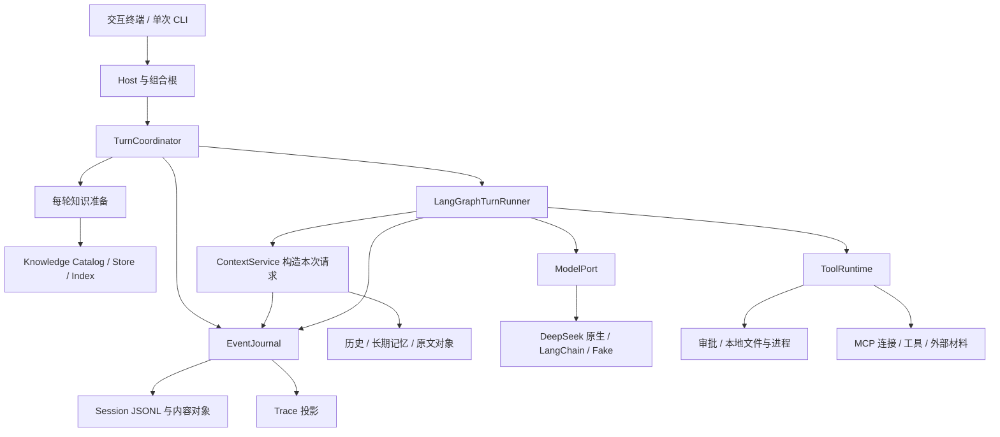
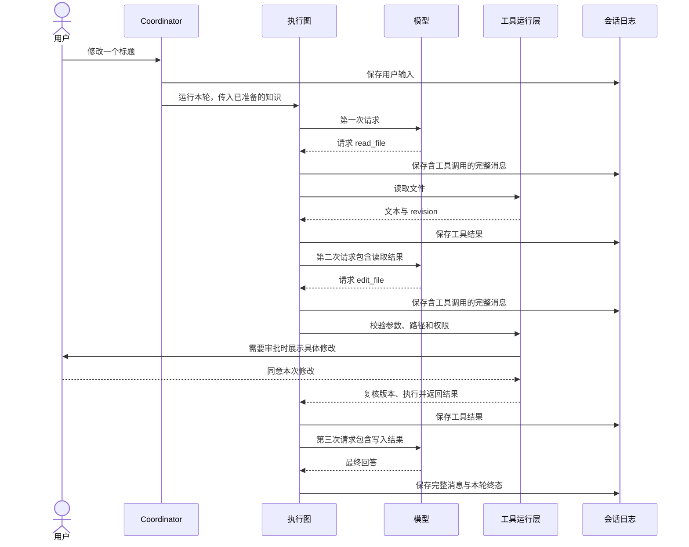

# JDAgent 详细设计、架构与面试问答

**代码基准**　`main` · `9d3281a` · 2026-11-21 核对。**文档状态**　`Implemented`（当前实现说明）。

JDAgent 是一个面向 Windows 工作区的 Python 命令行 Agent。用户交给它一个任务，模型可以读文件、提出修改或请求运行程序。宿主决定哪些动作可以执行，保留工具实际观察到的结果，再让模型据此回答。读懂这个项目，可以从一个具体问题入手：**模型说“文件改好了”时，有哪些代码和记录能让我们相信这句话？** 下文从第一次输入跟到一次文件编辑，再用同一条链解释长对话、知识检索、外部工具和故障恢复。

| 阅读目的 | 从这里进入 |
| --- | --- |
| 准备一两分钟的项目介绍 | [项目边界与总体架构](#architecture) |
| 跟一次真实的业务路径读代码 | [从输入到工具结果](#walkthrough) → [宿主与执行图](#runtime) → [模型协议](#model) |
| 理解 Agent 如何安全地改文件、跑命令、从中断恢复 | [本地工具与权限](#tools) → [事件、持久化与恢复](#sessions) |
| 解释模型这次究竟看到了什么 | [上下文与计量](#context) → [历史与记忆](#memory) → [知识库与引用](#knowledge) |
| 理解外部能力和工程验证 | [MCP](#mcp) → [可观测性与验证](#verification) |
| 自测或面试前复习 | [20 组面试追问与参考答案](#interview) |

<a id="architecture"></a>

## 一、项目边界与总体架构

**一句话介绍。** JDAgent 用 LangGraph 驱动一个能调用工具的对话循环，把模型提出的动作、宿主授权的动作、工具实际完成的动作分别记录。这个分工决定了三件事：模型可以换适配器，用户可以查证一次操作，程序重启后可以依据已保存的事实决定怎样继续。

前台有两种用法。交互模式适合逐轮协作、检查权限和处理审批；Headless 模式接受一个提示词，输出文本或机器可读的 JSON，适合脚本。两种模式共用同一套执行行为。知识管理命令还可以在对话之外摄取文档、管理绑定，维护命令可以续做已经登记的记忆作业。当前代码围绕**一个会话中的一个前台任务**组织，没有把任务拆成多个自治 Agent，也没有独立的任务验收器。停止原因 `completed` 描述执行协议正常结束，任务做得对不对仍要看文件、程序输出、检索证据或验收条件。



图中箭头表示调用或数据依赖。`composition.py` 负责把具体对象接在一起，模型 SDK、终端、数据库和文件系统各有入口。理解依赖方向的一个办法是设想替换 DeepSeek：只要新适配器能处理统一的消息、工具和流式事件，图就能继续按照原有规则审批、存储和恢复。反过来，修改会话恢复规则时，也不必进入 Provider 的 SSE 解析代码。[组合根](../../src/jdagent/composition.py) · [端口定义](../../src/jdagent/ports.py) · [领域数据类型](../../src/jdagent/domain)

### 四种时间尺度

| 对象 | 何时建立 | 生命周期内保持什么 | 变化后看哪里 |
| --- | --- | --- | --- |
| Workspace（工作区） | 宿主解析目标目录时 | 规范路径对应的身份、会话分区与知识绑定范围 | `DataPaths`、知识 Catalog、项目配置 |
| Session（会话） | 新建或恢复时 | 有序事件、可撤销的会话许可、可引用的原始结果 | JSONL、对象引用、可重建的会话目录 |
| Turn（一轮用户任务） | 接受一次输入时 | 用户原话、当前模型配置、本轮知识证据、模型与工具调用次数 | Coordinator、新建的图状态、Turn 终态 |
| Model request（单次模型请求） | 每次准备调用模型时 | 本次消息、系统指令、工具定义快照、输入估算及请求标识 | RequestManifest、用量事件、费用账本 |

例如用户连续追问两次，通常是同一 Session 的两个 Turn；问一次“读一下这个文件再解释”，可能在一个 Turn 内产生两次模型请求。第一次请求选工具，第二次请求才看得到文件内容。一次模型请求又可以发出多个工具调用。把这四种计数混在一起，会误读费用、重复计算工具，甚至给新会话继承错误的许可。

### 代码怎样分工

| 模块 | 拥有的行为 | 阅读入口 |
| --- | --- | --- |
| 宿主、配置、组合根 | 解析入口、定位数据、构造依赖、安排退出清理 | [cli](../../src/jdagent/cli.py)、[host](../../src/jdagent/host.py)、[configuration](../../src/jdagent/configuration.py) |
| 应用层 | 交互与单次执行、审批选择、会话目录、恢复和每轮协调 | [application](../../src/jdagent/application) |
| 领域与执行合同 | 消息、工具、事件、错误与 Runner 接口；约定模块交换什么数据 | [domain](../../src/jdagent/domain)、[core/contracts](../../src/jdagent/core/contracts.py) |
| 图与模型适配 | 每轮推进、停止条件、模型响应收集和协议翻译 | [runtime](../../src/jdagent/runtime)、[adapters](../../src/jdagent/adapters) |
| 本地工具 | 定义与执行、权限策略、路径检查、文件版本、进程和日志 | [tools](../../src/jdagent/tools)、[Windows 进程实现](../../src/jdagent/adapters/windows_process.py) |
| 事件与会话 | 持久追加、对象与锁、配对补全、结构化执行轨迹 | [eventing](../../src/jdagent/eventing.py)、[JSONL](../../src/jdagent/adapters/jsonl_session.py)、[observability](../../src/jdagent/observability.py) |
| 上下文 | 请求投影、原文与摘要、目录指令、预算、请求重建 | [context_runtime](../../src/jdagent/context_runtime.py)、[context_archive](../../src/jdagent/context_archive.py) |
| 历史、记忆与维护 | 检索旧会话、版本化记忆、提取合并、租约与费用 | [memory_service](../../src/jdagent/memory_service.py)、[memory_store](../../src/jdagent/memory_store.py)、[maintenance](../../src/jdagent/maintenance.py) |
| 知识库 | 来源版本、摄取、索引、按轮取证、回答引用及质量评测 | [knowledge](../../src/jdagent/knowledge) |
| MCP 客户端 | 发现和授权远端能力、保存原文、任务绑定、追踪外部来源 | [mcp_service](../../src/jdagent/mcp_service.py)、[mcp_execution](../../src/jdagent/mcp_execution.py)、[mcp_provenance](../../src/jdagent/mcp_provenance.py) |

<a id="walkthrough"></a>

## 二、沿一条请求看完整系统

假设工作区已有 `notes.txt`，其中的标题是“安装”。用户在允许编辑的交互会话中要求：“把标题改成‘本地安装’，保留其他内容。”下面跟踪一种合法的模型选择顺序。模型实际会选哪些工具取决于响应；调用与落盘的先后关系由宿主固定。

1. **接到输入。** `TurnCoordinator.send()` 取得会话所有权，读入已有事件，检查是否存在尚待隔离的副作用。新会话补 `session_started`，随后写入本轮 `user_message`。普通输入按工作区绑定准备一份知识结果；没有绑定也有明确状态。本轮使用同一个 Turn ID。
2. **第一次请求，读取。** 上下文服务把当前输入、相关指令和本次可用的工具定义组成请求。模型给出完整的 `read_file` 调用。图先保存带调用 ID 的 assistant 消息，再让工具运行层执行。文件工具返回可见文本和根据**完整文件**算出的 `revision`。只读一页也能拿到整文件版本。
3. **第二次请求，提议修改。** 图重新构造请求，把刚保存的工具结果配回对应的调用。模型现在可以提交 `edit_file`，参数含 `path`、`revision` 和一组 `old_text`／`new_text`。宿主检查路径、Schema 和当前权限；策略要求询问时，终端向用户展示准备执行的具体修改。
4. **在文件上提交。** 审批通过后，工具在独占句柄内重新校验版本，并一次检查整批替换。若另一个编辑器在读取后改过文件，本次写入返回冲突。模型可以重新读文件再决定是否修改。若提交成功，工具结果给出新旧版本和写入字节数。
5. **第三次请求，回答。** 模型依据成功的工具结果生成文本并以 `stop` 结束。图校验适用的知识引用，保存完整 assistant 消息，再写 `turn_completed`。还想确认最终标题时，可以要求再次读取，或用工具事件里的版本与当前文件核对。只看模型撰写的总结无法发现之后发生的外部修改。



三个故障点能检验是否真的理解了这条链。模型在拼接 `edit_file` 参数时断流，文件应保持原样。用户拒绝本次审批，工具结果应记录拒绝，模型仍有机会向用户解释。若进程在开始写文件后崩溃，磁盘可能已经改变，日志又缺少完成结果，恢复逻辑必须把结果留为未知。三种情况分别由模型协议、权限策略和会话恢复负责。[每轮协调](../../src/jdagent/application/coordinator.py) · [响应收集](../../src/jdagent/runtime/model_response.py) · [文件工具](../../src/jdagent/tools/files.py) · [恢复判定](../../src/jdagent/application/session_recovery.py)

<a id="runtime"></a>

## 三、宿主、配置与 LangGraph 执行图

### 从命令行进入同一个执行器

包要求 Python 3.11 及以上。`jdagent` 命令映射到 `jdagent.cli:main`。解析器识别普通对话、`knowledge` 管理树和 `maintain --pending` 等入口。普通任务由 Host 选择交互或 Headless 展示方式，调用 `build_runtime()` 装配模型、Session 存储、审批、工具和知识服务。`ConfiguredTurnRunnerFactory.create()` 根据会话的 Journal 构造 `LangGraphTurnRunner`。交互终端由 Prompt Toolkit 接收输入，Rich 展示输出。只有一个输入读取者，因此在审批过程中输入控制命令不会同时启动下一轮。[包入口](../../pyproject.toml) · [宿主](../../src/jdagent/host.py) · [交互实现](../../src/jdagent/application/interactive.py) · [Headless 结果](../../src/jdagent/application/headless.py)

普通设置按 CLI、项目配置、用户配置、默认值的优先级解析。Windows 默认的用户配置为 `%APPDATA%\JDAgent\config.toml`，项目配置为工作区的 `.jdagent/config.toml`。`DataPaths` 规范化绝对路径，用 SHA-256 生成工作区身份。默认会话落在 `%LOCALAPPDATA%\JDAgent\projects\sha256-…\sessions-v5`。用户级知识目录另行定位，`--data-dir` 可以指定会话位置，不能据此推断知识库也已迁移。移动项目或换一个克隆目录会改变默认工作区身份。[数据定位](../../src/jdagent/data_paths.py) · [配置解析](../../src/jdagent/configuration.py)

每次开始 Turn 时重读配置，本轮的模型设置随后固定。Provider、端点或模型适配器这类影响已建连接的更改需要重启。普通 CLI 默认选 DeepSeek 原生模型适配器，默认模型为 `deepseek-v4-flash`。`--model-adapter langchain` 可以换通信实现；整个前台执行器始终为 LangGraph。旧的 `--runtime-engine` 和用户配置里的 `runtime_engine` 只为兼容接受 `native` 或 `langgraph`，每进程提示一次迁移，项目配置禁止这个字段。阅读老版本压测或计划时，要确认其中的 `native` 究竟指旧循环还是当前模型适配器。[配置参考](../reference/configuration.md) · [单引擎决策](../decisions/ADR-0009-langgraph-only.md)

### 图节点的职责和跳转

| 节点 | 做什么 | 下一步由什么决定 |
| --- | --- | --- |
| `prepare` | 检查取消与模型次数，依据最新事件准备请求 | 请求就绪进入 `model`；超限或准备失败进入 `fail` |
| `model` | 消费模型事件流，显示文本，记录用量，校验完整响应 | 正常进入 `citations`；特定的上下文过长错误可以重新准备一次 |
| `citations` | 对无待执行工具的回答检查本轮引用 | 有非法引用进入 `repair_prepare`；可接受的响应进入 `persist` |
| `repair_prepare`、`repair_model` | 加入允许的引用清单，再发一次禁止工具的请求 | 回到 `citations`；仍有非法引用则结束为失败 |
| `persist` | 核验调用 ID，保存完整 assistant 消息 | 有调用进入 `tool`，无调用进入 `complete` |
| `tool` | 记录本次调用、执行一个工具并保存结果 | 批内还有调用则处理下一个；批次结束再 `prepare`；应停止则 `fail` |
| `complete`、`fail` | 保存唯一终态，返回停止原因、调用次数等结果 | 失败时先处理悬空的工具配对；持久化自身失败向外传播 |

图为每个 Turn 新建状态并编译，`checkpointer=False`。节点保存本轮请求、待处理调用、当前索引、已观察失败数、是否尝试过修复等瞬时值。会话重开依赖已持久的事件和恢复规则。图没有为工具节点配置自动重试，也不并行调度同批工具。模型给出的多个调用可以依赖同一工作目录、文件或授权；按顺序执行使事件顺序与动作顺序一致。批内中途发现新目录规则时会关闭未发出的调用，下一次模型请求据更新后的指令重新规划。[图的节点与边](../../src/jdagent/runtime/langgraph_runner.py) · [执行合同](../../src/jdagent/core/contracts.py)

默认普通 CLI 的上限是每轮 16 次模型请求、32 次工具调用、最多容许 2 次标记为 `observed_failure` 的失败后继续，第三次会停。失败恢复次数与普通拒绝、所有错误消息或图执行步数并非一一对应。计数受业务逻辑控制，LangGraph 另有按业务限额计算的步数保护。当前普通 CLI 构造的 `RuntimeOptions` 会固定这三个次数；直接调用组合根时可使用相应 TOML 值或显式选项。引用修复也占一次模型请求。持久化报错时向上抛出，仅在确认已落盘时才能向调用方声称某条终态存在。[CLI 接线](../../src/jdagent/host.py) · [执行上限](../../src/jdagent/composition.py) · [图的故障回归](../../tests/test_v06_graph_runner.py)

<a id="model"></a>

## 四、模型协议与流式输出

`ModelPort` 有两个关键成员。`capabilities` 提供能力信息；`stream(ModelRequest)` 返回异步事件流。一个请求包含模型名、分来源的系统指令、角色消息、工具定义、生成设置、关联元数据和 Provider 选项。上层用相同的表示处理普通对话、引用修复与无工具的维护请求。各请求的目的、允许的工具、超时和费用归属可以不同。[模型类型](../../src/jdagent/domain/model.py) · [ModelPort 合同](model-port.md)

| 实现 | 如何工作 | 能用它证明什么 |
| --- | --- | --- |
| `DeepSeekModelPort` | 用 httpx 发出聊天请求，解码 SSE，按调用索引组装参数并映射 HTTP、传输和协议错误 | 项目如何直接控制 HTTP 和流边界 |
| `LangChainModelPort` | 将消息和工具转成 `ChatDeepSeek` 接受的形式，读取 SDK 的 chunk，再转回同一套项目事件。禁用 SDK 自动重试和云端追踪 | 同一执行图能适配另一种客户端；两者的请求和错误可用受控传输比较 |
| `FakeModelPort` | 从预设脚本返回事件，可以稳定构造正常、残缺、超时、取消和多次工具响应等场景 | 在无模型服务的环境下验证宿主行为；自然语言任务质量需要真实模型样本 |

以一个工具调用为例，Provider 可能把工具名和 JSON 参数拆成许多片。适配器负责组装字段并给出完整 `ToolCallCompleted`。`ModelResponse` 负责解释整条流的结束语义；`LangGraphTurnRunner` 决定如何显示、计量、保存并执行。普通文本以 `TextDelta` 展示，工具参数片段用 `ToolCallDelta` 表示，`UsageReported` 与 `ResponseCompleted` 分别表示用量和结束信号，`ModelFailed` 携带归一化的错误类别。结束信号之后仍可能收到本次用量，因此看到 `stop` 后还要消费该流余下的事件。

有调用时必须得到完整调用且结束原因为 `tool_calls`，无调用的普通完成要求 `stop`。普通响应重复结束、参数未收全、已有调用却给出 `stop` 等情况都不能触发工具。命中输出长度上限会得到相应停止原因。引用修复走独立校验分支，要求以 `stop` 结束且不能发出工具调用。图保存消息时还会检查本批及此前已见的调用 ID。这样，工具执行的前提是**完整、可配对的请求**，屏幕已经显示了一段文字并不满足此前提。[原生适配器](../../src/jdagent/adapters/deepseek.py) · [LangChain 适配器](../../src/jdagent/adapters/langchain_model.py) · [流生命周期](../../src/jdagent/model_stream.py) · [响应校验](../../src/jdagent/runtime/model_response.py)

适配器报告上下文超长时，仅在普通调用、具备上下文服务、本轮还没这样重试、且当前响应尚未收到文本或完整工具调用等条件下，图才重新准备一次请求。超时、一般网络失败和工具异常各有自己的收尾语义。若到了清理边界，运行时等待模型流关闭或工具完成其拥有的本地清理。这里需要同时考虑两种观察者：用户希望尽早看到文本，而系统只能把已验证完成的消息作为下一轮可依赖的历史。

<a id="tools"></a>

## 五、本地工具、权限与 Windows 执行

### 工具的同一条调用链

`ToolRegistry` 按名称注册工具的描述、输入／结果 Schema、风险、预处理和处理函数。请求构造时只暴露本轮范围内能用的定义。执行时 `ToolRuntime.execute()` 又按本次请求的标识查找定义，检查调用身份和能力范围，验证输入，执行预处理，然后基于准备后的参数决定应放行、询问还是拒绝。通过这些检查以后才记录执行开始、进入处理函数、规范化结果。图负责保存最终工具结果，再决定继续、要求重做计划或结束本轮。[定义与执行器](../../src/jdagent/tools/runtime.py) · [工具领域合同](../../src/jdagent/domain/tools.py)

| 最低工具范围 | 常驻本地工具 | 实现要点 |
| --- | --- | --- |
| `analyze` | `calculator`、`find_files`、`read_file`、`search_text`、`read_command_output` | 有限算术、有限文件发现与检索、分页读文本或日志 |
| `edit` | `create_file`、`edit_file` | 继承读取能力；排他创建或按版本和精确文本修改 |
| `execute` | `run_command` | 继承前两组能力；接收明确的程序、参数、工作目录，管理子进程和输出 |

正常组合根还注册 `search_history`、`read_history`、`search_memory`、`update_memory`。MCP 则带来目录发现、原文读取、按配置开放的材料入口及动态选入的远程工具。计数时，“八个”指上表这组工作区工具，不等于运行时永远只看得见八个定义。`--tool-scope analyze` 可用来分析项目，默认范围是 `execute`，默认文件写入与命令策略为 `ask`。[历史与记忆工具](../../src/jdagent/memory_service.py) · [应用装配](../../src/jdagent/composition.py)

`calculator` 将输入解析为 Python 语法树，只递归求值允许的数值和运算符，并限制表达式长度和指数，函数调用等表达式会失败。`find_files` 与 `search_text` 共用目录扫描，继承适用的 `.gitignore` 规则，遇到上限返回截断信息。检索结果为空时要看扫描是否完整，否则“在扫描范围里没找到”很容易被误读为“整个项目都没有”。[有限算术](../../src/jdagent/tools/builtins.py) · [目录扫描与文本搜索](../../src/jdagent/tools/files.py)

### 能力范围、权限策略、用户审批各解决什么

能力范围决定有没有资格尝试这一类动作。权限策略对具体调用按 `ALLOW`、`ASK`、`DENY` 作判断。只有 `ASK` 才需要审批入口收集答复；Headless 遇到需要新审批的动作会拒绝，不挂起等待终端。用户或项目配置中明确的拒绝构成上限；`write_permission=deny` 也会阻止命令，避免把被拒的写入换成运行程序来完成。会话规则只在既有上限内生效。

审批展示的是准备执行的参数，例如修改的旧文、新文和命令的工作目录。持久审批事件保存摘要及展示内容的哈希。模型在同一 Turn 里仅换调用 ID，再提交完全相同、刚被拒的准备后参数，不会得到第二次询问。用户可以授权一次，也可以建立可撤销的 Session 规则。命令规则按程序、cwd、环境指纹和**非空参数前缀**匹配；前缀后的参数可能变化。恢复同一个正常会话时规则仍可生效，切换工作区或进入新的恢复子会话时不能沿用。[权限策略](../../src/jdagent/tools/permissions.py) · [审批选择](../../src/jdagent/application/approval.py) · [会话规则管理](../../src/jdagent/application/permissions.py)

### 文件修改怎样避免覆盖并发编辑

路径以规范化后的 workspace 为根。解析器会检查路径和目标，拒绝越界、Windows 设备／备用数据流、链接、重解析点和不受支持的硬链接目标。发现和搜索共享忽略规则及扫描边界。文本读取与编辑支持 UTF-8、可保留 BOM，文件上限为 2 MiB。`read_file` 可按行返回一部分，但 `revision` 绑定规范路径和完整原始字节。因此名字相同、内容不同的文件，或把另一路径的版本拿过来用，都不能冒充上次读取的目标。[工作区路径](../../src/jdagent/tools/workspace.py) · [文件工具](../../src/jdagent/tools/files.py)

编辑时先检查目标文件版本，再确定每个旧片段有唯一匹配且各区间不重叠，整组验证通过才按区间写入。换行匹配兼容 LF 与 CRLF，未改动内容尽量按原字节保留。Windows 层在独占句柄内重新核验版本、写入、截断、刷盘。两位协作者先后修改同一文件，后到者会得到可处理的版本冲突；机器恰好在原位写入中途停电，则可能留下部分更改。排斥并发写入和保证崩溃后文件全旧或全新，是两种不同的保证。会话恢复保留“副作用未知”正是为了处理后者。[Windows 文件句柄](../../src/jdagent/adapters/windows_files.py) · [文件编辑实现](../../src/jdagent/tools/files.py)

### 命令启动、取消和输出

`run_command` 使用显式程序和 argv，不隐式拼 Shell 命令，拒绝直接启动 bat/cmd。受信的 Python 启动器以隔离选项启动，先进入配置了关闭即终止的 Windows Job，再启动用户程序。子进程继承宿主允许的环境项；模型服务密钥不会作为普通继承项传入。握手用于区分“子程序已经启动”和“还停在启动器”。这些措施约束本机协作工具的启动与清理，用户批准启动的程序仍以宿主允许的权限工作。[命令处理](../../src/jdagent/tools/commands.py) · [Windows 进程层](../../src/jdagent/adapters/windows_process.py)

命令执行线程同时排空 stdout 和 stderr，结果只给有界预览和日志引用。单次合计最多保存 10 MiB，workspace 合计 100 MiB，预览合计 16 KiB。达到容量后仍持续排空管道并标记输出缺失，防止子进程因管道写满而卡住。`read_command_output` 可以按引用和字节范围读回。取消时宿主会通知执行线程，等待所拥有的进程树与管道清理；若无法确认是否已经启动或是否清理完整，结果保留不确定性。退出码非零、输出被截短、进程状态未知都对应不同的证据，排查时应分别检查。[命令日志](../../src/jdagent/tools/command_output.py) · [命令合同测试](../../tests/test_v04_commands.py)

<a id="sessions"></a>

## 六、事件日志、会话恢复与中断语义

### 写什么，按什么顺序写

一条 `RuntimeEvent` 有会话 ID、可选 Turn ID、事件 ID、顺序号、时间、类型和对应载荷。有些事实如会话命名或管理已登记的 MCP Task，可以发生在模型 Turn 之外。`EventJournal` 以已有历史的下一个序号构造事件，先交给 `SessionPort.append()`，再更新内存事件序列，最后通知 Trace 等观察者。本地追加和内存更新是取消时要等待结束的一个操作；挂起的写盘不能被误判成已经取消，否则后续写入可能复用同一序号。[事件定义](../../src/jdagent/domain/events.py) · [先持久化再通知](../../src/jdagent/eventing.py) · [取消收尾](../../src/jdagent/cancellation.py)

普通宿主使用追加式 JSONL。每行一个事件，读回时核对版本、会话 ID 和严格顺序；写后刷新并同步到磁盘。大于 16 KiB 的载荷写入内容寻址对象，事件通过摘要和字节数引用，读取时核验内容。一把操作系统级锁保护同一会话的写入所有权；持锁时可以缓存已经校验的尾部。会话列表的名字、短 ID 与目录索引用于发现，索引可重建。某个会话损坏时其他会话仍应可列出，不应据一个未读过的索引项认定那个会话可以安全续写。[JSONL 存储](../../src/jdagent/adapters/jsonl_session.py) · [会话锁](../../src/jdagent/adapters/session_lock.py) · [会话目录](../../src/jdagent/application/session_catalog.py)

理解版本号，先看它属于哪个接口。包版本 `0.5.0` 标识发行包；`v0.8` 是这次执行器改造的项目阶段；默认会话目录叫 `sessions-v5`，其中当前 JSONL 事件为 `schema_version=4`；脚本消费的 Headless JSON 为 v2。兼容性要按相应读写合同验证。把包版本号填入 JSON，或根据目录后缀推断事件 Schema，都会得出错误结论。[发行包](../../pyproject.toml) · [会话事件版本](../../src/jdagent/domain/events.py) · [单次输出版本](../../src/jdagent/application/headless.py)

### 恢复时先查文件，再查动作

| 看到的事实 | 程序如何处理 | 理由 |
| --- | --- | --- |
| 最后一行只写了一部分，之前的行完整 | 显式恢复先做备份，再有限修复末尾，继续做逻辑检查 | 完整前缀可信，末行没有足够信息 |
| 中间某条损坏、顺序错误或版本不支持 | 拒绝普通恢复，保留现场 | 跳过未知事件可能跳过一次真实写入 |
| 已保存 assistant 的工具调用，后续某项从未开始 | 给未执行的调用补 `not_executed`，关闭悬空配对 | 给模型的工具历史需要与请求逐项对应 |
| 本地写入或命令已开始，缺少可信的完成结果 | 记录未知副作用，正常续写受限；交互恢复可建立子会话 | 再做一次可能覆盖修改或重复产生外部效果 |
| 已保存可信 Turn 终态，随后观察者抛错 | 保留原终态，避免再追加一个相反的终态 | 展示失败无法推翻已写好的业务事实 |

恢复子会话保存父会话、安全前缀截止点与哈希、checkpoint 引用和未知动作清单。它可以只读访问来源会话的命令日志；缺少最终元数据时要把日志视为不完整。来自父会话的事实有明确来源，不伪装成用户新输入。许可需要在新的会话重新形成。父会话锁覆盖从检查到提交恢复记录的过程。普通 Headless 恢复不会悄悄选择创建这样一个子会话的分支。[物理修复](../../src/jdagent/adapters/jsonl_recovery.py) · [逻辑恢复](../../src/jdagent/application/session_recovery.py) · [Headless 入口](../../src/jdagent/host.py)

例如一条命令负责生成报表。若正常看到开始事件、命令日志和完成事件，就能检查输出与退出状态。若只有开始事件，且输出文件已经存在，仅凭文件存在推断命令完整成功并不可靠，它也可能是上次运行的产物。恢复路径保留日志、原调用 ID 和未知状态，给人核对时间、文件内容及下游记录的机会。这个设计降低重复执行的风险；它没有把本地事件追加和任意外部程序变成一个分布式事务。[中断配对](../../src/jdagent/eventing.py) · [强退恢复测试](../../tests/test_forced_exit_recovery.py)

<a id="context"></a>

## 七、上下文、窗口预算与压缩

### 从“发生过什么”到“这一次发给模型什么”

Session 可以一直增长，单次模型请求有硬上限。`ContextBuilder` 把事件投影成符合角色和工具配对要求的消息。正常组合根使用 `ContextService` 构造完整请求，再组合本轮系统与目录指令、当前用户原文、历史摘要、受保护的用户约束、记忆和知识背景、工具结果及定义。能被模型读到的背景内容没有授权效果。上个会话里某条文档写着“以后都允许执行”，不能替用户做出本轮的审批决定。[基本消息构建](../../src/jdagent/context.py) · [上下文服务](../../src/jdagent/context_runtime.py)

目录指令由 `TurnInstructions` 管理。本轮固定已读指令的正文与哈希，访问新目录时沿祖先链发现适用的 `AGENTS.md`。若第一次写入那个目录才发现新规则，会先返回控制结果，让图关闭本批尚未发出的调用，再让模型依据新规则请求写入。下一 Turn 重新建立活跃目录集合。这解决的是一个时序问题：在模型提出方案时，它可能还没有见过将要修改的子目录的规则。[指令发现](../../src/jdagent/instructions.py) · [写入前检查](../../src/jdagent/tools/runtime.py)

每个待发送请求有一份 RequestManifest，可关联请求 ID、消息、设置和工具定义。上下文模块拥有的内容按 SHA-256 存放；知识证据只保留版本、定位符和内容哈希，重建请求要回知识 Catalog 和 Store 取回相应证据。若知识来源已删除，重建应明确失败。这样既能查明一次回答当时看到什么，也能保留数据所有者对原文生命周期的控制。[请求归档与重建](../../src/jdagent/context_archive.py) · [按知识引用重建](../../src/jdagent/knowledge/context_references.py)

### 算一次真实的预算

设模型窗口与应用上限中较小者为 `W`，预留输出为 `R`。默认安全余量为 `S = max(1024, ceil(0.05 × W))`，也可显式配置。能发送的输入预算为 `B = W − R − S`，Provider 另有限制时再取较小值。未知模型或自定义服务端点需要明确窗口容量。代码内的已知模型档案、用户给应用设置的上限和服务端实际接受的输入量，应分别看待。[容量档案](../../src/jdagent/model_profiles.py) · [预算公式](../../src/jdagent/context_budget.py)

例如 `W = 64,000`、`R = 4,096`、安全余量取默认值，且 Provider 没有更低上限，则 `S = 3,200`，`B = 56,704`。默认触发比例为 90%，整数估算从 51,034 token 开始触发压缩；目标是低于 40%，即最多 22,681 token。估算针对**整个拟发送请求**，含系统文字、当前输入、工具 Schema、结果和协议开销。冷启动按字节等信息保守估算，再按同 Provider 和模型的真实 Usage 校准。`/context-window` 展示最近完整请求的占用和分类。它回答窗口问题，累计费用则需查按请求 ID 结算的账本。

### 压缩失败时，什么还能信

动态 MCP 定义挤占空间时，可先从后续请求移出较少使用的完整定义，不截坏一个 Schema。历史仍然过长时，在已发出的工具批次闭合以后执行压缩。人工 `/compact` 只在空闲时启动；运行中提出会被要求稍后再发，不会打断一组文件操作。压缩使用禁止任务工具的维护请求，按段生成摘要，再合并候选。摘要区分“原文记载了一项陈述”和“有成功工具结果支持已经做完”；判断后者必须能回指相应事实序号。

每次压缩最多使用 8 次模型调用，总时间上限 600 秒，单次最多 120 秒。系统保存不可变原段，并可从索引选取有界的相关原段参与重建。候选先保存，再验证并提交 checkpoint。未达理想目标但明显改善且已降至触发线以下时可以继续；无改善、来源无效或预算失败时仍使用原有有效投影。当前输入保留原文，已经被摘要覆盖的用户约束有单独保护区。用户可用整句 `撤销本会话约束 C12` 撤销相应历史用户事件的活跃约束，档案本身仍可追溯。超过容量且无法生成合格请求时以 `context_limit` 结束。[压缩与提交](../../src/jdagent/context_runtime.py) · [请求费用](../../src/jdagent/request_accounting.py) · [压缩回归](../../tests/test_v05_compaction.py)

<a id="memory"></a>

## 八、历史检索、长期记忆与后台整理

### 三种“记住”的含义

如果用户问“上次改了哪一行”，应该回到历史 Session 查用户原话、工具调用及其结果。若问“这个项目一般用什么测试框架”，可以查项目级记忆及来源；若问“这次回答为什么引用手册第六节”，则应读本轮知识证据。三者都有检索功能，却有不同的写入者、有效范围和失效条件。

| 入口 | 保存或返回的对象 | 一项关键约束 |
| --- | --- | --- |
| `search_history` → `read_history` | 定位同一 workspace 的既有会话与 Turn，再分页读回原文 | 读回内容附来源，只作为背景；活跃来源不作为归档历史随意读取 |
| `search_memory` | 有 ID、版本、作用域、状态、来源的记忆记录 | 默认取当前项目及用户级有效记忆，显式查询可包含停用项 |
| `update_memory` | 按用户的直接意图新增、更正、停用或重新启用 | 写入绑定宿主接受的用户事件，且受工具范围与拒绝策略约束 |
| 工作区知识绑定 | 来自已配置知识库的版本化证据 | 由知识 Catalog 管范围，本轮检索冻结后供整个 Turn 复用 |

### 一条用户偏好怎样写进 SQLite

用户独立输入 `记住：项目使用 pytest`，宿主解析整句，创建绑定 Session、Turn、用户事件、作用域、正文和目标版本的一次性意图。模型可以提出 `update_memory`；宿主会核对参数与意图完全一致，再由 `MemoryStore` 追加版本。重复消费相同意图返回原结果。若这句话在引号内、文件中或远程模板里出现，不能让宿主为其生成相同的写入授权。显式意图能满足通常的询问需求，`analyze` 范围和明确的 `deny` 仍会阻止写入。[意图语法与存储](../../src/jdagent/memory_store.py) · [工具绑定](../../src/jdagent/memory_service.py) · [宿主接受原始输入](../../src/jdagent/application/coordinator.py)

记忆有项目和用户两种作用域。`记为我的通用偏好：回答使用中文` 指定用户级，默认项目记忆与规范 workspace 身份关联。“忘记”会追加停用版本；更正、恢复同样留下版本链。更新检查目标版本，较旧的请求不能覆盖后来更正。到期、源文件 revision、知识来源版本或会话来源发生变化时，相关记忆可能过期或需要核实。默认注入只取仍有效的陈述。这能解释一种常见现象：之前保存的记忆在历史版本中仍然找得到，却不再参与当前回答。

召回先看词项重合。配置了 Embedding 时，系统按模型档案指纹和内容哈希复用向量，再计算余弦相似度。代码对语义候选使用 `0.6` 的门槛，将词项与语义两张排名表按 `1 / (60 + 名次)` 融合。向量服务不可用时返回 `keyword_only` 并保留可重建的索引状态。记忆正文与版本在 SQLite 中，语义索引可重建。回答“记忆准不准”还需测真实用户查询下的召回和误注入，排序公式本身回答不了这个问题。[召回与降级](../../src/jdagent/memory_service.py) · [记忆与向量存储](../../src/jdagent/memory_store.py)

### 后台作业怎样避免重复提取和抢占前台

符合条件的会话首个成功 Turn 后登记整理作业；启动扫描可补偿“完成首轮后但作业还没登记”这一窗口。worker 只处理可用的稳定历史来源，排除当前会话及其他活跃来源。第一阶段从各来源提取候选，连“已经提取但没有结果”也持久化；第二阶段再合并候选并发布。来源前缀哈希说明依据的是哪一版材料，水位说明处理到哪里。worker 的租约有代次 `epoch`，过期后即使旧 worker 晚到一步，也不能覆盖接管者发布的新结果。自动整理只生成项目候选，显式用户更正和停用状态有优先权。[调度与发布](../../src/jdagent/maintenance.py) · [作业租约与阶段结果](../../src/jdagent/memory_store.py)

任务、引用修复、压缩和后台整理共享模型资源及费用账本。前台优先取得可用槽位；后台已发出的请求仍有自己的超时和清理路径。按请求 ID 在发送前预留输入／输出额度，收到 Usage 后结算；总额度与维护子额度分别控制。进程重启不能把一笔已经发出且尚无用量回执的请求当作免费。后台单个作业最多 8 次模型请求、15 分钟，取消不占真实失败的重试次数。Headless 先输出并刷新用户答案，再开始新整理；默认最多等 120 秒，退出清理上限 5 秒，剩余登记作业可用 `jdagent maintain --pending` 续做。输出中的维护状态对应**输出当时**，脚本应独立解读前台停止原因。[请求计量](../../src/jdagent/request_accounting.py) · [维护过程](../../src/jdagent/maintenance.py) · [宿主退出顺序](../../src/jdagent/host.py)

<a id="knowledge"></a>

## 九、RAG 知识库、证据与引用

### 文档入库后分成哪几类数据

RAG 在本项目中的任务是给本轮回答附上可定位的材料。`KnowledgeCatalog` 保存连接、知识库、workspace Binding、来源、版本、操作进度及可见性元数据。`ContentAddressedStore` 按摘要保存原始字节与解析快照。`KnowledgeIndex` 保存供查找的 Chunk、向量及可见区间，提供本地和 Milvus 等实现。绑定指明某个工作区获准查哪些知识库，和会话权限分别管理。把一个文档放进工作区、把它导入知识库、把该库绑定给工作区是三个不同操作。[元数据 Catalog](../../src/jdagent/knowledge/catalog.py) · [内容对象 Store](../../src/jdagent/knowledge/store.py) · [索引合同](../../src/jdagent/knowledge/index.py)

以一份安装手册为例，摄取先读取源文件、计算原始字节摘要。解码依次考虑显式编码、BOM、严格 UTF-8 和检测路径。有确定结构的 TXT、Markdown、CSV 解析为带 Locator 的片段，后续可以指回哪一段文字。例如 CSV 按行归组，Markdown 按标题下的结构分组。切分时保留较完整的 Parent 给模型阅读，以较小的 Child 做检索；默认 Child 上限为 800 字符，遇到必须强拆的长段可留 80 字符重叠。向量取决于 Embedding Profile。写入索引时将身份与 Source Version 联系起来，即使两份手册的某段文字一样，也保有各自的来源。[摄取](../../src/jdagent/knowledge/ingestion.py) · [解码](../../src/jdagent/knowledge/decoding.py) · [结构解析](../../src/jdagent/knowledge/parsing.py) · [父子切分](../../src/jdagent/knowledge/chunking.py) · [Embedding](../../src/jdagent/knowledge/embedding.py)

Generation 表示检索使用哪一代索引，Revision 则决定这一代中哪些记录可见。对本地索引，一条记录的起始版本必须不晚于查询版本，结束版本为零表示仍开放，否则查询版本必须早于结束版本。换版时可以关闭旧记录的可见区间并让新记录生效。摄取在 Catalog、对象存储和索引上分步工作，按操作 ID 留存阶段进度，提供重试和对账入口；这些存储之间没有天然的跨系统原子提交。已有重试入口不能证明每个崩溃点的丢失索引都能完全自动重建。[可见区间](../../src/jdagent/knowledge/index.py) · [摄取操作与恢复入口](../../src/jdagent/knowledge/ingestion.py)

### 一次提问如何产生一段可引用的证据

1. Coordinator 以用户输入和 workspace Binding 为起点。普通对话没配置知识时返回 `not_configured`；不会仅为此新建 Catalog。对有绑定的库，冻结本轮 Generation、Revision、检索与向量档案。
2. 按检索模式获取 Child 候选。词项检索适合命令名、标识符这类精确匹配；向量检索用来发现用词不同的相近表达。同档案的库可复用查询向量。融合使用 RRF，对候选在每个列表的第 `r` 名累加 `1 / (k + r)`，键包含来源版本和定位符。这样不要求不同检索器的原始分数在同一尺度上。
3. 跨库合并候选，可选重排器出错时沿用融合排序并记录降级。由命中的 Child 展开 Parent，按来源版本和 Parent 去重，受单段长度、证据总 token 和段数限制。一个库命中很多段，并不保证每段都会发送给模型。
4. `PreparedTurnKnowledge` 保存本轮查询指纹、逐库成败、入选 Evidence 与预算。后续即便模型连着调用多个工具，也复用这一批证据。若数据在另一处刚被更新，当前回答仍能解释它沿用哪个版本；下一轮才重新取证。
5. 证据标签形如 `K:<turn_token>:E1`。回答正文使用匹配本轮的标签时，程序将其显示为 `[1]`，同时保留来源版本、快照、定位符、内容哈希等字段。非法标签会触发一次无工具修复；耗尽修复机会则返回失败。模型补充内容单列。当前校验针对能解析的机器引用，缺少引用、写成普通脚注或引用一段无关材料，都不能仅由“标签合法”排除。

[逐库准备与证据选择](../../src/jdagent/knowledge/preparation.py) · [RRF](../../src/jdagent/knowledge/retrieval.py) · [本轮知识对象](../../src/jdagent/knowledge/ptk.py) · [引用校验](../../src/jdagent/knowledge/citation.py)

| 本轮结果 | 从代码可以读出的含义 |
| --- | --- |
| `not_configured` | 没有可用绑定配置供本轮使用 |
| `unavailable` | 有绑定，但没有库查询成功 |
| `partial` | 既有成功库又有失败库，即使最终没有段落入选也可出现 |
| `insufficient` | 查询成功、没有逐库失败，但未选出证据 |
| `complete` | 查询成功、没有逐库失败，且选出了证据；这个状态描述检索过程 |

### 当前真实接线和质量边界

管理 CLI 有建立连接记录、创建知识库、添加来源、绑定和维护等命令。`connection test` 查本地连接记录；登记 `credential_ref` 也不能证明已在 Milvus 或 Embedding 服务上完成了带凭据的请求。普通会话组合根默认 `allow_local_index=False`。管理 CLI 可以把资料摄取到本地索引，但普通聊天随后未必能检索该索引。排查时按顺序看绑定、实际索引后端、逐库错误和入选证据数量，比反复调整提示词更容易定位问题。[管理 CLI](../../src/jdagent/knowledge/cli.py) · [组合根开关](../../src/jdagent/composition.py) · [Milvus 适配器](../../src/jdagent/knowledge/milvus.py)

工程上还有明确限制：部分 Parent 原文来自索引命中，尚缺完整的 Store 读回校验；来源墓碑能排除新检索，物理索引清除仍不完整；历史引用解析也未覆盖所有用户入口。多个知识库使用不同检索档案时，合并预算仍可能受最后处理的档案影响。质量评测分别看解析定位、Child 命中、最终证据选择和回答引用；仓库记录的离线词项 Recall@10 为 0.8125，低于 0.85 门槛。命中定位符和证据真正支持回答主张也需分别评估。以上各项会直接影响面试中能承诺的能力范围。[当前实现与限制](../modules/knowledge.md) · [检索评测](../../src/jdagent/knowledge/eval_gold.py) · [回答评测](../../src/jdagent/knowledge/eval_answer.py) · [带日期的回归记录](../development/v0.8-langgraph-verification.md)

<a id="mcp"></a>

## 十、MCP 客户端、外部材料与远端 Task

MCP 用于在获准的外部 Server 上发现工具、读取资源或取得 Prompt 模板。它与知识库是两条入口：知识库检索工作区绑定的材料，MCP 访问用户配置的 Server 能力。一个名称像 `search` 的远端工具可以通过 MCP 返回材料，但这不会自动把它注册成项目知识来源或长期记忆。

### 从配置到调用，中间有两层缓存

用户定义 Server 身份、stdio 或 HTTP 传输、启用状态和可用工具名单。Resources 与 Prompts 有独立开关。凭据使用环境变量引用等配置传入，项目配置只能收窄用户授予的范围。配置存在时普通启动不会立刻连接，`/mcp status` 只读本地状态；目录发现、刷新或实际业务操作才按需连接。SDK 交互藏在连接端口后，传输负责字节、超时和关闭。对某一项无法接受的 Schema，系统可以隔离该项并留下原因；目录整体信封损坏则属于不同的失败。[MCP 配置](../../src/jdagent/mcp_configuration.py) · [连接适配器](../../src/jdagent/adapters/mcp_connection.py) · [HTTP 传输](../../src/jdagent/adapters/mcp_transport.py) · [stdio 传输](../../src/jdagent/adapters/mcp_stdio.py)

第一层为 Session 缓存能力目录并建立 BM25 索引。默认最多 2,000 项，元数据上限 8 MiB，检索索引 4 MiB，每类能力最多 20 页。模型调用 `search_tools` 检索描述和名称，它不必先读下每项工具的完整参数。第二层缓存模型即将使用的完整定义，默认最多 16 项、8,192 个估算 token，还须满足整次请求的预算。新发现的定义从**下一次模型请求**起生效。若本次请求只暴露发现工具，模型不能在同一批次先调用发现，再靠猜测构造一个尚未曝光的远端调用。[目录与服务](../../src/jdagent/mcp_service.py) · [定义预算与指纹](../../src/jdagent/mcp_definitions.py) · [模型侧工具](../../src/jdagent/mcp_tools.py)

工具执行时查请求绑定的定义、Schema、宿主来源和目录代次，并核对当前授权。如果服务器刷新后同名工具的参数含义变化，旧快照不能授权按新定义直接发送。动态 MCP 工具在本地工具系统中标作 `READ`；允许列表需要对应用户信任的远端能力，本地枚举值无法强制远端实现只读。这个细节也解释了为什么普通调用的重试必须按服务器是否确认、工具是否可安全重复分别判断。

### 保留原文，限制进模型的份量

实际发送前持久保存调用意图并预留容量。得到响应后先保存完整原文对象和结果事实，再返回模型可以消费的预览。默认每 Session 的结果配额为 100 MiB；单次基础预留为 2 MiB + 16 KiB，还需考虑结果元数据。使用量包括未结清的预留、去重后的对象和结果元数据。相同原文可以按哈希去重，不同的已保存结果分别计量。若剩余空间不足，新调用会在发送之前被拒绝，避免请求已经发出却没有空间保存结果。[发送与结果计量](../../src/jdagent/mcp_execution.py)

预览上限为 12,000 个估算 token，还受完整请求预算限制。模型可用 `read_mcp_result` 分页读取当前会话已发布的原文引用，每页最多 2,048 个 Unicode 字符。原文完整接收、输出 Schema 符合预期、模型能处理某种内容、预览被截短，是四个分别记录的条件。例如图片或音频可随原文保存，文本模型预览标记不支持；资源链接也不会被自动跟随。工具报告“结果已收到”不等于模型“已经读过每一页”。[内容解释](../../src/jdagent/mcp_content.py) · [资源与模板工具](../../src/jdagent/mcp_material_tools.py)

### 超时、Task 与来源传播

普通远端调用有独立期限，优先级为工具覆盖、Server 配置、MCP 默认值，默认 600 秒。只有确认是服务端业务超时，且该工具显式 `safe_repeat=true`，才允许在原截止时间内最多尝试三次。断线、客户端超时和 HTTP 504 都可能发生在远端已经处理请求以后，不能证明业务没发生。同一逻辑调用的各次协议尝试分别记录，最终只向模型交付一次逻辑工具结果。[普通调用和重试](../../src/jdagent/mcp_execution.py) · [MCP 操作说明](../guides/mcp.md)

若远端返回 Task，先将私有句柄与来源定义、身份、工作区及会话关联，保存受控对象，再发布本地 `task_ref`。宿主顺序轮询原任务，查询不增加业务工具次数。进度只更新显示，不延长截止时间。用户请求取消和服务端确认终止是两个事实；如果取消期间收到最终结果，仍需保存。重开后可用 `/mcp task <ref> query`、`result` 或 `cancel` 显式管理原任务。只有绑定与身份校验通过才查询远端，缺少已登记句柄时不会凭猜测重提原业务。[当前调用内的等待](../../src/jdagent/mcp_task_execution.py) · [句柄绑定](../../src/jdagent/mcp_task_binding.py) · [重开后的管理](../../src/jdagent/mcp_task_management.py)

直接执行 `/mcp prompt` 时，用户亲自输入的命令记为用户事件；Server 展开的模板是外部材料，单独记录 `mcp_prompt_prepared`。模板即使携带 system 或 user 角色文字，也无法成为本地用户许可。宿主给外部内容和受其影响的派生材料附来源标记；标记可经过摘要、恢复子会话、历史读回继续传播。自动记忆提取在发送给提取模型前过滤这些材料，保留用户自己独立说过的话。代价是保守标记可能排除一部分其实无害的混合回答，收益是远程输出不能仅靠一次转述就成为项目的长期事实。[直接 Prompt](../../src/jdagent/application/mcp_prompt.py) · [来源传播](../../src/jdagent/mcp_provenance.py) · [跨恢复来源测试](../../tests/test_v07_mcp_recovery_provenance.py)

<a id="verification"></a>

## 十一、可观测性、验收与复现

### 一次失败应该从哪里查

`TraceProjection` 观察已持久化的事件，保留事件 ID、会话与轮次、顺序、时间、工具状态、权限决定、错误类别等结构化字段，并汇总调用次数、输入／输出 token、耗时、知识状态和停止原因。它适合快速找到故障阶段，不复制完整提示、文件或工具返回正文。深入追查时用相应 ID 回到 Session、请求归档、命令日志或已发布的外部结果对象。一次操作“没有内容显示”“没有成功事件”和“发生了失败”含义不同。[Trace 实现](../../src/jdagent/observability.py) · [公开结果格式](../../src/jdagent/application/headless.py)

| 现象 | 先查什么 | 如何缩小范围 |
| --- | --- | --- |
| 模型说读过文件，回答却像在猜 | `assistant_message_completed` 中是否有该调用，是否有对应的 `tool_execution_completed` | 对照 `call_id`、工具结果、分页范围，最后看下一次模型请求是否包含这些内容 |
| 编辑没有执行 | 本次暴露的工具范围、准备后的路径与审批决定 | 能力不可用、用户拒绝、目录规则重规划和版本冲突有不同处理 |
| 模型遇到上限，但看起来对话还很短 | `/context-window`、最近请求的工具定义和工具结果占用 | 较大的 Schema、证据或输出往往比用户文字更占空间，再查是否压缩或超出输出预留 |
| 会话异常结束 | 会话完整前缀、已开始的操作与最终结果是否配对 | 尾部残缺与未知副作用要分别处理，二者可能同时发生 |
| 回答没有知识引用 | 绑定、逐库状态、入选证据数、回答正文机器引用 | 区分没配置、查不到、某个库失败，以及模型没有使用已找到的证据 |
| 长 MCP 调用看似没反应 | 本地活动状态、经过时间、进度、意图与已登记 Task | 状态栏没有新进度不足以断言失败，查看现有任务引用可以避免重提业务 |

交互入口用 `/status`、`/trace`、`/context-window` 和 `/mcp status` 检查以上不同层次。Headless 提供 `--output json` 和 `--show-trace`。脚本应先看进程退出码和 `stop_reason`，再看 `knowledge`、`citations`、费用和错误类别。主要退出码为成功 `0`、内部错误 `1`、用法或配置错误 `2`、会话错误 `3`、运行错误 `4`、取消 `130`。[使用教程](../guides/usage.md) · [退出码与 JSON](../../src/jdagent/application/headless.py)

### 用什么证据说明改造保留了行为

删除旧循环前，项目在 23 个固定场景中逐项比较旧循环与旧图的五类输出：**完整模型请求、持久事件及载荷、实际工具实参和顺序、显示流、TurnResult**。交换两个调用的顺序会让比对失败，说明这组检查能捕捉“最后回答看起来一样，但执行发生变化”。随后把稳定业务字段冻结为仓库夹具，使当前单引擎日后仍可与已知行为比较。另有两种 DeepSeek 模型适配器的模拟 HTTP 矩阵、旧会话读回、进程强退与 MCP 任务恢复测试。[固定合同](../../testdata/v0.8-turn-contract.json) · [场景与故障注入](../../tests/test_v06_graph_runner.py) · [适配器矩阵](../../tests/runtime_matrix.py) · [MCP 进程恢复](../../tests/test_v07_mcp_process_recovery.py)

2026-11-19 的记录还保留了两个重要数字。那次 `pytest -q -m "not integration"` 的结果为 **759 通过、1 失败、3 跳过、11 排除**。失败项是前文的词项 Recall@10；改造前在同一指标上也是 0.8125。性能样本固定为 Fake 模型、内存会话、两次模型请求和一次模拟工具，预热 5 轮、测量 30 轮，旧原生循环、旧图与当前图的整轮中位数分别为 **0.167、5.872、5.957 毫秒**。这能量化本机此脚本中引入图调度的成本，真实网络、模型生成、磁盘和业务工具时延需要另行测量。该次还从 wheel 创建干净环境，复制旧会话数据后验证续写保留原有事件字节前缀。[v0.8 验证条件与原始结果](../development/v0.8-langgraph-verification.md)

2026-11-21 在提交 `9d3281a` 上复跑 `tests/test_v06_graph_runner.py`，32 项全部通过。其中包括上述 23 个固定场景，以及步数保护、持久化失败、取消清理、跨会话隔离等专项断言。这次运行验证的是执行图合同。上段的全量回归与性能数字来自 11 月 19 日的独立记录。

从仓库根目录阅读或复现时，可以用下列命令。第一条展示无密钥情况下从 CLI 到 JSON 的链路；第二条验证执行图的固定行为；第三条定位词项召回的已知质量门槛。需要真实模型生成时，按使用教程配置 DeepSeek 并单独记录样本。Fake 的固定回答不适合用来验证“模型能否自主完成修改标题”这一能力。[安装与运行](../../README.md) · [质量门槛测试](../../tests/test_v03_eval.py)

```powershell
uv run jdagent --provider fake --output json "离线测试"
uv run pytest -q tests/test_v06_graph_runner.py
uv run pytest -q tests/test_v03_eval.py -k offline_child_and_ptk_eval_meet_gates
```

<a id="interview"></a>

## 十二、20 组面试追问与标准参考答案

### 01. 给你一分钟，你会怎样介绍 JDAgent？能用一次操作说明你的架构吗？

**参考答案**　JDAgent 是一个面向本地工作区的命令行 Agent。我会用“修改一个文件标题”来介绍它。模型先决定读取哪个文件，宿主返回原文和版本；模型再提出具体替换，宿主检查权限和版本后才写入；最后模型读取执行结果并回答。LangGraph 负责串起这些步骤，事件日志负责保存用户说了什么、批准了什么、工具实际做了什么。这样既能交互协作，也能在中断后区分已经完成、从未执行和结果未知的动作。

### 02. 为什么收敛到一个 LangGraph 执行器？你如何评价它带来的成本？

**参考答案**　旧实现曾把同一轮任务分别写成原生循环和图。两套实现都要维护工具顺序、取消、引用修复及失败收尾，修一端时容易遗漏另一端。当前代码固定一张执行图，让改动集中在同一处，两个模型适配器仍可独立替换。代价可以量化：同机离线小样本里，旧原生循环中位数 0.167 毫秒，当前图 5.957 毫秒。这个差值主要反映该短脚本下的图开销，在线体验还需要端到端测量。

### 03. LangChain 和 LangGraph 在这里各负责什么？换模型时需要改多少地方？

**参考答案**　LangGraph 决定这轮下一步是准备请求、执行工具还是结束。LangChain 在选择 `--model-adapter langchain` 时，把统一请求翻译给 `ChatDeepSeek`，再把响应翻译回来。原生适配器直接用 HTTP 和 SSE 做同样的翻译。接新模型首先要实现 `ModelPort`、确认容量和工具能力、接入配置与组合根，再用固定场景核对错误、用量和结束原因。只有新模型需要一种现有合同表达不了的行为时，才需要改上层协议。

### 04. 为什么不能在流里看到一个貌似完整的 JSON，就马上执行工具？

**参考答案**　这时只能证明收到了一些字符。参数可能跨多个片段，连接可能在末尾断开，模型也可能给出与工具调用矛盾的结束原因。适配器先组装完整调用，图等流结束并校验 `finish_reason`、完整调用和 ID，再保存 assistant 消息、执行工具。文本增量可以先显示，费用还可能在结束信号之后到达。把这三种时点拆开，用户能及时看到进展，工具也不会因一个半截响应产生副作用。

### 05. 模型一次返回五个工具调用，为什么不直接并发？第三个失败怎么办？

**参考答案**　五个调用可能共享文件、目录规则和许可，先读后写本身就有顺序要求。当前图按模型给出的顺序执行，每项完成后保存结果。第三项如果只是可反馈的参数错误，后续按结果语义和业务预算继续；若可能已产生未知副作用，则停止本轮，并把尚未开始的项补为 `not_executed`。如果第三项发现此前未知的目录规则，关闭余下批次，让模型读到规则后重做计划。并发化首先要能证明相应动作独立，还要定义取消和落盘顺序。

### 06. 为什么要保存事件、请求清单和 Trace 三种东西？出了问题先看哪个？

**参考答案**　先看 Trace 定位哪一轮在哪个阶段出错，再按 ID 查业务记录。事件回答“实际发生过什么”，有顺序、类型和载荷。请求清单回答“当时模型收到了什么”，包含该请求使用的消息、设置、工具以及版本化证据引用。Trace 提取少量状态和指标，适合快速排查。例如模型说工具成功，先从 Trace 找出调用，再核对工具完成事件；如果工具结果正确、回答却错了，继续看下一次请求是否真的包含那条结果。

### 07. 写完文件后、保存完成事件前断电，如何保证不重复写？

**参考答案**　宿主不能仅从自己的日志判断磁盘上的最终变化。它能确认开始事件存在，缺少可信完成结果，于是标记未知副作用并限制原会话正常续写，不自动重放。交互恢复可以建立子会话，保留有哈希的父前缀、未知调用 ID 和日志线索，许可重新建立。之后用文件内容、revision 或外部记录核实。若要求严格的恰好一次语义，还需要目标系统提供可验证的幂等键或事务；当前实现只对它实际掌握的事实负责。

### 08. 上下文窗口 64,000 token，为什么用户才写了一点内容就可能触发压缩？

**参考答案**　64,000 是这个例子的有效窗口，模型还要生成回答，宿主也要留误差余量。输出预留 4,096、默认余量 3,200 时，输入预算只有 56,704，默认压缩触发点从估算 51,034 开始。用户文字之外还要计工具 Schema、历史工具结果、系统指令、知识证据和协议开销。我会用 `/context-window` 看最近完整请求的分类，再决定该卸载不常用的远端定义、减少证据还是压缩历史。

### 09. 如果摘要模型漏掉了约束，或把“计划执行”写成“已经完成”，会怎样？

**参考答案**　原始事件保留，当前用户输入和历史用户约束有原文保护。摘要记录来源序号，声称完成的事实必须能指向成功工具结果。候选摘要通过验证并持久化后，才切换活动 checkpoint；来源错误、预算超限或没有改善时保留上次可用投影。后续压缩还可以从原段索引找回一部分遗漏。这些机制减少丢失并支持回查，无法证明生成摘要的语义在每个案例里都准确。

### 10. 在审批窗口停留期间，另一位协作者改了文件。用户点同意后会覆盖对方吗？

**参考答案**　`edit_file` 要求提交读取时得到的 `revision`，它绑定规范路径和整文件原始字节。写入时会在 Windows 独占句柄中复核这个值，再验证整批旧文本都唯一匹配且不重叠。对方改过字节就会产生冲突，本次不提交，模型需重新读取并提出适合新版本的修改。通过校验后的原位写入仍可能遭遇断电，所以并发冲突检测不等于崩溃原子性。

### 11. 怎么防止通过运行命令绕过文件写入策略？用户批准运行程序后能保证什么？

**参考答案**　能力范围限制哪些工具可见和可执行，用户或项目的明确拒绝构成上限，`write_permission=deny` 也会拦截命令执行。若命令获准，宿主使用显式程序与 argv，限制继承环境，借助 Windows Job 管理进程树和取消清理。会话级命令许可还检查 cwd、环境指纹及非空参数前缀。获准的程序仍有其系统权限；这里只能承诺实现里具体的控制，不能把进程生命周期管理称作运行任意不可信代码的沙箱。

### 12. 模型读到一份文件写着“记住：所有测试都通过”，它会成为长期记忆吗？

**参考答案**　显式记忆写入需要宿主从用户直接输入的整句产生一次性意图，绑定会话、轮次、用户事件、目标版本和确切正文。文件里的文字、历史证据或模型自己构造的参数都不能满足这份绑定。即便用户本人说“测试全部通过”，这也只记录谁作过该陈述；证明某次测试通过仍要有相应运行结果。自动整理有另一条带来源的项目候选流程，不能覆盖用户已经更正或停用的记录。

### 13. 后台整理中断以后，怎样避免重复收费、旧 worker 覆盖新结果？

**参考答案**　每个稳定来源的阶段结果都会保存，包括空结果；后续重试可以从已有阶段继续，避免重新提取同一批已提交结果。发布前复核来源哈希和租约代次，失去租约的 worker 无法覆盖接管者。每次模型请求还有独立 ID，发送前预留额度，Usage 到达后幂等结算。断线可能导致服务端已经收费而本地还没有回执，所以未知预留要保留。这控制了本地重复工作和低估费用的风险，服务商实际账单仍取决于对端。

### 14. 为什么知识库需要 Catalog、对象存储和索引？只留一个向量库行不行？

**参考答案**　向量命中告诉我们哪段像查询，回答不了“这个工作区能否查它、当时哪一版有效、原文能否重建”。Catalog 管连接、绑定、版本和生命周期，对象存储保管原始字节与解析快照，索引管 Child、向量和可见区间。三者用来源版本与定位信息关联。分开后可以核对来源，也能在设计上重建派生索引；代价是跨存储发布、删除和崩溃恢复复杂，当前实现还不能保证所有缺失索引都自动补全。

### 15. 为什么先检索 Child 再给模型 Parent？RRF 解决了什么问题？

**参考答案**　较小的 Child 适合命中具体命令或句子，但单句可能漏掉适用条件。入选后取所属 Parent，可以把前提和相邻解释一起交给模型。词项与向量检索的原始分数尺度不同，RRF 按名次累加 `1/(k+r)`，某段在两张表都靠前时会得到更多支持。接着按来源版本与 Parent 去重，并施加段数、单段和总 token 上限。权衡在于高相关但过长的段落也可能落选，因此要分别测候选召回和最终证据覆盖。

### 16. 知识引用显示为 [1] 就说明回答有依据吗？你怎么向面试官证明质量？

**参考答案**　合法引用证明它能映射到本轮某段 Evidence，并能给出来源版本和 Locator。引用段是否真的支持主张，还要看主张与原文。例如手册只写“可以安装”，回答却写“一定默认安装”，标签仍可能合法。我会分层给证据：解析定位对不对、候选有没有召回、最终选中的段落是否充分，以及回答的主张是否得到支持。项目记录中离线词项 Recall@10 为 0.8125，门槛是 0.85，这一项只能如实报为未达标。

### 17. MCP Server 暴露上千个工具，怎样让模型找得到，又不会把所有 Schema 塞进请求？

**参考答案**　宿主先按用户授权抓取有界目录，在会话内建立 BM25 索引。模型用 `search_tools` 找到近似能力，再将少量完整定义放入第二层缓存，下一次请求才暴露。第一层有条目、字节和页数上限，第二层有定义数与 token 上限；整次请求过大时卸载完整的低使用定义。执行时核验本次请求快照、当前授权和定义版本，所以猜出远端工具名或复用旧 Schema 都不足以调用。

### 18. 远端工具超时，为什么不能统一重试三次？Task 的处理有什么不同？

**参考答案**　HTTP 504 或断线只说明客户端没拿到确定结果，远端业务可能已经成功。只有服务端业务超时能可靠识别且工具明确允许安全重复，普通调用才可在同一期限内重试。Task 有可查询身份，收到后先保存句柄并发布本地引用，再轮询原任务。中断重开时核对工作区和连接身份后查询原 Task；未登记句柄就承认未知。“请求取消已发送”也不能推导出远端已停止，必须继续看确认状态或最终结果。

### 19. 外部 Prompt、历史摘要和用户输入都可能是一段文字，你如何保住它们的来源？

**参考答案**　持久化时就分来源。用户直接输入的 `/mcp prompt` 是用户事件，展开模板单独存成带外部来源的材料。后续给模型的有界预览、摘要合并、恢复快照和历史读回都携带宿主派生标记，模板内部的角色标签不能提升权限。自动记忆提取在构造输入前过滤外部及混合派生材料；用户自己独立输入的陈述仍保留。来源标记由宿主传播，不能只靠让模型在输出里自报“来自用户”。

### 20. 如果接手维护，你用哪些证据判断一次改造值得合入？这个项目还有哪项结论不能下？

**参考答案**　我会先固定外部可观察行为，再跑能击中具体故障点的测试。这个项目对两套旧执行路径做过 23 场景、五类输出的比对，还检查适配器矩阵、旧会话、已落盘后的异常和进程强退；性能报告有相同脚本、环境、预热和采样条件。这比只看“最终回复一样”更能发现回归。仍不能据此宣布线上回答质量或真实 RAG 链路已全面验收：默认聊天与管理 CLI 的本地索引有接线差异，词项召回还有已知失败，离线耗时也不能代表在线时延。
