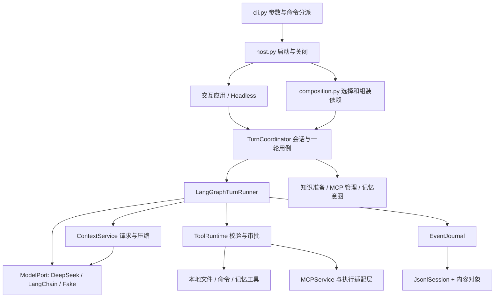

# JDAgent 当前架构

状态：`Implemented`（实现说明）。v0.8 执行路径核对日期为 2026-11-19，改造前基准为 `9d7cbdc`。

JDAgent 是本机 Python CLI。应用层持有会话和用户交互，Runner 调度模型与工具，独立服务处理
上下文、知识、记忆和 MCP。端口隔离模型与存储实现；持久事件记录执行事实，模型消息由这些事实投影而来。
本文描述已有代码；历史方案与 ADR 用于解释取舍，当前实现与文档冲突时以代码为准。

## 入口与依赖

组合根是依赖组装入口，图中的边表示调用或持有关系，并非严格的单向包分层。
当前 Coordinator 直接组装知识 Catalog／Index；图执行器调用知识模块校验与修复引用。
讨论未来拆分时需要从这些真实依赖出发。

| 代码位置 | 当前职责 |
| --- | --- |
| [cli.py](../../src/jdagent/cli.py)、[host.py](../../src/jdagent/host.py) | 参数解析、知识子命令、交互／Headless／维护启动与资源收尾 |
| [composition.py](../../src/jdagent/composition.py) | 选择适配器、创建 Session／记忆／MCP 服务、按轮构造 Runner |
| [application/](../../src/jdagent/application) | 用户输入、审批、会话列表与恢复、MCP 直接 Prompt 等用例 |
| [core/](../../src/jdagent/core)、[runtime/](../../src/jdagent/runtime) | TurnRunner 合同与唯一的 StateGraph 实现 |
| [ports.py](../../src/jdagent/ports.py)、[domain/](../../src/jdagent/domain) | 类型、协议、事件和工具结果合同 |
| [adapters/](../../src/jdagent/adapters) | 模型协议、JSONL、Windows 文件与进程、终端、MCP SDK |
| `context*.py`、`memory*.py`、[maintenance.py](../../src/jdagent/maintenance.py) | 输入预算、原文／摘要、记忆版本、后台整理和费用 |
| [tools/](../../src/jdagent/tools)、`mcp*.py`、[knowledge/](../../src/jdagent/knowledge) | 本地执行、远端 MCP 能力与独立知识库 |

## 一次普通输入怎样运行

1. CLI 解析参数；配置按 CLI、项目、用户、默认值解析，权限另受 DENY 上限限制。
2. 宿主选择交互或单次入口；Coordinator 创建或恢复 Session，取得所有权并检查中断状态。
3. 每轮重读可变配置，保存用户输入，识别直接记忆意图，冻结本轮知识检索结果。
4. ContextService 加入指令、历史、记忆、知识和当前工具定义，计算输入预算，必要时移除
   较少使用的 MCP 定义或压缩历史，并保存请求清单。
5. ModelPort 返回流事件。只有完整且结束原因一致的响应才能进入工具阶段；同批工具逐个执行。
6. ToolRuntime 检查参数、范围、目录规则与权限，记录开始事实，执行 Handler；Runner 保存结果。
7. 有工具结果时回到请求构造；正常文本结束时校验引用，必要时修复一次，保存回答和终态。
8. 回答输出后可开始记忆整理；Headless 先输出再有界等待，资源最终由宿主关闭。

单个模型响应结束不等于任务结束，`completed` 也不表示用户任务经过独立验收。
错误、取消和未知副作用见[运行时](../modules/runtime.md)与[会话](../modules/sessions.md)。

## 图调度与模型接入

组合根直接为当前会话构造 `LangGraphTurnRunner`。DeepSeek 默认使用原生适配器，
也可以用 `model_adapter = "langchain"` 选择 LangChain。Fake 使用脚本适配器。
Provider、端点或模型适配器变更需要重启。模型名、超时和输出上限在下一轮重读。

LangGraph 使用自建 StateGraph，节点调用既有服务，`compile(checkpointer=False)`。
当前没有持久 checkpoint、interrupt、ToolNode 自动执行、副作用节点重试或并行工具调度。
恢复仍由 SessionRecovery 与 JSONL 事件负责；失败不会自动换引擎重跑。

LangChain 的 ChatDeepSeek 被封装在 ModelPort 内，SDK 消息不会成为 Session 格式。
主任务、压缩、引用修复和后台整理共用 PrioritizedModel，前台优先使用模型槽。
详见[模型模块](../modules/models.md)和[ModelPort 合同](model-port.md)。

## 数据分别由谁保存

| 数据 | 持有者与持久化 | 可重新生成的部分 |
| --- | --- | --- |
| 对话与执行事实 | EventJournal → JsonlSession，追加 JSONL 与不可变对象 | UI、Trace、会话列表索引 |
| 请求与压缩 | ContextService、RequestManifest、内容对象和 checkpoint 事件 | 当前消息投影；摘要不覆盖原文 |
| 长期记忆 | MemoryStore 的 SQLite，版本、来源、作业、费用与租约 | 关键词／向量索引 |
| 外部知识 | Catalog 保存身份与生命周期；ContentAddressedStore 保存原文 | 本地或 Milvus 搜索索引 |
| MCP | Session 事件保存发送、结果与任务关联；受控对象保存原文和私有句柄 | 连接、目录、BM25 与定义缓存 |

知识库、历史、记忆与 MCP 各有自己的生命周期。MCP 材料不写入 RAG；自动记忆提取排除 MCP
及其派生材料，独立的用户直接记忆意图仍走原授权路径。请求中的知识引用依赖原 Store，
不能通过归档绕过来源删除。数据目录见[配置参考](../reference/configuration.md#数据位置)。

## 工具、取消与恢复

本地八工具之外还有四个历史／记忆工具，以及 MCP 控制与动态工具。
能力范围同时决定可见定义和可执行范围；ASK 才进入审批，DENY 不能被会话规则放宽。
文件编辑以完整 revision 防止覆盖旧内容；命令通过 Windows Job 管理进程树，输出另存可分页日志。

本地文件或命令已开始但结果未知时，恢复隔离到子会话，不继承许可，不自动重放。
MCP 在发送前持久预留容量，Task 的受控关联保存后才开始轮询，重启后可显式查询原任务。
本地停止等待和远端确认停止是不同事实。详见[工具](../modules/tools.md)、[MCP](../modules/mcp.md)。

## 限制与证据

RAG 的本地管理链与普通对话链尚未完全接通，完整删除恢复与真实配置也有缺口。
代码包含 Milvus Adapter 不等于真实环境验收完成。当前没有通用任务验收器、完整跨平台文件执行层、
多 Agent 或并行远端任务。旧方案中的其他 Provider、持久图恢复或未来检索能力不属于可用功能。

[当前状态](../context/current.md)汇总限制；[验证说明](../modules/verification.md)区分历史测试、当前检查与未验证质量。
架构理由保存在 [ADR](../decisions/README.md) 和[归档](../archive/README.md)。
