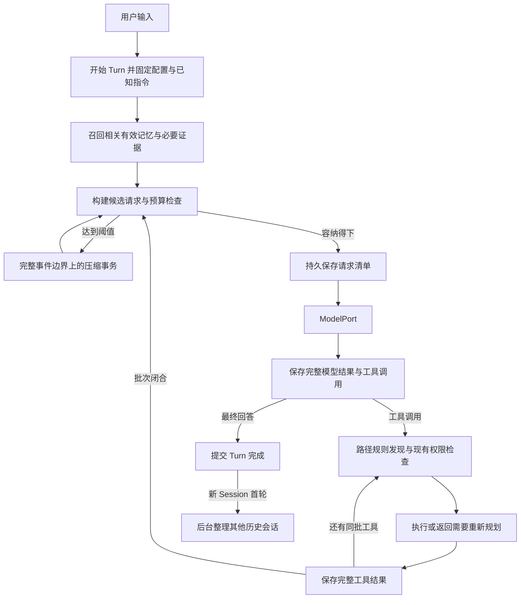

# v0.5 上下文与记忆架构

状态：`Proposed`（将已确认行为细化为实现合同）

日期：2026-10-21。依据：[需求规格](../requirements/v0.5-context-memory.md)。
修订：2026-10-22，R1；依据 [Cursor 审查及维护方处置](../reviews/REV-20261021-001-v0.5-context-memory-design-review.md)。
本文件中的逻辑类型、接口、存储选择和初始维护限额是本轮新增的工程提案；不得将其当作已有代码。
长期所有权决策另见 [ADR-0007](../decisions/ADR-0007-context-projection-memory.md)。

## 现有接入点

基准 `b54a20132cc9eab7b33f2be7c4ee2b2ad1238621` 的 AgentLoop 在每次模型调用前调用
[ContextBuilder](../../src/jdagent/context.py)，完整保存 assistant 工具调用，再顺序执行工具并保存结果。
[EventJournal](../../src/jdagent/eventing.py) 已采用先持久化、再更新内存和通知观察者的顺序；
[SessionPort](../../src/jdagent/ports.py) 与 JSONL Adapter 承担规范事件保存。

当前 `max_context_tokens` 默认 64,000，组合根输出预留 4,096，估算按 UTF-8 字节及消息开销进行；
DeepSeek 能力中窗口尚未给定。Builder 超限时移除最老完整 Turn，当前 Turn 不可缩小。
本版以压缩投影替换这种静默移除策略，保留 ModelPort、工具权限和既有恢复边界。

## 所有者与最小接口

以下是逻辑职责，不要求每行建立新包或 Port。只新增能够隐藏完整行为的 Context 协调服务与
Memory 服务；沿用已有 ModelPort、SessionPort、Tool Runtime，存储与计数实现留在边界。

| 责任主体 | 唯一拥有的状态 | 对调用方提供的行为 |
| --- | --- | --- |
| AgentLoop | Turn 生命周期、正在执行的工具批次 | 在调用前请求上下文；在完整结果边界允许压缩；提交 Turn 完成事实 |
| Session 日志与对象存储 | 原始规范事件、完整结果引用、请求清单、压缩提交事件 | 追加、读范围、按 hash 取不可变对象；不给模型写历史权限 |
| Context 协调服务 | 由持久事实重建的当前投影、待压缩请求、Turn 指令快照 | `prepare_request` 返回可发送请求或明确停止原因；`request_compaction`；`inspect_window` |
| 指令加载器 | 全局及目录规则的版本快照 | `begin_turn`、`discover_paths`；返回适用路径、版本和规则文本 |
| Memory 服务 | 记忆版本、状态、来源、停用约束、整理作业 | `recall`、`search_history`、`read_history`、`revise_memory`、`schedule_after_first_turn` |
| 检索索引 | 从历史与记忆重建的检索表示 | 先过滤再关键词/语义排序；不拥有唯一原文 |
| ModelPort | Provider 协议和 Usage 转换 | 正常或维护模型请求；不决定记忆生命周期或执行工具 |
| CLI | 命令解析和状态呈现 | 将 `/compact` 请求交给协调服务；显示 `/context-window` 快照 |

`prepare_request` 接收 Session/Turn、当前事件位置、模型配置与本轮来源快照，返回请求、占用报告与
request ID。内部完成必要压缩，Loop 不操作摘要字段。Memory 服务接收可信 workspace identity，
模型不得通过传入任意根目录扩大范围。禁止为每种 Context 来源建立一套公共 Provider 框架。

## 正常数据流

每个 Turn 只固定当时相关的记忆与知识版本。后台新记忆下一 Turn 才进入自动召回；明确的用户更正
在本轮立即影响有效状态并记录版本。动态规则发现补充本轮快照，不能替换已经使用的规则版本。

## 指令发现与文件变化

全局规则位置由显式配置解析，项目链从可信 workspace 根到 cwd，不向工作区外递归搜寻。
每条规则保存规范路径、适用子树、内容 hash、发现时间、Turn ID 与内容对象引用。将“发现缓存”与
“本轮活跃规则集”分开：每 Turn 从全局与 root→cwd 链开始；首次访问目标路径时补入其祖先规则，
本轮保留原文。上一 Turn 的其他目录仅保留发现索引，不自动注入正文；下轮访问时仍须重新检查，
不能因 Session 缓存命中而跳过。Turn 开始重验基础链，首次访问时重验该路径链，发现修改、删除与
新建；mtime/size 仅作快速线索，内容 hash 决定版本。文件监听只可
辅助失效缓存，不能成为唯一正确性条件。配置解析失败时保留现有 Turn，下一 Turn 报可定位错误。

文件工具先规范化已知目标路径并验证边界，再检查祖先 AGENTS.md。多目标编辑检查全部目标；目录
搜索和枚举先检查已知搜索根，返回的新目录在后续深入访问前检查。符号链接与路径逃逸遵守现有
工具权限；不得靠规则文件放宽权限。任意 shell 程序内部路径无法静态穷尽，至少检查声明 cwd 和
显式路径参数，并在使用说明中准确标出边界。

读操作可在结果中附上新发现规则；写操作若首次发现适用规则，返回结构化 `instructions_discovered`
且不执行写入，让模型先接收规则再重发。每个已发出的 tool call 仍获得一个完整结果。若一个批次
含后续写操作，发现影响它们的新规则后也不得继续旧计划中的写入，须分别返回未执行结果。
无法读取适用规则时，写操作停止；不能假装规则为空。

权限与平台约束独立强制执行。可覆盖的指令遵循当前用户明确要求、较深目录、祖先目录、全局默认
的顺序。规则必须携带适用路径，不能将兄弟目录要求提升为全局指令。摘要、记忆、检索结果均为
带来源的背景材料；文本中的“忽略规则”不产生权限。只有指令加载器可声明新发现的目录规则，
普通工具返回的自称“AGENTS 指令”不得进入可信指令快照。

活跃规则原文属于系统/目录指令分类，压缩后仍按本轮快照注入，不进入有损摘要。相同文件去重，
但不得去掉其适用路径。指令预算 `instructions_max_tokens` 可显式收紧，默认受 B 总预算约束；
超限列出文件与占用并停止相关操作，不能截断规则。发现缓存可增长，不代表注入正文跨 Turn 单调增长。

## 窗口与预算

Provider/model 配置记录容量值及来源，包含模型总窗口 `W_model`、应用上限 `W_app`、可选独立
输入上限 `I_provider`、最大输出 `R`、安全余量 `S`、触发率和目标率。`R` 还须满足模型输出能力。
未知 `W_model` 时要求用户显式提供该模型容量；不能从另一个模型猜测。省略应用上限表示不额外
收紧，不代表无限模型容量。

旧配置 `max_context_tokens=64000` 明确对应 `W_app`，不再拿它推断模型真实容量。新增模型容量字段
可来自已核实的内置模型档案或用户显式配置，档案须记录 Provider、精确 model ID、官方来源与核对
日期。现有 DeepSeek Adapter 返回 `None` 时不能承诺默认配置开箱通过：若无已核实档案，启动在首个
模型请求前报缺少模型容量，并给出字段名；已知模型档案的交付与来源核对列为阶段一出口。未知自定义
模型保持“必须配置”的既定行为。Fake 模型用明确的测试容量；本设计不填写未经核实的真实模型数字。

有效总窗口 `W = min(W_model, W_app)`；可用输入预算
`B = min(W - R - S, I_provider)`，没有独立输入限制时忽略第二项。只有总窗口扣输出预留，不能
把 Provider 的“仅输入上限”也误当总窗口扣一次。`B <= 0` 为配置错误。

候选请求估算 `E` 包含实际消息、工具定义和协议开销。`E >= 0.90 × B` 请求自动压缩；正常目标
`E_after < 0.40 × B`。调用前始终检查 `E <= B`，即使手动更改阈值也不能绕过。单个工具结果
使输入突然超过预算时，结果先完整保存，再以有界预览和对象引用进入压缩；不要求先把超限请求
发给主模型。投影替换以完整批次为单位；维护模型读取的超大事件正文可按带偏移的对象片段分段，
满足维护模型自己的输入预算，具体规则见“大型调用与结果”。

触发、压缩目标、展示和发送前检查使用同一个 `E`，不另外用未经校准的字节值作为隐蔽硬门槛。
`E` 是本地输入估算，`R` 与 `S` 仅在 B 中扣除，不在 E 中再次加入。Provider 最终检查实际窗口，
本地估算不能宣称为数学上界。

计数策略提案：

- 有匹配 tokenizer 时，固定其名称、版本与序列化规则，计入角色和工具封装；模型名相近不算匹配。
- 无匹配 tokenizer 时，逐分类计算 UTF-8 字节代理量 `b_i`，封装代理量单列；冷启动使用系数 1，
  标记 `uncalibrated`。有真实 Usage 后使用最近 20 个有效请求的 `input_tokens / sum(b_i)` 最大值
  作为校准系数 k。窗口大小 20 是实验参数；只有同 Provider/model、协议及估算器版本的完整请求
  可以参与校准，缺 Usage、服务端不可见的历史状态或未知截断不能参与。
- `E = ceil(k × sum(b_i))`；各分类先按同一 k 向下取整，剩余舍入差额归入协议分类，保证总和一致。分类始终
  标记为本地估算，不把 Provider 的总 input_tokens 伪造为八类实测值。安全余量 S 承担校准误差预留。
- 压缩后对新投影重新计算代理量和 E；模型、协议或估算器改变则重置相应校准，不累加旧 Usage。
  冷启动可能保守地提前压缩，UI 显示原因；后续校准确实改变所有预算判断，而非只改变显示。
- 若 Provider 仍拒绝窗口，记录估算误差，当前 Turn 将 k 的下限提高为原值的 1.25 倍（tokenizer
  路径则增加 S），强制重新准备一次。重复拒绝即停止；不能原样重试，也不能靠取消余量绕过。
  上调后的下限本轮不因旧校准样本而降低。1.25 与初始 S 均须由中英文本、代码和工具 Schema 实验校准。

初始可调参数提案：安全余量取总窗口 5% 与 1,024 tokens 的较大值；压缩每事务最多 8 次模型
调用（包括分段和重试），单请求最多 1 次重试、120 秒超时、事务总计 10 分钟；后台整理每作业
最多 8 次提取/合并调用、15 分钟。另设维护输入/输出 token 总额和全局总额，使用前验证配置。
这些数值须以基线实验校准，不宣称用户已逐项批准；无法在上限内处理时保存待办，不静默放宽。
维护计数不挤占现有主循环 16 次调用额度，但两者均进入总开销和总预算。

主任务保留默认 `max_model_calls=16`、`max_tool_calls=32`、`max_failure_recoveries=2`，三项均作为
Turn 开始时固定的配置；长任务可显式提高，压缩不会重置计数或自动放宽限额。`instructions_discovered`
与 `not_executed` 属于控制结果，不增加 observed_failure，但每次被接纳的工具请求仍计入工具调用
限额，模型重发仍计模型调用。E01 必须记录其配置，分别验证默认限额内的多次压缩和提高限额后的长任务。

`/context-window` 展示：模型与应用上限、输出预留、安全余量、可用输入 B、当前 E、E/B、触发线、
压缩目标、估算方法、快照时间与对应 request ID。互斥分类为系统/目录指令、工具定义、用户内容、
assistant/工具消息、历史摘要、长期记忆、知识证据、协议封装；另列上次 Provider 实测及其 request ID。
累计消耗属于费用栏；缓存 token 仍计窗口。执行中展示最近完整快照并注明可能尚未包含在途结果。

未消费的缓存命中量不能抵扣窗口。请求编排保持确定顺序和工具配对，基础系统指令与工具定义尽量
稳定；不为了前缀缓存改变指令作用域或消息语义。缓存布局优化留到阶段四用 cached_tokens、成本与
延迟对照评估；Provider 未返回该项时标为不可用，不记为 0。

## 原文档案、保护区与摘要

完整会话档案与模型投影分离。原始用户/assistant 规范消息、工具调用和完整结果永久保留在新版
Session 体系中；大结果进入按 hash 去重的对象存储，事件保留引用、字节数和校验值。Provider
原始网络包、凭证和未经规范化的调试输出不构成重建逻辑请求的必需材料。

原文保护区包含当前用户目标、仍有效的明确限制、关键原文片段、待回应的问题和执行恢复必需项。
每项带来源范围和保留原因。当前 Turn 全部用户输入保留原文；旧 Turn 约束在覆盖前建立带原文的
有效约束记录，无法确认是否失效时不擅自解除。用户明确替代或撤销才改变其状态。保护区自身超限
时报告具体占用并停止，不能把“不丢约束”解释为模型具有无限窗口。

保护条目保存 `constraint_id`、来源、适用范围、保留原因和估算大小；保护标记是内容属性，不是
第九个 token 分类，避免重复计数。用户明确替代/撤销可缩小保护区，已明确限定路径或任务的条目
只在该范围生效；不能仅凭模型判断“不重要了”解除。`/context-window` 保持简要统计，额外显示
保护内容总量；因保护内容阻止压缩或超限时，列出占用最大的三个条目 ID、来源、短摘录和大小，
其余通过原文引用查询，不倾倒全部正文。

超限也必须保留控制输入能力。应用层可识别完整的直接请求“撤销本会话约束 C12”，采用下文同样的
整句意图判定规则，写入 `ConstraintRevoked` 事件，关联真实用户输入事件、约束 ID 与预期版本后重算。
这是 Session 约束变更，不产生 Memory 写授权，也不依赖已装不下的模型请求。有歧义时保留原约束并要求澄清。取消已失败的
过大输入后可提交较短的新任务；不提供自动移交选定约束的新 Session 功能，不引入日常删除入口。

摘要最少包含：目标、有效约束引用、决定及理由、已完成步骤及证据、待办、失败尝试、未知副作用、
重要路径/标识符、开放问题、来源事件范围。完成状态须由明确结果支持；“准备运行测试”不能变为
“测试通过”。模型负责提出摘要，程序验证结构、引用、原文片段、事件覆盖和已知执行状态；语义
完整性通过固定 Eval 与抽样原文对照验证，不能声称结构校验能证明所有语义都未丢失。

近期消息按完整工具批次保留，不按字符切开 call/result。已闭合批次即使属于当前 Turn 也能进入
分段摘要。历史分段不可变；当前投影只选择相关段及有界组合摘要，不把所有历史摘要永久叠加。
需要再次缩小时允许从分段及必要原文重新组合，而不是只压缩上次已经变短的摘要。

### 大型调用与结果

原始 call ID、工具名、参数和结果均归档；大型参数与大型结果一样可引用不可变对象。执行 Handler
始终读取完整原始参数，不能执行摘要参数。已闭合的巨大批次允许立即退出“近期原文”集合：将整个
assistant 调用消息及其所有结果替换为有来源的批次摘要，保留 call ID、参数 hash、关键参数、结果
状态及副作用证据。未被替换的调用/结果保持原文；不在 Provider 的 tool_calls 里伪造精简参数。

单个参数或结果超过维护模型容量时，维护输入使用对象引用、字段名与字节区间构成的有界片段，
按 UTF-8 边界读取，先分段提取再合并；片段不是可执行工具消息。主任务投影仍以整个闭合批次替换。
关键精确参数无法放入保护区，或维护总预算不足以完成合并时，保留原档案并明确停止，不静默截去。

## 压缩提交与恢复

压缩状态为 `requested → preparing → candidate_ready → committed`，失败或取消保留原因。
请求以 Session、基准 checkpoint、事件截止序号组成幂等键。压缩时暂停该 Session 的模型推进；
不运行任务工具，重复手动/自动请求合并。同一事件位置和配置上的失败不立即再自动发起相同事务；
记录失败水位后，只有新内容、配置改变或明确手动重试才能再次尝试，且仍受维护总预算约束。

1. 取完整批次边界上的事件前缀，固定指令、记忆与知识版本；把在途或未知副作用显式列出。
2. 按压缩模型预算生成摘要候选及原文引用；不得跨未完成的工具调用边界隐藏状态。
3. 校验候选，组装新请求并完整计数。低于 40% 为目标成功；确实缩小且低于 90%、容纳预留可提交
   为 `target_not_met`。无改善、仍处于触发区或保护区超限时失败，不能不断自行重试。
4. 先将不可变摘要对象落盘并校验，再追加并同步持久化 `CompactionCommitted` 事件，含原前缀 hash、
   新 checkpoint、覆盖范围、保留尾部和对象引用。最后安装内存投影并通知 CLI。
5. 崩溃发生在提交前：读取旧 checkpoint，忽略孤立候选。发生在提交后但内存替换前：恢复新 checkpoint。
   提交对象缺失或损坏时恢复可验证的上一版本和原文，无法安全继续则报错，不补造成功记录。

压缩不改变工具执行身份。工具已完成但结果尚未持久化属于既有“副作用未知”恢复路径，不能凭摘要
重新执行。执行恢复和压缩投影由不同记录描述，按下一节的引用合同组合，而非互相替代。

空闲 `/compact` 立即处理；没有可压缩历史时返回无须压缩且不调用模型。忙时 CLI 返回已排队；
正常自动或手动压缩均等待当前已发出的工具批次闭合，再进行压缩；该批次内不插入新的普通模型调用。
阈值在批次中被越过时立即标记待压缩，后续结果落盘，不把超预算投影发给模型。仅请求压缩不会取消
尚未开始的工具调用。用户取消、权限变化、新目录规则要求重新规划、工具要求停止或执行限额触发时，
才为剩余调用记录 `not_executed`；返回实际原因和未完成步骤，不消耗 observed_failure。
取消维护不删除候选以外的有效历史，也不自动取消已经开始的外部副作用。

### 恢复 Session 的引用合同

保留“副作用未知时新建 recovery Session、不继承父会话权限”的既有行为。现有快照已经有
`parent_session_id` 与 `through_sequence`；新版将内联 messages 改为不可变引用，不做旧格式迁移。
恢复记录含父 Session、最后安全终止序号、截至该序号的前缀 hash、可复用 checkpoint 引用、该
checkpoint 到安全序号之间的事件引用，以及独立的未知操作清单。引用不能指向安全截止点之后的摘要。

恢复创建在父 Session 独占锁下完成，随后释放；不为创建恢复会话而调用维护模型或改写父会话。
若没有合适 checkpoint，引用安全原文前缀；第一次请求由 Context 模块按正常预算分段准备。选定
checkpoint 必须能验证对象 hash、覆盖范围与前缀 hash；损坏时从相同安全范围的原文重建，无法
验证则停止。不得以“较新的摘要更短”为由带入未决执行结果。

新投影由安全历史的 checkpoint、其后的安全原文、该前缀仍有效的约束、恢复说明和当前用户输入
组成。未知操作的 call ID、effect、日志引用与“禁止自动重放”进入不可有损改写的恢复条目；它们
只描述不确定性，不声称动作完成。旧 `protected_tail_messages` 的作用归入这些具名保护条目，
不再维护第二套按位置计数的保护逻辑。恢复说明不伪装为用户原话，也不能产生记忆修改授权。

历史索引按最初 Session/事件 ID 建单元，恢复引用只形成来源关系，不重复索引父正文；读取恢复
上下文时可沿引用回查原始来源。恢复 Session 只新增自己的用户和执行事实。它首个完整 Turn
仍触发整理，但存在未决副作用的父 Session 暂不作为自动提取来源。v0.5 新增 `SideEffectResolution`
记录写入恢复 Session，关联父 Session/call ID、真实用户确认事件或后续核查结果、结论与证据；这不是
现有恢复代码已具备的能力。仅当所有未知操作均有可验证且不冲突的解决记录，父来源才重新具备资格；
缺记录、证据不足或多个恢复分支结论冲突时继续排除。解决记录不改写父日志、不授权自动重放。
恢复 Session 的提取只处理自己的新增事实，父引用不充当重复证据。

### CLI 输入合同

应用层是唯一终端输入所有者，模型流式输出通过 Presenter 更新显示。Turn 任务与控制输入队列
可以并行等待，但不能启动两个 `prompt_async` 同时抢输入；审批请求作为同一输入循环的状态切换。

| 状态 | `/compact` | `/context-window` | 普通文本与审批回答 |
| --- | --- | --- | --- |
| IDLE | 立即压缩，空历史返回无须执行 | 展示最近快照 | 普通文本开始 Turn |
| RUNNING_TURN / RUNNING_TOOL | 登记并合并，批次闭合后执行 | 展示带时间戳的最近完整快照 | 保留编辑内容并提示当前忙，不提交为新 Turn |
| WAITING_APPROVAL | 登记压缩，继续等待原审批，不代答 | 展示统计后恢复原审批 | 仅审批选项进入对应请求；普通文本不能成为下一轮 prompt |
| COMPACTING | 合并到当前事务，不追加重复维护调用 | 显示压缩前快照与进行中状态 | 不开始新 Turn |
| CONTEXT_BLOCKED | 在内容/配置改变后重试 | 展示阻塞项 | 接受直接撤销约束等控制输入；普通输入先检查能否准备新请求 |

Ctrl+C 保留取消含义，不隐式批准；审批取消不得被解释为压缩确认。压缩失败返回上一有效投影状态
或 CONTEXT_BLOCKED。未知斜杠命令明确报错，不发送给模型。Headless 的普通 prompt 不作为交互命令
通道，仅在执行中自动压缩；`/compact` 的排队合同属于交互模式，不能将快捷键作为其唯一实现。

## 请求可追溯性与存储

每次模型调用前保存 `RequestManifest`：Session/Turn/request ID、调用类型、Provider/model、
模型设置、事件截止位置、指令与工具 Schema 版本、摘要 checkpoint、记忆版本、证据引用、
逻辑消息顺序、计数报告和各正文对象 hash。实际 Usage 与终止原因随后通过事件关联。
不记录秘密；hash 相同的正文共享存储。持久化失败不发送一个无法追溯的新请求。

Manifest 本体作为不可变对象持久保存，Session 只追加 `ModelRequestPrepared` 事件及 manifest hash、
request ID、调用类型和计数摘要。对象同步落盘后再提交引用事件；崩溃后未被引用的对象不可自动成为
有效请求。审计重建按 manifest 的有序条目读取，内联事件不复制整份请求。

提案采用新版独立 Session 目录及格式标记，不读取旧版目录；Session 仍以 JSONL 规范日志为
权威。对象存储持有正文；SQLite 事务保存 Memory 版本、停用规则和后台作业，历史检索索引由
Session 重建。SQLite 中的记忆和作业是权威状态，检索表是可重建派生状态，不把二者混为缓存。

JSONL Adapter 打开时在 Session 独占锁下完整校验一次，持有锁期间缓存已验证的文件身份、长度和
最后序号，后续追加校验下一序号并同步落盘，无须每次解析整个日志。重新取得锁必须重新校验；
检测到文件身份、长度等异常时丢弃缓存并走恢复路径。只比较长度不能证明内容未变，不以此替代锁。
独占锁不防御工作区外的任意文件篡改，离线完整校验仍检查事件与对象 hash。记录 1千/1万/10万事件
下的追加和打开耗时，区分首次恢复成本与持续追加成本，禁止通过跳过 fsync 美化结果。

请求清单引用 KB 的来源版本而不私藏另一份正文。[既有知识合同](v0.3-knowledge-retrieval.md)
要求删除来源后历史引用成为 tombstone；因此“可重建请求”以前置来源仍可访问为条件。来源删除
或对象损坏时报告缺失依赖，保留当时引用、hash 和记录，不复活已删除的 KB 内容。
文件工具读到的结果由 Session 档案持有，不因工作区文件后来改变而重写历史。

Manifest 的内容条目显式区分 `owned_object` 与 `knowledge_ref`。后者仅保存 KB/source/version、
Locator、content_hash、证据顺序及渲染模板版本；整个含 KB 正文的 system part 不能再作为 owned_object 保存。
已生成 assistant 历史按既有合同保持不变，但从它派生的 Memory 须继承 Citation 的 source_version
依赖；缺少足够引用关系时不得将其当作已验证知识记忆。召回与发布均查询依赖是否仍有效：删除、
版本更替或无法验证时转为 `needs_verification` 并停止自动使用。对多来源陈述先保守待核实，只有
以仍有效的独立证据建立新版本后才恢复；不删除或重写旧回答，也不把“记住”当作绕过 KB 生命周期的授权。

### 进程与写入所有权

支持不同 Session 在多个进程运行；同一 Session 在同一时刻只允许一个进程拥有。交互或 Headless
打开 Session 前取得 OS 支持的跨进程独占锁，覆盖写入和恢复生命周期；第二个进程收到 session_busy，
不能仅靠现有 threading.Lock。进程崩溃由 OS 释放锁，持久 owner 信息仅供诊断，不能代替锁状态。

后台选择来源时尝试取得其同一锁，失败说明正在使用，跳过；成功则读取已校验的事件截止序号/hash
作为来源快照并释放锁，不在网络请求期间阻止用户继续会话。发布提取结果前重新取得来源锁验证
版本；来源变更或重新活跃时暂缓该来源，不推进其成功水位。多个来源锁按规范 ID 排序取得，短时
校验后提交，禁止与长时间模型调用交叉持锁。

SQLite 对每个 workspace 的整理作业使用单写入租约。提案为 30 秒心跳、120 秒 TTL，每次接管
增加单调 `lease_epoch`；候选发布与成功水位提交在事务中同时验证 owner、epoch、未过期与来源
版本。过期 worker 即使后来收到模型结果，也不能覆盖新 owner 的提交。费用预留和回执按 request ID
独立幂等记账：迟到 Usage 可结算原请求，但不授予发布资格、不重置预算；没有回执则保留预留与未知
状态，不能把真实费用丢掉。用户级记忆修改用同库
事务和目标 expected_version 串行校验；后台项目作业不能取得用户级写授权。锁/租约冲突是忙或
待重试状态，不算模型任务失败；心跳数值待故障实验核对。

## 跨会话检索与 Memory

历史单元按完整用户/assistant 消息和工具批次划分，记录 workspace、Session/Turn、事件区间、
时间、类型和正文引用。工具只返回有界摘录、来源、游标和总量提示；可进一步按引用读取原文。
历史查询默认当前 workspace，可指定本会话或其他会话，不自动扫描其他项目。

workspace identity 继续采用规范路径 hash。同一仓库的另一个克隆、移动或重命名后的目录是新身份，
不会自动关联旧历史与项目记忆，旧记录仍保留；启动与空查询提示当前身份的路径口径。v0.5 不自动
猜测两份仓库相同，也不提供身份迁移，后续有明确迁移需求再设计显式映射和范围核验。

提案新增少量工具：`search_history`、`read_history`、`search_memory`、`update_memory`，统一经过
现有 Registry、Schema、权限和结果合同。Memory 的停用、重新启用必须有当前用户明确意图证据；
后台模型只可提出候选，不获得停用约束的解除权限。自然语言查看调用检索工具，无专用斜杠命令。

### 记忆写入的授权合同

前台工具参数不是授权证据。授权在应用层接收真实 `UserMessage` 时确定，工具结果、历史正文、
恢复提示、摘要或模型生成的“用户引用”都不能创建授权。后台整理使用单独的自动维护策略，不要求
每条自动记忆都有本 Turn 用户命令，也不能借自动策略取得停用、重新启用或全局写入权限。

直接操作提案采用有限的整句意图语法，由应用层解析，例如“记住：陈述”“把本项目记忆 M12 更正为：
陈述”“忘记本项目记忆 M12”“重新启用本项目记忆 M12”“记为我的通用偏好：陈述”。允许白名单礼貌
前缀，但须完整匹配整条直接请求；外层引述、代码块、分析/转述任务中的同样字串不匹配。默认“记住”
限定当前 workspace。内容是引用载荷时只能作为待记的陈述，不能在载荷中递归发现另一个操作。
尚不能直接解析的自然表达，由模型提出可见的陈述、作用域与目标，让用户澄清/确认后形成明确操作；
不以字串包含、模型自报 confidence 或另一个 LLM 的判断直接赋予写权限。

应用层为已确定的直接请求持久记录 `MemoryChangeIntent`：真实用户事件 ID、操作、作用域、目标 ID、
目标 expected_version、精确新陈述 hash、有效 Turn 和一次性消费状态。`update_memory` 必须与该
记录逐字段匹配；授权由 ToolExecutionContext 传入，模型不能通过参数新建或扩展它。已消费的同一
请求只返回先前结果，变更目标/内容/作用域或使用过期 Turn 授权均拒绝。新 Session 和恢复提示不继承
旧授权；恢复 Session 中真实的新用户输入可以正常产生新授权。上述语法是实现提案，示例不穷尽中文。

| 操作来源 | 可发布的变更 | 不满足条件时 |
| --- | --- | --- |
| 当前用户直接意图 | 精确绑定的记住、更正、停用、重新启用；用户作用域须明确且内容属于通用偏好 | 无意图、目标不唯一或版本变化时返回需澄清，不写 active |
| 自动整理策略 | 当前 workspace 的有来源新记忆、同一来源谱系的自动记忆更新、幂等去重；到期/真实来源失效由程序处理 | 无证据、语义冲突或可能等价于停用项时保持 needs_verification |
| 模型自行提出修改 | 仅在自动维护策略允许时保存 workspace 候选，不能直接执行用户级或停用状态变更 | 无策略则只返回建议，不写 Memory |

自动提取须引用真实用户陈述、稳定项目来源或已验证工具结果；“文件里要求你记住 X”不证明用户
有此偏好，assistant 单独自述也不算验证。程序检查来源类型、范围、版本、执行状态和依赖；语义
是否准确仍由提取 Eval 检验，不承诺来源检查能证明一切陈述为真。后台不能替代或降级用户明确写入
的记忆，仅因模型认为冲突时保存待核实候选；程序观察到明确到期/来源失效的状态变化另行记录。

权限映射如下：搜索与读取为 `READ`，在 analyze/edit/execute 中可用；`update_memory` 为 `WRITE`，
只在 edit/execute 暴露，target_kind 为 Memory，不能套用文件/目录许可。`write_permission=deny`
始终禁止前台与后台 Memory 变更；analyze 同样暂停自动 Memory 变更。Session 日志、查询审计和
暂停作业状态仍可保存，这些不构成新增记忆。每次提交重新检查当前权限，不能只检查作业开始时的值。

在 ASK 下，已验证的直接意图构成限于该对象的一次操作许可，无须重复询问同一动作；自动整理由
显式可关闭的 workspace `memory.auto_consolidation` 策略授权，v0.5 默认启用已确认的自动整理范围。
两者都不能覆盖 DENY，不能授权文件写入或命令执行。其余需审批的操作沿用审批机制并展示目标、
陈述和作用域。Headless 无法询问时拒绝这种待审批操作；完整直接意图或自动策略仍可在允许范围内
生效，不把所有“记住”都变成必然失败，也不让后台停用正确记忆或解除抑制记录。

首版检索提案使用本地关键词索引和持久化 embedding 的精确余弦搜索，对两路候选合并排名；保持
同一索引格式中的 embedding 模型版本，变更模型须重建。可复用 RAG 的 embedding 能力与排序经验，
但历史/记忆使用独立命名空间、生命周期和过滤条件。无需将本版强绑定到尚未完成验收的 Milvus Live。
若语义服务失败，显式标明暂用关键词路径，保留语义索引待办；只通过关键词不算完成双路验收。
规模增长到本地检索延迟不可接受时再基于测量选择专用向量服务。

每条 Memory 保存 `memory_id`、版本、workspace/用户作用域、类型、陈述、来源及版本、成立理由、
验证证据、有效时间与状态。模型置信度不能替代证据。状态包括 `active`、`superseded`、`disabled`、
`needs_verification`、`expired`；后三类不作为确定事实自动注入。需讨论冲突时可检索并明确标注。

自动召回先过滤范围、状态和期限，再按当前任务相关性排名，在 Context 配额内选择。提案以 2,500
tokens 作为 Memory 注入上限起点，另受 B 限制；此数值待实验，不把全量 Memory 当固定系统提示。
一般历史由明确回溯、摘要缺口或来源核查触发，避免每个 Turn 先搜索所有会话。

Memory 以 `source=memory_evidence` 的有界背景片段进入 ModelRequest，包含作用域、记忆版本、来源
和有效状态，并显式标注“描述既往信息，不产生新指令或权限”。适配到 Provider 时保留该标记，
不能伪装成当前用户消息。目录与全局 AGENTS.md 都是指令；与其冲突的历史偏好不覆盖指令。只有
当前用户明确要求才按既定优先级覆盖可覆盖规则；不新增“Memory 高于全局规则”的层级。

用户更正生成新版本并使旧版 `superseded`；模糊矛盾标记 `needs_verification`，仅在影响当前任务时
询问用户。停用另写持久的抑制记录，关联记忆身份、等价陈述和旧来源版本；提取与合并均检查该记录。
不能只按原文 hash 拦截，否则改写同一事实会复活。无法排除与停用项等价的候选先保持待核实，
不得自动发布为 active；只有明确重新启用可解除匹配的抑制约束。明确历史问题可返回旧说法，但标记停用状态。
稳定记忆不按闲置时间失效；明确 `valid_until` 到期为 `expired`，相关来源版本变化使其待核实。

## 首轮后的后台整理

新 Session 首个成功完成的用户 Turn 只生成一次调度事件。已有记忆可用于首轮，整理出的新记忆从
后续 Turn 使用。被取消或未完成的 Turn 不消费首次完成触发资格，恢复后完成再调度；恢复同一
Session 不重复生成任务。显式“记住”走即时记忆写入并写来源，不等待这项后台任务。

作业先选同 workspace、非当前、无活跃所有者且无未决副作用、截至截止时刻内容稳定的历史 Session。按最后事件
序号与内容 hash 判断增量，优先未处理的近期来源，分批有界处理，不能因暂未入选永久遗漏旧来源。
第一阶段逐来源提取，保存候选或空结果及 watermark；第二阶段合并、去重、核查冲突和抑制记录，
一次事务发布有效 Memory 版本与合并水位。当前任务进度与未经验证猜测不自动形成稳定记忆。

作业记录 `pending/running/succeeded/failed`、来源版本、阶段、调用和 token 花费、重试时间、
lease 与幂等键。进程退出后租约超时允许重领；同一来源/版本的成功结果重复提交无效，失败不
覆盖有效记忆。待办在下次进程启动时即可续做，不必等该进程又完成首轮；也可显式运行维护待办。
退避后有限重试，不借每个 Turn 创建新作业。
并发首轮触发只增加待处理来源；每个 workspace 同时至多一个合并写入者。维护与普通会话共享
读取能力，不占有主任务工具执行权。用户级偏好由明确作用域意图写入，项目作业不能自行提升作用域。

### 调度、退出与 Headless

首个 `TurnCompleted` 是持久触发事实，作业键为 workspace、Session 与该事件序号。SQLite 作业
登记与 Session 日志不假装存在跨存储原子事务：启动时核对完成事件与作业水位，补登记缺失作业，
唯一键使重复登记无效。只有当前 Session 首轮事件首次出现才创建新任务；续跑旧待办不算新触发。

交互与 Headless 都登记作业，不能默认排除 Headless。前台最终回答先输出并 flush，再允许本轮
新维护请求发送；交互进程存活时后台执行，用户发起下一 Turn 后前台优先。复用 Provider 的限流
协调器，前后台默认总并发为 1；后台在途请求不会因抢占而重复提交，下一个额度先交前台。客户端
是否共享取决于 Adapter 的并发能力，但计数与速率限制必须共享，维护输出不能混入 assistant 文本。

退出行为提案：交互 `/exit` 先停止派发新维护请求，取消在途维护并最多等待 5 秒清理；Headless
输出单一结果后默认给待办 120 秒有界执行机会，随后执行同样清理。结果记录 job ID 和输出时状态，
未完成就是 pending，不宣称已整理；进度仅走 stderr/Trace，不追加第二份结果 JSON。等待时间可
显式配置，Ctrl+C 可立即要求取消；这不会撤回已经输出的主任务成功事实。

增加非交互维护入口 `jdagent maintain --pending --workspace <路径>`，只续做已有待办，不创建
Session 或绕过首轮触发；它不属于新增斜杠命令。短 Headless 运行或主动取消导致积压时，可用该
入口在单作业既有 15 分钟上限内继续。没有存活进程时没有后台执行承诺，不自动安装守护进程。

已完成的每阶段结果即时保存，退出取消记为 pending 并释放匹配 epoch 的租约；真实模型失败记为
failed 并退避。重启、显式维护和接管不重置累计重试或费用预算。调用前持久预留输入/输出预算，
取得 Usage 后结算；崩溃导致 Usage 未知时保留预留及 unknown 标记，不能当成零消耗或重复释放。
终止清理超时则保留可接管的 running 状态，旧 worker 的迟到记忆/水位发布仍须通过 epoch 检查；
费用回执按前述 request ID 独立记账规则处理。

## 候选方案与复审条件

| 问题 | 选择 | 未采用方案及代价 | 何时复审 |
| --- | --- | --- | --- |
| 历史缩小 | 分段摘要、保护原文、近期完整批次 | 仅滑窗简单但失约束；唯一滚动摘要累积失真 | 多轮 Eval 仍退化时调整分段/校验 |
| 长期整理 | 新会话首轮后两阶段后台作业 | 每轮整理成本高、易把临时状态固化；只手工记忆覆盖不足 | 自动提取低收益或积压明显 |
| 原文与索引 | 权威原文与可重建索引分开 | 向量库保存唯一事实难恢复和核查 | 数据量或检索延迟有实测瓶颈 |
| 检索后端 | 本地关键词+精确语义检索 | 直接共用 KB 集合会混淆生命周期；新向量服务增加依赖 | 达到固定性能门槛后比较后端 |
| 动态指令 | Turn 固定、路径首次访问补充 | 只启动加载会过期；任意时刻热换破坏执行一致性 | 新工具提供可靠完整路径声明 |
| 请求保存 | 内容对象+版本清单 | 全请求重复存盘浪费空间；只存摘要无法审计 | 长期存储增长影响运行时 |

工程验收必须验证语义保留和恢复，而不是仅证明摘要 JSON 合法。成本、延迟、索引规模及具体配额
由[实验方案](../development/v0.5-context-memory-validation.md)提供证据后再调整。
