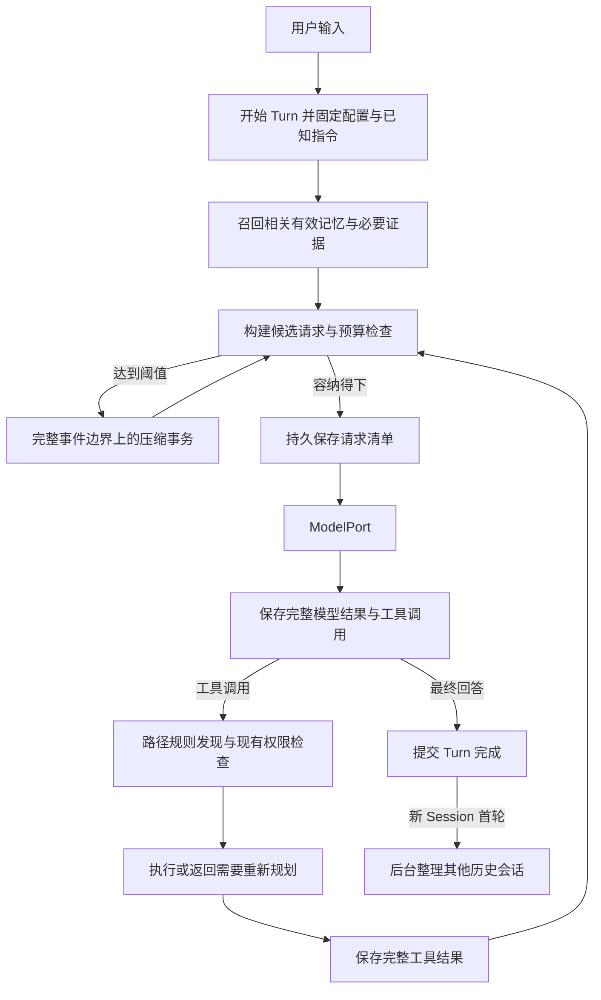

# v0.5 上下文与记忆架构

状态：`Proposed`（将已确认行为细化为实现合同）

日期：2026-10-21。依据：[需求规格](../requirements/v0.5-context-memory.md)。
本文件中的逻辑类型、接口、存储选择和初始维护限额是本轮新增的工程提案；不得将其当作已有代码。
长期所有权决策另见 [ADR-0007](../decisions/ADR-0007-context-projection-memory.md)。

## 现有接入点

基准 `b54a20132cc9eab7b33f2be7c4ee2b2ad1238621` 的 AgentLoop 在每次模型调用前调用
[ContextBuilder](../../src/jdagent/context.py)，完整保存 assistant 工具调用，再顺序执行工具并保存结果。
[EventJournal](../../src/jdagent/eventing.py) 已采用先持久化、再更新内存和通知观察者的顺序；
[SessionPort](../../src/jdagent/ports.py) 与 JSONL Adapter 承担规范事件保存。

当前 `max_context_tokens` 默认 64,000，组合根输出预留 4,096，估算按 UTF-8 字节及消息开销进行；
DeepSeek 能力中窗口尚未给定。Builder 超限时移除最老完整 Turn，当前 Turn 不可缩小。
本版以压缩投影替换这种静默移除策略，保留 ModelPort、工具权限和既有恢复边界。

## 所有者与最小接口

以下是逻辑职责，不要求每行建立新包或 Port。只新增能够隐藏完整行为的 Context 协调服务与
Memory 服务；沿用已有 ModelPort、SessionPort、Tool Runtime，存储与计数实现留在边界。

| 责任主体 | 唯一拥有的状态 | 对调用方提供的行为 |
| --- | --- | --- |
| AgentLoop | Turn 生命周期、正在执行的工具批次 | 在调用前请求上下文；在完整结果边界允许压缩；提交 Turn 完成事实 |
| Session 日志与对象存储 | 原始规范事件、完整结果引用、请求清单、压缩提交事件 | 追加、读范围、按 hash 取不可变对象；不给模型写历史权限 |
| Context 协调服务 | 由持久事实重建的当前投影、待压缩请求、Turn 指令快照 | `prepare_request` 返回可发送请求或明确停止原因；`request_compaction`；`inspect_window` |
| 指令加载器 | 全局及目录规则的版本快照 | `begin_turn`、`discover_paths`；返回适用路径、版本和规则文本 |
| Memory 服务 | 记忆版本、状态、来源、停用约束、整理作业 | `recall`、`search_history`、`read_history`、`revise_memory`、`schedule_after_first_turn` |
| 检索索引 | 从历史与记忆重建的检索表示 | 先过滤再关键词/语义排序；不拥有唯一原文 |
| ModelPort | Provider 协议和 Usage 转换 | 正常或维护模型请求；不决定记忆生命周期或执行工具 |
| CLI | 命令解析和状态呈现 | 将 `/compact` 请求交给协调服务；显示 `/context-window` 快照 |

`prepare_request` 接收 Session/Turn、当前事件位置、模型配置与本轮来源快照，返回请求、占用报告与
request ID。内部完成必要压缩，Loop 不操作摘要字段。Memory 服务接收可信 workspace identity，
模型不得通过传入任意根目录扩大范围。禁止为每种 Context 来源建立一套公共 Provider 框架。

## 正常数据流

每个 Turn 只固定当时相关的记忆与知识版本。后台新记忆下一 Turn 才进入自动召回；明确的用户更正
在本轮立即影响有效状态并记录版本。动态规则发现补充本轮快照，不能替换已经使用的规则版本。

## 指令发现与文件变化

全局规则位置由显式配置解析，项目链从可信 workspace 根到 cwd，不向工作区外递归搜寻。
每条规则保存规范路径、适用子树、内容 hash、发现时间、Turn ID 与内容对象引用。Turn 开始重验
已加载文件，发现修改、删除与新建；mtime/size 仅作快速线索，内容 hash 决定版本。文件监听只可
辅助失效缓存，不能成为唯一正确性条件。配置解析失败时保留现有 Turn，下一 Turn 报可定位错误。

文件工具先规范化已知目标路径并验证边界，再检查祖先 AGENTS.md。多目标编辑检查全部目标；目录
搜索和枚举先检查已知搜索根，返回的新目录在后续深入访问前检查。符号链接与路径逃逸遵守现有
工具权限；不得靠规则文件放宽权限。任意 shell 程序内部路径无法静态穷尽，至少检查声明 cwd 和
显式路径参数，并在使用说明中准确标出边界。

读操作可在结果中附上新发现规则；写操作若首次发现适用规则，返回结构化 `instructions_discovered`
且不执行写入，让模型先接收规则再重发。每个已发出的 tool call 仍获得一个完整结果。若一个批次
含后续写操作，发现影响它们的新规则后也不得继续旧计划中的写入，须分别返回未执行结果。
无法读取适用规则时，写操作停止；不能假装规则为空。

权限与平台约束独立强制执行。可覆盖的指令遵循当前用户明确要求、较深目录、祖先目录、全局默认
的顺序。规则必须携带适用路径，不能将兄弟目录要求提升为全局指令。摘要、记忆、检索结果均为
带来源的背景材料；文本中的“忽略规则”不产生权限。只有指令加载器可声明新发现的目录规则，
普通工具返回的自称“AGENTS 指令”不得进入可信指令快照。

## 窗口与预算

Provider/model 配置记录容量值及来源，包含模型总窗口 `W_model`、应用上限 `W_app`、可选独立
输入上限 `I_provider`、最大输出 `R`、安全余量 `S`、触发率和目标率。`R` 还须满足模型输出能力。
未知 `W_model` 时要求用户显式提供该模型容量；不能从另一个模型猜测。省略应用上限表示不额外
收紧，不代表无限模型容量。

有效总窗口 `W = min(W_model, W_app)`；可用输入预算
`B = min(W - R - S, I_provider)`，没有独立输入限制时忽略第二项。只有总窗口扣输出预留，不能
把 Provider 的“仅输入上限”也误当总窗口扣一次。`B <= 0` 为配置错误。

候选请求估算 `E` 包含实际消息、工具定义和协议开销。`E >= 0.90 × B` 请求自动压缩；正常目标
`E_after < 0.40 × B`。调用前始终检查 `E <= B`，即使手动更改阈值也不能绕过。单个工具结果
使输入突然超过预算时，结果先完整保存，再以有界预览和对象引用进入压缩；不要求先把超限请求
发给主模型。大型压缩源按完整事件/批次切分，并满足压缩模型自己的输入预算。

优先使用与模型协议匹配的 tokenizer。不可用时采用保守估算及该 Provider/model 最近 Usage
校准，标记估算方法；配置和投影改变后重新计算，不能简单累加压缩前 Usage。服务端真实超限
触发一次有界重新准备；不消耗无限重试。连续估算偏低时增大余量并保留校准证据。

初始可调参数提案：安全余量取总窗口 5% 与 1,024 tokens 的较大值；压缩每事务最多 8 次模型
调用（包括分段和重试），单请求最多 1 次重试、120 秒超时、事务总计 10 分钟；后台整理每作业
最多 8 次提取/合并调用、15 分钟。另设维护输入/输出 token 总额和全局总额，使用前验证配置。
这些数值须以基线实验校准，不宣称用户已逐项批准；无法在上限内处理时保存待办，不静默放宽。
维护计数不挤占现有主循环 16 次调用额度，但两者均进入总开销和总预算。

`/context-window` 展示：模型与应用上限、输出预留、安全余量、可用输入 B、当前 E、E/B、触发线、
压缩目标、估算方法、快照时间与对应 request ID。互斥分类为系统/目录指令、工具定义、用户内容、
assistant/工具消息、历史摘要、长期记忆、知识证据、协议封装；另列上次 Provider 实测及其 request ID。
累计消耗属于费用栏；缓存 token 仍计窗口。执行中展示最近完整快照并注明可能尚未包含在途结果。

## 原文档案、保护区与摘要

完整会话档案与模型投影分离。原始用户/assistant 规范消息、工具调用和完整结果永久保留在新版
Session 体系中；大结果进入按 hash 去重的对象存储，事件保留引用、字节数和校验值。Provider
原始网络包、凭证和未经规范化的调试输出不构成重建逻辑请求的必需材料。

原文保护区包含当前用户目标、仍有效的明确限制、关键原文片段、待回应的问题和执行恢复必需项。
每项带来源范围和保留原因。当前 Turn 全部用户输入保留原文；旧 Turn 约束在覆盖前建立带原文的
有效约束记录，无法确认是否失效时不擅自解除。用户明确替代或撤销才改变其状态。保护区自身超限
时报告具体占用并停止，不能把“不丢约束”解释为模型具有无限窗口。

摘要最少包含：目标、有效约束引用、决定及理由、已完成步骤及证据、待办、失败尝试、未知副作用、
重要路径/标识符、开放问题、来源事件范围。完成状态须由明确结果支持；“准备运行测试”不能变为
“测试通过”。模型负责提出摘要，程序验证结构、引用、原文片段、事件覆盖和已知执行状态；语义
完整性通过固定 Eval 与抽样原文对照验证，不能声称结构校验能证明所有语义都未丢失。

近期消息按完整工具批次保留，不按字符切开 call/result。已闭合批次即使属于当前 Turn 也能进入
分段摘要。历史分段不可变；当前投影只选择相关段及有界组合摘要，不把所有历史摘要永久叠加。
需要再次缩小时允许从分段及必要原文重新组合，而不是只压缩上次已经变短的摘要。

## 压缩提交与恢复

压缩状态为 `requested → preparing → candidate_ready → committed`，失败或取消保留原因。
请求以 Session、基准 checkpoint、事件截止序号组成幂等键。压缩时暂停该 Session 的模型推进；
不运行任务工具，重复手动/自动请求合并。同一事件位置和配置上的失败不立即再自动发起相同事务；
记录失败水位后，只有新内容、配置改变或明确手动重试才能再次尝试，且仍受维护总预算约束。

1. 取完整批次边界上的事件前缀，固定指令、记忆与知识版本；把在途或未知副作用显式列出。
2. 按压缩模型预算生成摘要候选及原文引用；不得跨未完成的工具调用边界隐藏状态。
3. 校验候选，组装新请求并完整计数。达到 40% 为目标成功；确实缩小且低于 90%、容纳预留可提交
   为 `target_not_met`。无改善、仍处于触发区或保护区超限时失败，不能不断自行重试。
4. 先将不可变摘要对象落盘并校验，再追加并同步持久化 `CompactionCommitted` 事件，含原前缀 hash、
   新 checkpoint、覆盖范围、保留尾部和对象引用。最后安装内存投影并通知 CLI。
5. 崩溃发生在提交前：读取旧 checkpoint，忽略孤立候选。发生在提交后但内存替换前：恢复新 checkpoint。
   提交对象缺失或损坏时恢复可验证的上一版本和原文，无法安全继续则报错，不补造成功记录。

压缩不改变工具执行身份。工具已完成但结果尚未持久化属于既有“副作用未知”恢复路径，不能凭摘要
重新执行。恢复快照解决执行不确定性；压缩 checkpoint 解决模型看到哪些历史，两者不可混用。

空闲 `/compact` 立即处理；没有可压缩历史时返回无须压缩且不调用模型。忙时 CLI 返回已排队；
完成当前已启动工作的最低必要收尾，记录同批未执行项后压缩，再进行下一次普通模型调用。
取消维护不删除候选以外的有效历史，也不自动取消已经开始的外部副作用。

## 请求可追溯性与存储

每次模型调用前保存 `RequestManifest`：Session/Turn/request ID、调用类型、Provider/model、
模型设置、事件截止位置、指令与工具 Schema 版本、摘要 checkpoint、记忆版本、证据引用、
逻辑消息顺序、计数报告和各正文对象 hash。实际 Usage 与终止原因随后通过事件关联。
不记录秘密；hash 相同的正文共享存储。持久化失败不发送一个无法追溯的新请求。

提案采用新版独立 Session 目录及格式标记，不读取旧版目录；Session 仍以 JSONL 规范日志为
权威。对象存储持有正文；SQLite 事务保存 Memory 版本、停用规则和后台作业，历史检索索引由
Session 重建。SQLite 中的记忆和作业是权威状态，检索表是可重建派生状态，不把二者混为缓存。

请求清单引用 KB 的来源版本而不私藏另一份正文。[既有知识合同](v0.3-knowledge-retrieval.md)
要求删除来源后历史引用成为 tombstone；因此“可重建请求”以前置来源仍可访问为条件。来源删除
或对象损坏时报告缺失依赖，保留当时引用、hash 和记录，不复活已删除的 KB 内容。
文件工具读到的结果由 Session 档案持有，不因工作区文件后来改变而重写历史。

## 跨会话检索与 Memory

历史单元按完整用户/assistant 消息和工具批次划分，记录 workspace、Session/Turn、事件区间、
时间、类型和正文引用。工具只返回有界摘录、来源、游标和总量提示；可进一步按引用读取原文。
历史查询默认当前 workspace，可指定本会话或其他会话，不自动扫描其他项目。

提案新增少量工具：`search_history`、`read_history`、`search_memory`、`update_memory`，统一经过
现有 Registry、Schema、权限和结果合同。Memory 的停用、重新启用必须有当前用户明确意图证据；
后台模型只可提出候选，不获得停用约束的解除权限。自然语言查看调用检索工具，无专用斜杠命令。

首版检索提案使用本地关键词索引和持久化 embedding 的精确余弦搜索，对两路候选合并排名；保持
同一索引格式中的 embedding 模型版本，变更模型须重建。可复用 RAG 的 embedding 能力与排序经验，
但历史/记忆使用独立命名空间、生命周期和过滤条件。无需将本版强绑定到尚未完成验收的 Milvus Live。
若语义服务失败，显式标明暂用关键词路径，保留语义索引待办；只通过关键词不算完成双路验收。
规模增长到本地检索延迟不可接受时再基于测量选择专用向量服务。

每条 Memory 保存 `memory_id`、版本、workspace/用户作用域、类型、陈述、来源及版本、成立理由、
验证证据、有效时间与状态。模型置信度不能替代证据。状态包括 `active`、`superseded`、`disabled`、
`needs_verification`、`expired`；后三类不作为确定事实自动注入。需讨论冲突时可检索并明确标注。

自动召回先过滤范围、状态和期限，再按当前任务相关性排名，在 Context 配额内选择。提案以 2,500
tokens 作为 Memory 注入上限起点，另受 B 限制；此数值待实验，不把全量 Memory 当固定系统提示。
一般历史由明确回溯、摘要缺口或来源核查触发，避免每个 Turn 先搜索所有会话。

用户更正生成新版本并使旧版 `superseded`；模糊矛盾标记 `needs_verification`，仅在影响当前任务时
询问用户。停用另写持久的抑制记录，关联记忆身份、等价陈述和旧来源版本；提取与合并均检查该记录。
不能只按原文 hash 拦截，否则改写同一事实会复活。无法排除与停用项等价的候选先保持待核实，
不得自动发布为 active；只有明确重新启用可解除匹配的抑制约束。明确历史问题可返回旧说法，但标记停用状态。
稳定记忆不按闲置时间失效；明确 `valid_until` 到期为 `expired`，相关来源版本变化使其待核实。

## 首轮后的后台整理

新 Session 首个成功完成的用户 Turn 只生成一次调度事件。已有记忆可用于首轮，整理出的新记忆从
后续 Turn 使用。被取消或未完成的 Turn 不消费首次完成触发资格，恢复后完成再调度；恢复同一
Session 不重复生成任务。显式“记住”走即时记忆写入并写来源，不等待这项后台任务。

作业先选同 workspace、非当前、无活跃租约、截至截止时刻内容稳定的历史 Session。按最后事件
序号与内容 hash 判断增量，优先未处理的近期来源，分批有界处理，不能因暂未入选永久遗漏旧来源。
第一阶段逐来源提取，保存候选或空结果及 watermark；第二阶段合并、去重、核查冲突和抑制记录，
一次事务发布有效 Memory 版本与合并水位。当前任务进度与未经验证猜测不自动形成稳定记忆。

作业记录 `pending/running/succeeded/failed`、来源版本、阶段、调用和 token 花费、重试时间、
lease 与幂等键。进程退出后租约超时允许重领；同一来源/版本的成功结果重复提交无效，失败不
覆盖有效记忆。待办在下次启动或显式恢复维护时续做，退避后有限重试，不借每个 Turn 创建新作业。
并发首轮触发只增加待处理来源；每个 workspace 同时至多一个合并写入者。维护与普通会话共享
读取能力，不占有主任务工具执行权。用户级偏好由明确作用域意图写入，项目作业不能自行提升作用域。

## 候选方案与复审条件

| 问题 | 选择 | 未采用方案及代价 | 何时复审 |
| --- | --- | --- | --- |
| 历史缩小 | 分段摘要、保护原文、近期完整批次 | 仅滑窗简单但失约束；唯一滚动摘要累积失真 | 多轮 Eval 仍退化时调整分段/校验 |
| 长期整理 | 新会话首轮后两阶段后台作业 | 每轮整理成本高、易把临时状态固化；只手工记忆覆盖不足 | 自动提取低收益或积压明显 |
| 原文与索引 | 权威原文与可重建索引分开 | 向量库保存唯一事实难恢复和核查 | 数据量或检索延迟有实测瓶颈 |
| 检索后端 | 本地关键词+精确语义检索 | 直接共用 KB 集合会混淆生命周期；新向量服务增加依赖 | 达到固定性能门槛后比较后端 |
| 动态指令 | Turn 固定、路径首次访问补充 | 只启动加载会过期；任意时刻热换破坏执行一致性 | 新工具提供可靠完整路径声明 |
| 请求保存 | 内容对象+版本清单 | 全请求重复存盘浪费空间；只存摘要无法审计 | 长期存储增长影响运行时 |

工程验收必须验证语义保留和恢复，而不是仅证明摘要 JSON 合法。成本、延迟、索引规模及具体配额
由[实验方案](../development/v0.5-context-memory-validation.md)提供证据后再调整。
