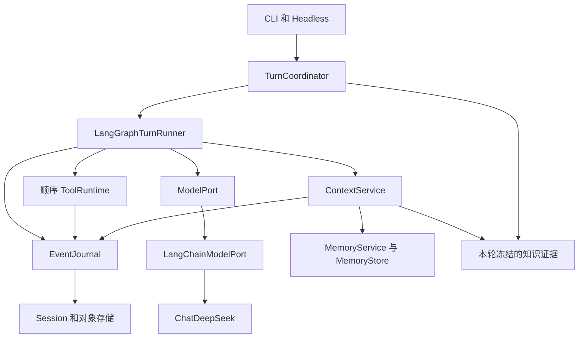
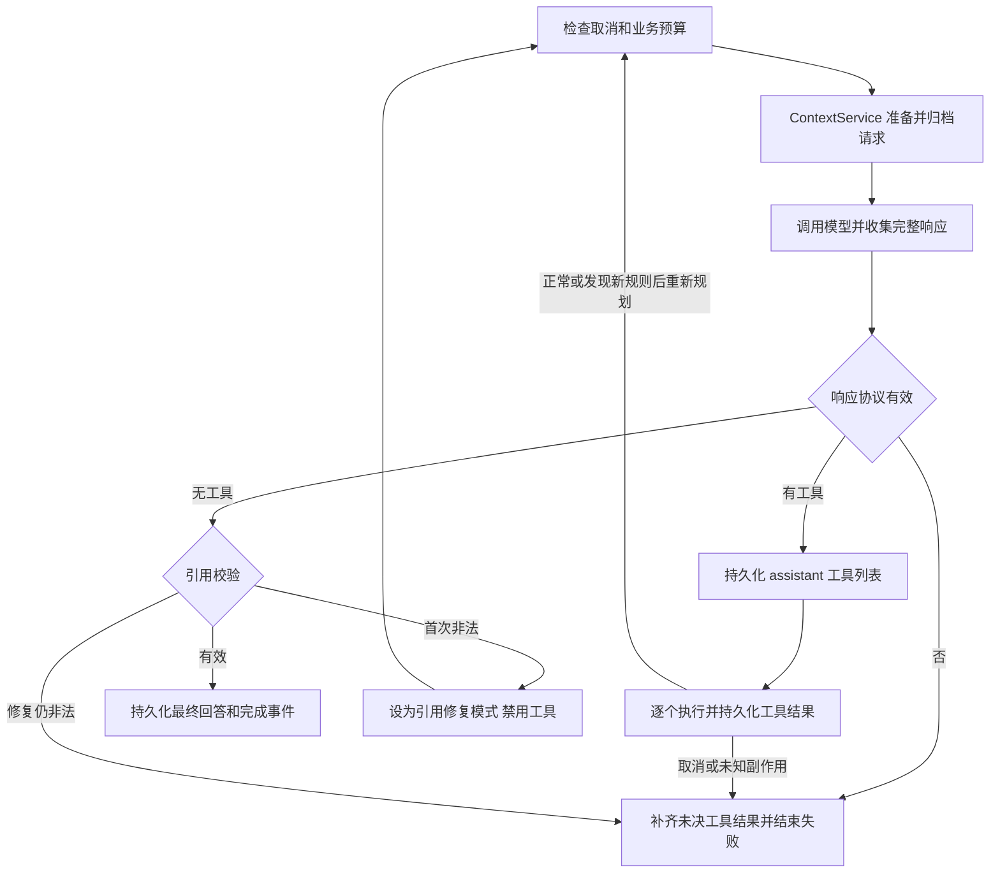

# v0.6 LangChain 与 LangGraph 重构设计

状态：`Approved`（2026-11-05 所有者选择本方案并明确要求分步骤实现）。

初稿日期：2026-10-29；R1 修订日期：2026-11-05。
代码基准：`6996e764537c12f27e85a060011ace32d359a5db`。
本文合并记录本版本的需求、架构、迁移计划和验收标准。R1 按五项本地自审意见修订；R1 文档阶段
没有产品实现授权。随后所有者明确要求按自建 StateGraph 等方案分步骤实现，实施进度与实际证据见
[v0.6 实施记录](../plans/v0.6-implementation.md)。旧版本验收缺口和人工学习出口不因此关闭。
关联：[框架资料](../research/v0.6-langchain-langgraph.md)、
[ADR-0008](../decisions/ADR-0008-langchain-langgraph-boundaries.md)、
[学习清单](../learning/v0.6-langchain-langgraph-learning-checklist.md)、
[R1 自审处置与验证](../reviews/REV-20261105-001-v0.6-design-disposition.md)。

## 设计结论

建议用 **LangGraph 自建 StateGraph 接管主循环的流程编排，用 LangChain 的模型组件接管
Provider 接入**。JDAgent 继续拥有上下文策略、工具权限、执行事实、记忆版本和恢复规则。

用户可观察的核心结果是：现有 CLI 任务改由新的执行引擎完成，仍能流式回答、顺序使用工具、
压缩上下文、查询和维护记忆，并在失败或取消时保留可信的执行记录。框架替换不改变这些行为。
工程收益是把主循环的分支变成可检查的图，并将手写模型协议处理交给成熟集成包；是否减少维护成本
仍需通过差分测试、变更范围和实际依赖复杂度判断，不预先承诺质量、速度或费用改善。

首版不启用 LangGraph 持久 checkpointer，也不将现有 MemoryStore 换成 LangGraph Store。
图负责“接下来执行什么”，Session 事件负责“实际上发生了什么”。进程重启后沿用现有恢复流程，
不自动重跑中断的图节点。图的检查点和 v0.5 已提交的上下文压缩检查点是两种不同对象。

## 目标和范围

| 编号 | 要达到的结果 | 验收入口 |
| --- | --- | --- |
| R06-01 | 用图节点和条件边取代主 Agent 的 while 调度，覆盖正常、工具、引用修复与失败路径 | A01、A03、A09 |
| R06-02 | LangChainModelPort 能替代现有 DeepSeek Adapter，调用方继续使用项目 ModelPort | A02、A07、A10 |
| R06-03 | v0.4 工具、权限、取消和 v0.5 上下文／记忆合同不因框架改变 | A03–A08 |
| R06-04 | v0.5 正常会话可继续使用；中断和未知副作用仍按现有规则恢复 | A05、A11 |
| R06-05 | 能独立比较和切换模型适配器、执行引擎，明确定位回归并安全回退 | A01、A11、A12 |
| R06-06 | 完成框架边界、失败机制和替代方案的学习与证据交付 | 学习清单、阶段 P4 |

本版不增加多 Agent、Planner/Executor、MCP、Web UI、远程审批、分布式执行或新的模型 Provider。
不以图改造替代 RAG 工程收尾；不重做知识来源生命周期、文件／命令实现或长期记忆策略。
Embedding、文档切分和记忆子图的适用性会说明，但不纳入 v0.6 必做范围。

## 当前代码为什么适合渐进改造

当前入口是 `TurnCoordinator.send()`，随后由 `ConfiguredLoopFactory.create()` 为每个 Turn
建立 Context、ToolRuntime 和 AgentLoop。`AgentLoop.run()` 同时处理模型流、协议检查、计数、
工具批次、引用修复及结束事件。已有端口使模型和工具实现可以独立替换，但控制流程集中在一个函数。
代码见 [Coordinator](../../src/jdagent/application/coordinator.py)、
[组合根](../../src/jdagent/composition.py)、[Loop](../../src/jdagent/core/loop.py)。

现有模型适配器自行构造 HTTP 请求、解析 SSE 和合并工具参数；这个部分适合交给 LangChain 的
Provider 集成。与此同时，模型响应仍须转换为 JDAgent 的事件并满足自身协议合同，不能删除
ModelPort 后让 SDK 类型进入上下文、工具或 Session。[模型类型](../../src/jdagent/domain/model.py)
与 [ModelPort](../../src/jdagent/ports.py) 是保留的边界。

v0.5 已有请求归档、压缩检查点、保护区、费用预留、记忆意图、版本和后台租约。
这些机制的用途比通用聊天历史更具体。把它们全部换成框架 memory 会扩大迁移范围，并失去现有
测试依据。现状见[上下文](../modules/context.md)、[记忆](../modules/memory.md)、
[会话](../modules/sessions.md)。

## 候选方案

| 方案 | 收益 | 代价与限制 | 判断 |
| --- | --- | --- | --- |
| A 仅接入 LangChain，保留 AgentLoop | 模型替换范围小，容易独立验证 | 主循环复杂度和控制结构保持原状，没有使用 LangGraph 编排 | 作为迁移中间态 |
| B 自建 StateGraph，加 LangChainModelPort | 显式表达现有分支，复用业务服务，框架类型限制在边界内 | 仍需维护节点、事件转换及业务不变量；暂不使用图持久恢复 | **推荐用于 v0.6** |
| C 使用 create_agent、middleware、ToolNode 和框架持久化整体接管 | 快速获得标准 Agent 循环及配套扩展机制 | 要重写消息、工具、审批、恢复和费用衔接，容易形成两个事实来源 | 当前不选；新建独立简单 Agent 时可重新比较 |

`create_agent` 本身就构造 Agent 图；在它外面再套一个保留完整循环的 AgentLoop，只会形成双层调度。
LangGraph 支持自建流程，也不要求先使用 LangChain Agent 工厂。
[官方框架定位](https://docs.langchain.com/oss/python/langgraph/overview)、
[create_agent API](https://reference.langchain.com/python/langchain/agents/create_agent)

## 模块采用方式

| 当前模块 | v0.6 采用方式 | 保留的职责 |
| --- | --- | --- |
| AgentLoop | 用 LangGraphTurnRunner 实现同一个 run 用例；控制循环改成条件边 | 停止原因、调用预算、事件顺序和执行结果合同 |
| DeepSeekModelPort | 新增 LangChainModelPort，首个后端为 ChatDeepSeek；迁移期保留原 Adapter | Provider 配置、能力声明、错误分类和项目 ModelEvent |
| ContextService／ContextBuilder | 作为图节点调用的普通服务 | 请求构造、指令快照、90% 触发／40% 目标、保护区和归档 |
| ToolRegistry／ToolRuntime | 工具 schema 传给模型；图内按原顺序调用完整 ToolRuntime | 参数校验、preflight、审批、revision、进程清理及副作用判断 |
| Session／EventJournal／Recovery | 继续作为事实和恢复入口 | 锁、追加保存、工具配对、父会话快照与 unknown 隔离 |
| MemoryService／MemoryStore | 保留；提取和压缩模型调用通过新的 ModelPort 受益 | 意图、scope、版本、停用、来源失效和费用 |
| MemoryMaintenance | 保留当前两阶段作业及租约，暂不图化 | 作业登记、已完成阶段复用、前台优先、退出 drain |
| Knowledge／Milvus | 保留现有入口和引用链 | Catalog、Source Store、Binding、冻结 Revision、Evidence、Citation |
| CLI／Presenter／Trace | 继续调用 Coordinator、消费项目事件 | 用户命令、单一输入所有者、审批展示、JSON v2 |

LangChain 的 Embeddings 接口适合未来接入更多向量服务，但现有 EmbeddingPort 的 profile、
维度、归一化和版本仍须保留。通用 retriever 或 `langchain-milvus` 不能直接接管知识生命周期。
通用文本切分器也只有在保留 Parent/Child、Locator 和来源版本合同后才适合使用；更换切分会影响
索引 Generation 与 Recall，应作为独立检索改造验证。当前没有第二个真实接入需求，因此不预建
这些适配器。[知识模块及既有缺口](../modules/knowledge.md)

## 目标架构



图引擎和 LangChain 类型只出现在各自实现内部。Coordinator 不返回 LangGraph StateSnapshot，
领域类型不包含 BaseMessage，Session 不保存 SDK 序列化对象。两个框架边界通过现有领域类型连接。

### 最小接口调整

当前 `AgentLoopFactory.create()` 直接标注返回 `AgentLoop`。迁移时改为返回项目内部
`TurnRunner` 协议，唯一执行方法沿用当前语义：

```python
async def run(
    turn_id: str,
    tool_context: ToolExecutionContext,
    *,
    cancellation: CancellationToken | None = None,
    knowledge: PreparedTurnKnowledge | None = None,
) -> TurnResult: ...
```

`TurnResult`、`LoopLimits`、`CancellationToken` 和 `ModelEventObserver` 从具体 Loop 实现中移到
不依赖框架的共享模块；迁移期可从原位置重导出，减少无关调用方变化。原生 Loop 和 Graph Runner
确实是两个用于差分验证的实现，所以这个接口有实际用途，不再为每个节点创建 Port。

建议新增 `runtime/langgraph_runner.py` 与 `adapters/langchain_model.py`，共享合同放入
`core/contracts.py`；这些是待实现路径。节点函数可以先保持在同一实现文件内。只有内部复杂度
确实妨碍理解时才拆文件，不能把旧 while 整段塞进一个 `agent` 节点并声称完成图化。

### 图状态和生命周期

每次 `run()` 创建新的执行状态和会话绑定依赖。允许复用无状态图拓扑，但不能在单例节点对象上
保存当前 Session、ContextService 或工具权限。Journal、模型客户端、锁和服务对象通过运行依赖
传入，不作为业务历史复制到图 state。

| 图内内容 | 含义和限制 |
| --- | --- |
| session_id、turn_id | 本次调用身份，不是持久图恢复游标 |
| model_calls、tool_calls、observed_failures | 本 Turn 的业务计数；tool_calls 含新目录规则触发的剩余调用补齐，不等于实际进入 execute 的次数 |
| seen_call_ids | Turn 开始时从 Journal 初始化、当前 Turn 按发起时点更新的 ID 集合；只用于本次运行，不成为新历史存储 |
| call_kind、repair_attempted、context_retried | 普通请求／引用修复分支及一次性机会 |
| 当前 ModelRequest、候选响应、pending_calls | 本轮临时数据，持久事实只在 Journal／对象存储中 |
| turn_text_parts | 本 Turn 按原 Loop 加入时点累计的完整响应，包含工具前说明；成功和失败都用于构造 TurnResult.assistant_text |
| result、failure | 返回值及失败分支；不能在 Journal 写入成功前声明完成 |

`turn_text_parts` 保持原 `text_parts.append(text)` 与错误检查的先后关系，不只保留最后一次回答。
它不收集尚未完整结束的流式增量，也不把未通过引用校验的候选加入结果；终端已显示的临时文字
与最终返回值继续分开判断。累计范围只限当前 Turn，不复制整个 Session 历史。

不用 `MessagesState` 或 `add_messages` 再维护一份无限增长的历史。每次模型请求仍从最新事件构造。
节点顺序执行，因此无需为历史设置追加 reducer；工作流不会因使用 StateGraph 自动并行化工具。

### 工具调用 ID 的检查范围

Adapter 验证单次响应中的 ID 完整性和重复；Runner 负责与 Session 历史及当前 Turn 的已见 ID
比较。`seen_call_ids` 在 `run()` 开始时，从 Journal 中所有已保存的 assistant 工具列表初始化一次。
每次完整候选响应都先检查批内重复和已见 ID，失败时不保存新的 assistant 工具列表、不执行工具；
候选文本的累计时点仍遵循前述 `turn_text_parts` 合同。

当前 Turn 中，只有通过取消与工具限额检查、即将记录 `ToolCallRequested` 的调用才加入集合。
批次因新目录规则被跳过的后续调用不在此时加入；它们已保存在 Journal 中，下一 Turn 初始化时
会被读入。因此不能在每次模型响应前重新扫描 Journal，或在保存 assistant 时把整批 ID 加入集合。
这是对[当前 Loop](../../src/jdagent/core/loop.py)的等价迁移；若要改成统一的严格会话唯一规则，
须单列行为纠偏及验收，不能借框架替换静默改变。

ID 验收场景使用足够的模型／工具额度：重复上一 Turn 或本 Turn 已发起的 ID，应在执行前协议失败；
本 Turn 因目录规则跳过的 ID 再次出现，先通过 ID 检查，再按正常权限和限额处理；到了下一 Turn，
该 ID 已进入初始化集合，重复时应拒绝。不能让调用限额先触发而掩盖 ID 检查的结果。

## 主流程和失败行为



图中未画出的异常边统一进入失败收尾；持久化本身失败时保留现场并向应用层报告 Session 错误，
不能假装失败事件已经保存。Coordinator 仍在入图前处理 Session 所有权、用户事件、宿主记忆意图
和本轮知识准备；成功回合后的记忆作业登记仍在现有应用流程中。

节点承担以下完整动作，而非只给原函数改名：

1. **检查与请求准备**：检查取消和模型次数；调用 ContextService 完成压缩、预算和 RequestManifest。
   先保存材料、预留费用、记录 `model_request_prepared`，再允许进入模型节点。节点不额外做第二次预留。
2. **模型调用**：消费完整流、记录 Usage，保留临时文本和工具调用。缺结束证据、重复调用 ID、参数损坏
   或结束原因不匹配时，不进入工具执行。仅普通请求在没有文本和调用时允许现有一次 context-length
   调整重试；每次真正发送仍计数、归档和计费。
3. **工具批次**：先持久化 assistant 的完整调用列表，再逐项记录请求、调用 ToolRuntime、保存结果。
   遇到新目录规则按原合同补剩余 `not_executed` 并重新规划；普通压缩等待整个批次闭合。
4. **引用修复**：复用请求和模型传输能力，但使用独立调用策略。修复最多一次，禁工具，不向普通文本
   observer 输出修复流，不做普通请求的 context-length 重试，并继续检查取消和预算。
5. **成功与失败收尾**：只有最终引用校验成功才持久化最终 assistant 和 `turn_completed`。
   失败时先补工具配对，再写 `turn_failed`；取消仍等待工具拥有的进程和磁盘事务清理。

`tool_calls` 保留当前业务口径：`ToolRuntime.execute` 正常返回一个结果后加一；若该结果为
`INSTRUCTIONS_DISCOVERED`，还要加上本批剩余调用数，再补齐 `not_executed` 并重新规划。
其他失败收尾补齐工具结果时，不据此统一增加计数。工具调用抛出取消、尚未返回结果时，也不提前加一。
限额判断、终态事件和 TurnResult 使用这一业务计数；测试可另行统计进入 `execute` 的次数和实际
文件／命令效果，不能用它们替换业务计数或增加第二份持久账本。

例如限额为 2 的两项批次，第一项发现目录规则后，业务计数为 2，进入 `execute` 的次数为 1，
两项写入均未发生。重新规划后仍可生成最终文本，但下一项工具必须被限额检查阻止。A03/A04
必须固定这一场景；若要调整旧计数，应另列行为修改。

普通模型的候选文本当前可以流式显示；原非法回答及修复候选不会因此成为已保存的 assistant。
现有修复请求只追加修复指令，不把原非法回答重新写入请求或历史，图化时保持这个差异。

当前修复分支与普通调用还有两处协议处理差异：重复 `ResponseCompleted` 未被同样拒绝；
`length` 在修复分支归为无效响应，在普通调用归为限额停止。v0.6 等价迁移先保持并加入特征用例，
统一错误语义应另列纠偏，不能在抽取公共 helper 时悄悄修改。

### 图引擎的附加限制

- 不为模型、工具或 Journal 节点配置自动 RetryPolicy、缓存或回放。业务允许的重试由明确分支处理。
- 保留默认 16 次模型、32 次工具、2 次 observed failure 恢复的现有配置语义。LangGraph 的
  `recursion_limit` 统计图执行步数，不能替代上述计数；按当前拓扑最长合法路径计算并验证上限，
  防止框架默认值提前截断合法 Turn，也防止无限条件循环。
- 图步数异常、节点异常和取消由 Runner 的单一收尾路径处理；已有终态时不能再追加第二个终态。
  应验证异常恰好发生在“事件落盘之后、节点返回之前”的情况。
- 审批继续由 `ApprovalPort` 在当前进程等待，保留现有终端输入和 Headless 行为。不采用 `interrupt()`。
  这是维持当前产品合同的选择，不能宣称已有跨进程恢复审批能力。

## LangChain 模型适配

首个实现使用 `langchain_core` 的模型／消息类型和 `langchain_deepseek.ChatDeepSeek`。
项目依赖按实际使用选择 `langgraph`、`langchain-core`、`langchain-deepseek`，不为了包名再引入
未使用的顶层 `langchain`、`langchain-classic` 或 community 工具集。
[组件与版本依据](../research/v0.6-langchain-langgraph.md)

| 转换位置 | 必须保持的行为 |
| --- | --- |
| ModelRequest → 消息 | 系统材料和消息顺序不变，工具结果保留 tool_call_id；不自动添加框架系统提示词 |
| 工具定义 → bind_tools 输入 | 从当前 ToolRegistry 投影 JSON schema；不把底层 Handler 注册成另一条可执行路径 |
| Provider 配置 | 保留 model、base_url、timeout、输出上限、thinking disabled 及允许的命名空间选项；不静默换端点或启用 reasoning |
| 流式工具参数 | 只在完整聚合且校验后发出 ToolCallCompleted；检查 invalid_tool_calls、单次响应内缺失／重复 ID 和坏 JSON；历史 ID 由 Runner 检查 |
| 结束与 Usage | 流结束不推断为 stop；消费末尾独立 Usage，合并后按请求结算一次，不重复累加累计值 |
| 异常与取消 | 转成现有 ModelFailed 类别，清理流和客户端；不把取消吞成可重试错误 |
| 结构化维护请求 | 保留现有 JSON mode 与项目 schema／来源校验；不能默认变成 function_calling 或新增内部修复调用 |

`with_structured_output` 不是首版必用接口。当前维护请求已有输出格式与验证，优先让新 Adapter
等价传递其 `response_format`。若后续采用该接口，必须显式选择 JSON 策略并验证原始响应、Usage、
解析失败和请求归档；结构化 schema 本身不证明摘要的来源或完成状态正确。

ChatDeepSeek 的 `base_url`、`extra_body` 和结构化输出能力有官方资料依据，但本项目当前模型与
参数组合仍需阶段 P0 检查最终 HTTP body，特别是 thinking disabled、JSON mode、缓存 Usage、
`strict` 影响和断流行为。无法通过必要合同就保留旧 Adapter，阻止默认切换，不能省略校验来迁就框架。

SDK 自动重试显式关闭（按锁定版本验证实际底层尝试数）；前台、压缩、引用修复和后台提取继续经过
既有归档、费用账本及 PrioritizedModel。任何未来新增重试都须让每次外部尝试可计费、可追踪。
模型能力来自已验证的 Provider/model 配置，不因 LangChain 支持某功能就对所有模型宣称支持。

### 配置重载与请求快照

保留 `ConfiguredLoopFactory.prepare_turn()` 的现有逐轮重载：新 Turn 可以采用更新后的 model、
timeout、输出上限及相应上下文预算。Provider、base_url、Memory embedding profile 变化仍要求
重启；新增 `runtime_engine`、`model_adapter` 同样在进程内固定，重载发现变化时应在新 Turn
开始前明确要求重启，不能静默换后端或忽略更改。[当前组合根](../../src/jdagent/composition.py)

已构造的每份 ModelRequest 是本次调用的模型、设置及 Provider 选项快照。Adapter 必须以它生成
请求；归档完成后不能再从可变全局配置补参数。客户端或模型对象可以复用，但不能只保存启动时的
model／设置，也不能通过修改共享对象改变已建立的其他请求。后台维护、压缩和引用修复同样使用
各自请求快照；重载只影响后续新建请求。客户端缓存与参数绑定的具体实现由 P0 锁定版本实验决定。

P1/A10 用假 HTTP 验证同一进程内两轮之间改变 model、timeout、max_output_tokens，捕获的模型
字段、输出参数、传输 timeout 和归档均与各轮请求一致；同时让一份已建立的维护请求等待发送，
确认它不被新配置改写。新后端标识和现有需重启字段的重载拒绝路径也必须覆盖。

`RuntimeComposition.aclose()` 当前按 DeepSeekModelPort 的具体类型关闭客户端。迁移时改由组合根
统一登记并关闭自己创建的资源，覆盖两个 Adapter、后台任务与取消中的流，不把客户端关闭责任留给图。
调用生命周期调整应保持小范围，不为单个资源引入通用插件框架。

## 持久化和 v0.5 兼容

| 内容 | 唯一所有者 | v0.6 处理 |
| --- | --- | --- |
| 原始消息、工具事实、授权与终态 | SessionPort／EventJournal | 继续追加保存，不写 LangChain 消息对象 |
| 请求材料与压缩检查点 | ContextService／对象存储 | 继续验证、提交后使用；不映射为图运行位置 |
| 记忆、意图、费用及后台作业 | MemoryStore | 保留版本、lease epoch、来源水位和幂等提交 |
| Knowledge 来源与有效性 | Catalog／Source Store | 图只能消费冻结证据，不能另存正文绕过删除 |
| 当前图执行位置 | 当前进程 | 无持久 checkpointer；重启后丢弃，由 SessionRecovery 判断后续动作 |

v0.6 首选保持 Session schema 4、sessions-v5 分区、Memory 数据和 Headless JSON v2。
产品版本升级到 0.6 不自动导致数据格式升级。普通旧会话继续进入新 Turn；中断旧会话先走现有逻辑
恢复，有 unknown 时仍创建恢复 Session、不继承许可、不自动重放命令或写入。此次不清理旧数据。

如果实现确实需要新增不可兼容事件或存储字段，必须重新列出格式迁移与回退设计，并修订本提案；
不能借框架安装默默升级用户数据。运行引擎、依赖版本和配置记录进验证清单及安全诊断信息即可，
不为证明采用框架强行改 Session 格式。

未来启用图持久恢复需要单独解决 Journal 与 checkpoint 双写、稳定操作 ID、效果不明时的处置、
审批重新获取、图版本升级和 KB 正文生命周期。即使使用同步 checkpoint，也不能保证外部命令恰好
执行一次。[Checkpointers](https://docs.langchain.com/oss/python/langgraph/checkpointers)、
[Interrupts](https://docs.langchain.com/oss/python/langgraph/interrupts)

## 实施阶段与退出条件

设计可以先行。开始实质实现前仍须处理[模块交付工作流](../development/module-delivery-workflow.md)
规定的既有工程和学习出口，或由所有者明确裁定本次依赖与启动范围。v0.3→v0.4 的历史例外不自动
适用于 v0.6；本次设计请求不把 v0.4／v0.5 未完成验收改成通过。

| 阶段 | 工作与交付 | 退出条件 |
| --- | --- | --- |
| P0 建立基线与适配证据 | 固定实现起点；重跑相关基线；解析 Python 3.11 相容稳定依赖并锁定；用假 HTTP 验证参数、流、重试和关闭；固定后端验收矩阵、实验预算包装合同与性能比较模板 | 必要协议可表达；错误差异逐项列明；锁文件可复现；矩阵每项有入口和预期，预算包装原型验证新旧传输入口的发送前阻断 |
| P1 替换模型适配器 | 新增 LangChainModelPort；原生 Loop 接新 Adapter；保留逐轮配置重载和请求快照；前台及维护共用同一费用和模型槽 | A02、A07、A10 通过，含真实 Adapter 接线后的假 HTTP 预算阻断与重载检查；现有模型与维护测试无新增失败 |
| P2 替换主流程 | 提取 TurnRunner 合同；实现主图、顺序工具批次和统一收尾；明确 ID 集合更新时点与业务工具计数；旧 Loop 继续供对照 | 相同 Fake 脚本的请求、事件和效果差分一致；A01、A03、A04 的 ID／计数边界与 A09 通过 |
| P3 验证上下文与恢复 | 跑多次压缩、运行中命令、目录规则、记忆作业、费用、恢复和知识依赖用例 | A04–A08、A11 通过；不会出现第二份历史、账本或自动副作用重放 |
| P4 对照验收与切换 | 四组合公共用例、完整离线／安装检查；按预先固定的额度和判据进行真实对照；独立评审，教程和学习材料同步 | A12、A13 及矩阵要求通过；实验预算在两适配器上阻断有效；新增失败关闭；满足版本启动与发布裁定后切换默认值 |

实现时在 `uv.lock` 固定框架、Provider 包及传递依赖，不把三个包版本号强行设为相同。
使用当前维护的稳定 API，按锁定版本验证，不跟随在线文档自动升级。

迁移期建议新增两个独立的用户级配置／CLI 选项：`runtime_engine=native|langgraph` 和
`model_adapter=native|langchain`。它们的实现进度与当前默认见[实施记录](../plans/v0.6-implementation.md)；项目配置不能静默改写后端。
Fake Provider 仍走原 FakeModelPort，用于两种引擎的确定性对照；模型适配器本身用模拟 HTTP 单独验证。
初期默认 native/native，验收后默认 langgraph/langchain，保留 native 作为 v0.6 过渡回退路径。

只允许在进程重启、会话恢复检查完成后选择后端；不在运行失败后自动换引擎重跑同一 Turn。
四种组合按下述矩阵验证，以区分引擎问题、模型转换问题和组合问题。发布后旧路径进入冻结维护，不新增功能；
经过真实使用和回退验证后，再单独决定移除时间，避免长期维护两套产品行为。

## 验收与最小 Eval

以下都是拟定验收条件，不是本次已执行结果。测试通过相同公共接口观察请求、事件和实际文件／命令
效果；不以节点是否被调用作为主要正确性证据。

| 编号 | 固定场景及通过条件 | 现有测试起点 |
| --- | --- | --- |
| A01 主流程差分 | 普通回答、工具前说明、两次工具循环、引用修复和中途失败；新旧请求内容、工具 schema、事件顺序、终态、计数及 TurnResult.assistant_text 相同；覆盖历史、当前已发起及规则跳过的 ID 复用，不混入未完成流增量 | test_agent_loop.py、test_citation.py |
| A02 模型协议 | 分片参数、中文、无效 JSON、单次响应缺失／重复 ID、断流、结束原因与末尾 Usage；不执行半成品工具或虚报成功；Runner 另验证历史 ID，拒绝时无新 assistant 工具列表与执行 | test_deepseek_adapter.py、test_contract_adapters.py，加 Runner 历史 ID 场景 |
| A03 工具与权限 | 读→编辑→运行保持顺序；DENY 不绕过，拒绝去重、工具范围和完整审批不变；区分业务计数、进入 execute 的次数及实际效果 | test_tool_runtime.py、test_v04_contracts.py、test_v04_e2e.py |
| A04 上下文 | 同一 Turn 至少三次压缩，原文和保护约束可回查；新目录首次写入先重新规划，两项批次计为 2、execute 仅一次、剩余补 not_executed，限额 2 时下一项工具被阻止；失败压缩候选不启用 | test_v05_compaction.py、test_v05_instructions.py、test_v05_archive.py |
| A05 取消与恢复 | 在请求前、工具开始后、结果落盘后、图节点返回前强制终止；无副作用重复执行，unknown 不误作 not_executed，父锁和清理顺序不变 | test_forced_exit_recovery.py、test_v05_recovery_transaction.py、test_v05_process_ownership.py |
| A06 记忆 | 显式意图绑定、更正／停用／过期、项目隔离和来源失效保持；后台已付费阶段可复用，旧 lease 不能提交 | test_v05_memory.py、test_v05_memory_runtime.py、test_v05_review_regressions.py |
| A07 费用和重试 | 每次外部尝试都有请求及预留，Usage 结算一次、未知费用重启不清零、SDK 不暗中重试；实验包装对两 Adapter 的所有调用种类发送前阻断，跨尝试保留额度 | test_v05_context_budget.py、test_v05_review_regressions.py，加假 HTTP 次数与实验总预算检查 |
| A08 知识依赖 | 固定 PTK 和 Citation 语义不变；知识替换／删除后，不通过图状态或模型归档恢复无效知识 | test_v05_knowledge_dependencies.py、test_source_revision_regressions.py |
| A09 图步数与隔离 | 合法最大调用路径不被 recursion_limit 提前打断；人为死循环有明确终态；两个 Session 的权限、计数和 Context 不串用 | test_runtime_controls.py，加图执行集成用例 |
| A10 模型生命周期 | 请求 body 与允许参数一致；两轮重载 model／timeout／输出上限后归档和请求一致，已建立的维护请求快照不变；需重启字段变更明确拒绝；取消与退出释放客户端、槽和进程资源；维护仍为无工具 JSON 输出 | test_deepseek_adapter.py、test_v05_runtime_configuration.py，加两轮及待发送维护请求场景 |
| A11 数据兼容与回退 | 对 v0.5 完整／中断／unknown 会话副本启动新后端，再按原恢复流程回退；格式不变、无清理或隐式重放 | test_session_recovery.py、test_v05_storage.py |
| A12 安装与 CLI | Windows／Python 3.11 锁定安装；四组合选择真实生效；交互、Headless JSON v2、/compact、/context-window、maintain、退出码及重启选择无新增破坏 | test_cli_subprocess.py、test_interactive_cli.py、test_v05_terminal.py |
| A13 真实任务与成本 | native/native 与 langgraph/langchain 各三次统一工具／压缩任务，共六次；固定模型、夹具、总预算及比较判据，全部样本满足必要步骤与保护约束 | integration/test_v05_context_live.py，复用 integration/test_v04_tools_live.py 工具主线检查 |

差分运行必须使用两个隔离临时 workspace 和各自 Fake 脚本，不能在同一真实目录把副作用执行两次。
仅规范化随机 ID、时间戳、耗时和临时路径，不能忽略工具顺序、权限、消息内容、费用或失败类型。
迁移中发现旧缺陷先单独记录；需要纠偏时给出明确期望，不能用“与旧版本相同”替代正确性判断。

### 后端验收矩阵

P0 将本矩阵落实为带参数的测试入口和用例清单。测试必须显式选择引擎与适配器，并断言组合根实际
采用的实现；证据记录请求值和生效值。只打印配置标签、继续运行旧默认路径，不能作为新后端证据。

| 层次 | 必须覆盖的组合 | 验收范围与完成阶段 |
| --- | --- | --- |
| 引擎确定性差分 | native/Fake、langgraph/Fake | P2/P3：A01、A03–A09 的引擎相关场景，包含 ID、计数、上下文与恢复；不证明真实 Adapter 通过 |
| 模型协议 | native Adapter、LangChain Adapter，各接假 HTTP | P1：A02、A07、A10，包含流尾、重试、重载、维护快照、实验预算和关闭 |
| 组合根集成 | native/native、native/langchain、langgraph/native、langgraph/langchain，各接假 HTTP | P1–P4 逐步补齐：四组都执行普通回答、工具往返、压缩、引用修复、取消、关闭、恢复和 CLI 选择；覆盖 A01–A12 对组合的要求 |
| 真实任务对照 | native/native、langgraph/langchain | P4/A13：两组各三次同一工具／压缩任务，共六次；混合组合不在默认付费矩阵中 |

纯组件测试不必机械重复四遍，但清单必须将 A01–A12 每项分配到组件或组合用例；不适用时说明原因。
Fake Provider 不能替代“组合根集成”中的假 HTTP：后者必须经过被选择的真实 Adapter 转换和传输入口。
两种混合组合用于离线定位；若还需 Live 排查，另列实验范围、总额度和授权，不能自动扩大上述六次。

### 实验总预算与真实对照

现有 `test_v05_context_live.py` 只包装 `DeepSeekModelPort.stream`。新实验必须把与具体类无关的
预算包装放在选定 ModelPort 外侧，形成“现有 PrioritizedModel → 实验预算包装 → 选定 Adapter”的
调用链；任务、压缩、引用修复以及实验启用的后台维护都经过它。产品费用账本保持原职责，不能用
产品每会话限额代替整个实验的总额度；实验包装也不改变产品存储格式。

实验串行执行。旧／新组合和隔离 workspace 共用同一份实验总额度记录，逐次关联 request_id、
组合与 call_kind。发送前检查调用数、预估输入和最大输出预留并保存；Usage 到齐后只结算一次，
缺失时保留预留，重启不清零。包装被拒绝时不得进入底层传输；SDK 自动重试仍关闭，并由假 HTTP
计数证明一次允许的调用没有隐含第二次尝试。原生与 LangChain 两个 Adapter 都必须通过预算耗尽、
缺失／重复 Usage、断流及恢复后额度保留的离线检查，才可执行任何新后端 Live 验收。

A13 统一任务采用 v0.5 上下文 Live 夹具及其引用的 v0.4 工具主线检查，同时要求压缩、必要步骤和
保护约束满足。六次尝试全部保留成功和失败样本；运行前固定 revision、依赖、模型、夹具、配置和
涵盖六次的调用／token 总上限。此计划不构成付费调用授权，本次文档修订不执行实验。

比较首 token 时间、总耗时、输入／输出 token、模型调用数、业务工具计数、进入 execute 的次数、
启动时间和依赖体积。离线等价差分不允许额外模型调用或工具调用。P0 建立比较记录模板；P4 在
目标后端对照开始前，依据固定原生基线填入各性能／用量指标的容忍上限、单位、比较方式及依据并
冻结，未填写不能进入对照。不得看过目标结果后提高阈值，也不能凭空预设一个改善百分比。
必要步骤失败、保护约束破坏或超出实验预算直接判失败；超过比较上限时阻止默认切换，先定位请求
差异或框架开销，再修订方案或重新验证。三次样本只作为固定任务证据，不宣称统计上稳定的性能结论。

图拓扑、阶段 Trace、实际生效后端、锁定依赖、预算记录、比较判据和完整测试报告共同构成评审材料。
LangSmith 云端追踪不作为本版依赖，默认沿用本地安全 Trace。

实施起点必须重建基线。历史记录的 `273 passed, 1 failed, 14 skipped` 是 2026-10-22 的结果，
不能充当当前 HEAD 的新测试结果。已有 RAG Recall `0.8125 < 0.85`、v0.4 人工出口、v0.5 完整故障
矩阵／长任务成本／语义 Eval 分别保留；不降低阈值或把“已有失败”一概豁免为 v0.6 可发布。
见[当前状态](../context/current.md)和[验证记录](../modules/verification.md)。

## 设计决策与后续批准范围

建议批准的技术范围是：自建 StateGraph、LangChainModelPort、保留业务服务和原事实所有者、
无图持久恢复、渐进切换及上述验收。ADR-0001 的 Python Core、ADR-0002 的 ModelPort、
ADR-0003 的领域分离、ADR-0004 的 CLI 边界和 ADR-0006 的 Milvus 事实边界继续适用。

进入实现前需要确定的是方案与验收的批准，以及既有工程／学习门禁的具体处置；准确依赖版本由 P0
实验确定。新增持久图恢复、并行工具、整体迁移 RAG 或记忆存储均需另行扩展设计，不能混入普通重构。
v0.6 的学习初始模型和人工出口尚待学习者记录，不能由本设计代填。
