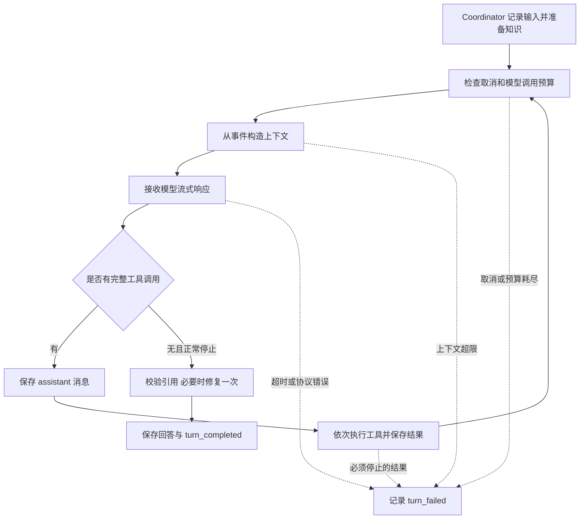

# 运行时与主循环

状态：`Implemented`（实现说明）

本模块负责把一次用户输入推进到回答、失败或取消。基准与验收范围见[Map](../map.md)、
[验证与验收](verification.md)。

## 职责与边界

外层 `InteractiveApplication` 等待输入、处理命令，再调用 `TurnCoordinator.send()`。
Coordinator 打开 Session、检查恢复状态、记录用户输入、准备本轮知识，随后创建 `AgentLoop`。
一个 Session 包含多个 Turn，一个 Turn 可以调用模型和工具多次。

`AgentLoop` 决定调用顺序和停止条件；`ContextService` 在请求前执行预算、归档与压缩，
内部使用 `ContextBuilder` 构造基本消息；
`ModelPort` 接模型；`ToolRuntimePort` 执行工具；`RuntimeJournal` 保存事实。
具体依赖由 `composition.py` 组装。Loop 不直接拼 DeepSeek HTTP 请求或读写 JSONL。

## 一轮的执行过程

Loop 接收完整响应后才执行工具；同批多个调用按顺序 `await`，没有并行工具调度。
每次重新调用模型都读取最新事件投影，因此模型能看到前一次的工具结果。
工具参数错误、权限拒绝等通常作为结果返回模型；未知副作用或要求停止的结果会结束 Turn。

模型必须以匹配的 `finish_reason` 结束：有工具调用时为 `tool_calls`，无工具时为 `stop`。
不完整流、重复调用 ID、不匹配的结束原因都不会作为成功回答。
最终引用修复最多一次、禁用工具，计入模型预算；具体引用语义见[知识模块](knowledge.md)。

## 控制与完成含义

默认每轮最多 16 次模型调用、32 次工具调用。`max_failure_recoveries=2`：
Loop 累计 `ToolOutcome.observed_failure`，第三次观察到失败时停止，避免无限修复。
启动失败没有验证结果，不能等同于“测试失败”。

停止原因包括 `completed`、`cancelled`、`model_error`、`context_limit`、
`limit_reached`、`session_error`、`internal_error`。持久化失败等边界错误还由应用层处理。
取消期间工具运行层先等待自己拥有的任务清理；中断批次的配对处理见[会话模块](sessions.md)。

`completed` 表示模型正常结束且没有待执行调用，不证明用户的所有任务要求已满足。
当前没有通用任务验收器、独立 Planner/Executor 或多 Agent 调度。

## 采用的设计

行为上是 ReAct 风格的“判断 → 工具动作 → 观察结果”闭环，动作使用结构化 Function Calling。
控制结构是 `while`、分支和预算计数器组成的状态机，没有每状态一个类的 State 模式或图执行引擎。
模块通过端口与适配器实现依赖倒置，状态以事件保存、按用途投影。

早期“小而稳定的 Loop”是设计方向；现有 Loop 已直接包含知识引用校验与修复分支，
Coordinator 也包含知识 Catalog／Index 组装。后续讨论模块边界时应以这些实际依赖为起点。

## 代码与验证入口

- [Loop 与预算](../../src/jdagent/core/loop.py)、[Coordinator](../../src/jdagent/application/coordinator.py)
- [端口](../../src/jdagent/ports.py)、[组合根](../../src/jdagent/composition.py)
- [主循环测试](../../tests/test_agent_loop.py)、[运行控制测试](../../tests/test_runtime_controls.py)、
  [v0.4 合同测试](../../tests/test_v04_contracts.py)
- 设计来源：[早期 Runtime 架构](../archive/v0.1/agent-runtime.md)、
  [ADR-0002](../decisions/ADR-0002-model-port.md)、[ADR-0003](../decisions/ADR-0003-runtime-domain-separation.md)
